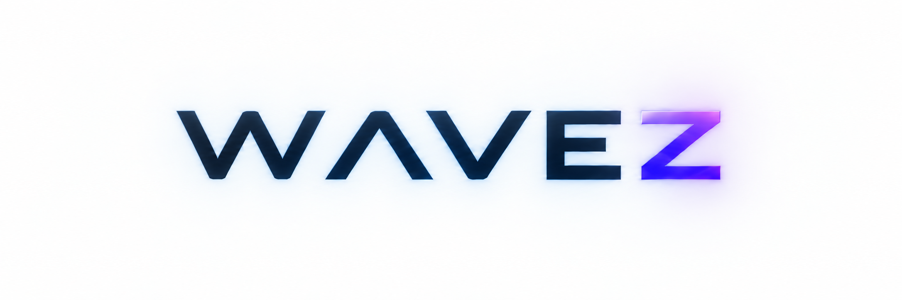

<picture>
  <source media="(prefers-color-scheme: dark)" srcset="viewer/ui/about/Wavez_Banner_No_Slogan_No_Border_Dark.png">
  <source media="(prefers-color-scheme: light)" srcset="viewer/ui/about/Wavez_Banner_No_Slogan_No_Border_White.png">
  
</picture>

**[Screenshot pending — Wavez viewer showcase]**

Wavez is a real-time 3D scientific simulation and data visualization application.
Simulations export particles, uniform-grid scalar fields and triangle meshes to
Wavez's **WVZ1 `.wvz` capture format**. The interactive viewer lets you explore
those recorded layers together, navigate their sample times and export images
or video.

**[Comparison pending — same simulation in Python and Wavez]**

## Development status

Wavez is in pre-1.0 development. **Scientific Selection and Analysis, including
related scene/analysis state workflows, are experimental and incomplete—a current
weak point.** Their end-to-end scientific workflows and UX have not been
comprehensively owner-tested. Known gaps include cumbersome cross-dialog workflows,
[analysis-dialog usability](https://github.com/mongstad/Wavez/issues/341) and a
[Selection list interaction bug](https://github.com/mongstad/Wavez/issues/342).
Automated tests do not constitute comprehensive scientific or user-workflow
validation. Independently verify analysis results before relying on them for
scientific conclusions.

## Explore recorded scenes

- View particles, volumetric fields and meshes together through the
  **Particles / Fields / Meshes** interface.
- Inspect scalar patterns with scientific colormaps and legends, field ranges,
  opacity controls and slices.
- Play and seek recorded time; move freely through the scene or use camera orbit.
- Export viewport images and deterministic video of a chosen time range and view.

Source-based probing is available with documented precision and verification
limits. Stored samples, derived measurements and rendered colors have different
meanings. The [Technical Documentation](docs/TECHNICAL_DOCUMENTATION.md) collects
their contracts and limitations.
For everyday controls, see the [user handbook](docs/WAVEZ_HANDBOOK.md).

## Get started

1. Run a provided Linux x86_64 package, keeping `WAVEZ.x86_64` and `WAVEZ.pck`
   together, or follow the source-build instructions.
2. Export your simulation's arrays with Python's `SceneCapture` to a new `.wvz`
   file. Small particle, field, mesh and combined examples are included.
3. Choose **File → Open**. The capture opens paused while preparation continues.
4. Explore the scene, adjust its presentation, then export an image or video.

[Getting Started](GETTING_STARTED.md) covers installation, complete Python examples
and simulation integration.

### Dependencies

| Workflow | Requirements |
|---|---|
| Packaged viewer | Graphical Linux x86_64 desktop and working Vulkan GPU/drivers. The Godot runtime is included; Python and a separate Godot installation are unnecessary for viewing. |
| Python export/integration | Python **3.10+**, **NumPy ≥1.23** and this repository's exporter. Zstandard compression is optional. |
| Optional tools | MP4 needs external **FFmpeg with `libx264`**. Experimental Selection/Analysis needs external `python3` and NumPy; isosurface extraction additionally needs **scikit-image 0.26.x**, on Python **3.11+**. |
| Source development/build | Tested with **Godot 4.7.2**; Linux packaging also needs Python and matching export templates. |

Use the [installation guide](GETTING_STARTED.md#choose-dependencies-for-the-work-you-want-to-do)
for dependency setup. **Forward+ Vulkan is the sole supported renderer.**

## System requirements

Linux x86_64 is the currently validated platform. Plan for a modern multi-core
64-bit CPU, a Vulkan-capable GPU with working drivers, and enough free storage
for captures and exports. The tiers below are **provisional planning guidance,
not certified minimums or performance guarantees**.

| Tier / intended workload | System RAM | GPU memory | Storage |
|---|---|---|---|
| Minimum estimate — modest captures and light workloads | 16 GB | About 6–8 GB | SSD |
| Recommended — substantial particle/mesh data and moderate fields | 32–64 GB | 8+ GB | Fast SSD / NVMe |
| High-end — 192³+ fields, multiple channels and longer prepared coverage | 64–128+ GB | 16+ GB where practical | Fast NVMe, substantial free capacity |

Development and validation have used **Fedora 44 / KDE, Ryzen 7 5800X, 48 GiB RAM,
RTX 3070 Ti 8 GB and Godot 4.7.2 / Forward+ Vulkan**. That workstation is evidence
of tested use, not certification of the other tiers or every capture.

More RAM can extend prepared playback coverage and reduce re-preparation. CPU
throughput and memory bandwidth help field preparation; bounded workers adapt to
available headroom. GPU speed and VRAM affect rendering capacity, while faster
storage helps uncached reads. VRAM does not replace the system-RAM capture cache.
Costs vary with resolution, channel/particle count, recording cadence, playback
speed and cache settings; preparation can still limit playback on a fast GPU.

## License

Original Wavez material is source-available under the
[PolyForm Noncommercial License 1.0.0](LICENSE), not an OSI-approved open-source
license. Commercial use requires a separate agreement. Separately licensed
components retain their [third-party terms](THIRD_PARTY_LICENSES.md), and the
name and artwork follow the [branding policy](TRADEMARKS.md).
