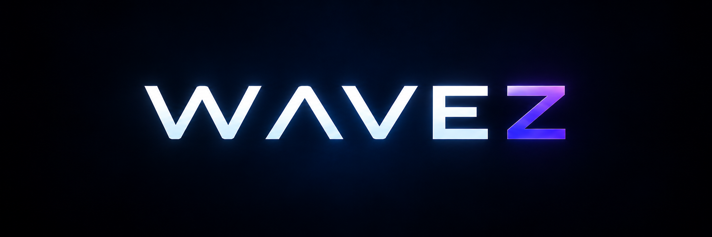

# WAVEZ

Wavez is a NumPy-first scientific capture and Godot visualization platform for
particles, meshes and uniform-grid scalar fields. New integrations use
`SceneCapture` / `SceneReader` and WAVEZ Scene Format (`.wvz`, WVZ1).

The current viewer provides deterministic video export, scientific
inspection/analysis, bounded playback preparation and particle/mesh/volume
rendering. The production shell includes recorded-time playback, status/Jobs,
Fullscreen, command menus, a category Simulation panel and focused Tools.
See [current status](docs/CURRENT_STATUS.md) for the accepted baseline, supported
contracts and scope boundaries. The [format policy](docs/CAPTURE_FORMAT_POLICY.md)
defines the WVZ1-only workflow.

**Forward+ Vulkan is the sole supported renderer.** Source and Linux standalone
viewing and GPU exports require a Vulkan-capable GPU and working Vulkan drivers.
Machines without suitable Vulkan support are excluded; there is no supported
OpenGL/Compatibility fallback. See [requirements and startup troubleshooting](docs/RENDERER_REQUIREMENTS.md).

Start with:

- [Getting Started: installation, Python examples and technical reference](GETTING_STARTED.md)
- [Quickstart](QUICKSTART.md)
- [Dark and Light themes](docs/APPLICATION_THEMES.md)
- [Editable Keyboard Shortcuts](docs/KEYBOARD_SHORTCUTS.md)
- [LMB vertical-axis preference](docs/LMB_Y_INVERSION.md)
- [Visibility-aware keyboard focus](docs/FOCUS_NAVIGATION.md)
- [Editable value focus and replacement](docs/EDITABLE_VALUE_FOCUS.md)
- [Fine particle size and exact numeric entry](docs/PARTICLE_SIZE.md)
- [Exiting with active jobs](docs/EXIT_WITH_ACTIVE_JOBS.md)
- [Close File without interrupting exports](docs/CLOSE_FILE.md)
- [Linux release Window signal diagnostics](docs/ROOT_WINDOW_SIGNALS.md)
- [Free-look steering and manual camera orbit](docs/MANUAL_CAMERA_ORBIT.md)
- [Viewport cursor visibility](docs/VIEWPORT_CURSOR.md)
- [Screen-fixed cinematic background](docs/CINEMATIC_BACKGROUND.md)
- [Auto Orbit](docs/AUTO_ORBIT.md)
- [Free Camera speed](docs/FREE_CAMERA_SPEED.md)
- [Edit orbit center and radius](docs/ORBIT_GIZMO.md)
- [Current status](docs/CURRENT_STATUS.md)
- [Paused opening and automatic preparation](docs/PAUSED_PREPARATION.md)
- [Dialog title and section hierarchy](docs/DIALOG_HIERARCHY.md)
- [Shared dialog close controls](docs/DIALOG_CLOSE_CONTROLS.md)
- [File and Tools dialog layout](docs/DIALOG_COHERENCE.md)
- [Dialog action button appearance](docs/DIALOG_ACTIONS.md)
- [Performance dialog](docs/PERFORMANCE_DIALOG.md)
- [Current Tools functional audit](docs/TOOLS_FUNCTIONAL_AUDIT.md)
- [Successful-open error recovery](docs/LOAD_ERROR_STATUS_RECOVERY.md)
- [Session action and error logs](docs/SESSION_LOGGING.md)
- [File Locations preferences](docs/FILE_LOCATIONS.md)
- [Video export from Linux release builds](docs/PACKAGED_VIDEO_EXPORT.md)
- [Volume opacity in legend overlays](docs/VOLUME_LEGEND_OPACITY.md)
- [Source-probe marker visibility and styling](docs/PROBE_MARKER_VISIBILITY.md)
- [Viewport-only video export](docs/VIDEO_VIEWPORT_EXPORT.md)
- [Violet UI cleanup and owner checks](docs/UX5_CLEANUP.md)
- [Application version and build policy](docs/VERSIONING.md) — view the identity in Help → About
- [Pinned edge reveal and Fullscreen](docs/WINDOW_EDGE_REVEAL.md)
- [Portable view presets](docs/WAVEZ_VIEW_PRESETS.md)
- [Wavez handbook](docs/WAVEZ_HANDBOOK.md)
- [Python API](WAVEZ_API.md)
- [Capture format](docs/WVZ1_FORMAT.md)
- [Simulation integration guide](docs/SIMULATION_INTEGRATION_GUIDE.md)
- [WVZ1 implementation validation and owner checks](docs/WVZ1_IMPLEMENTATION_VALIDATION.md)

The [UX workflow](docs/UX_WORKFLOW.md) defines presentation/review boundaries.
[Retained evidence](docs/EVIDENCE_INDEX.md) describes original development
checkpoints; their old capture names and commands remain historical. Use the
current guides above for supported workflows.

The [documentation audit](docs/documentation-audit/README.md) records the cleanup
and stable contract locations ahead of the separate public README and onboarding work.

Repository layout:

- `wavez_export/` — installable capture/analysis library
- `viewer/` — Godot viewer and native regression tests
- `examples/` — small repository-owned examples
- `tests/` — Python regression tests
- `tools/` — validation, profiling and external-input adapters
- `docs/` — current specifications/guides and retained review evidence

Scientific simulations, generated captures, benchmark payloads and research data
are intentionally outside this repository. See
[repository boundaries](docs/REPOSITORY_BOUNDARY.md).

## Licensing

Original Wavez material in this repository is offered under the
[PolyForm Noncommercial License 1.0.0](LICENSE). Wavez is source-available,
not OSI-approved open-source software. Commercial use is not granted by that
license and requires a separate written agreement with the rights holder.

Separately licensed bundled material retains its own terms. See
[THIRD_PARTY_LICENSES.md](THIRD_PARTY_LICENSES.md). Branding is handled separately
in [TRADEMARKS.md](TRADEMARKS.md).

This repository begins from a fresh audited source snapshot rather than importing
prior development Git history. See [PROVENANCE.md](PROVENANCE.md) for the scope of
that reset.
