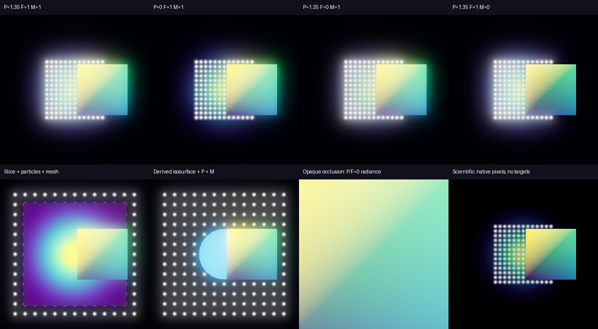
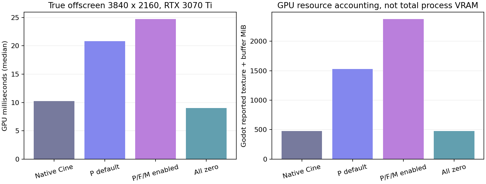

# Independent Bloom: bounded Forward+ prototype

**Recommendation: hold production integration and return for owner architecture
review.** The prototype proves isolated category sources and correct tested
visibility on Forward+. It preserves the particle 1.35 calibration on a
controlled background, but omits the existing background/fog contribution to
Cinematic Bloom. Its full-resolution render graph also has substantial 4K
costs and no proven production VRAM admission policy. These are unresolved
gates, not production acceptance.

The [owner direction](https://github.com/mongstad/Wavez/pull/309#issuecomment-6087574544)
authorizes this experiment only. The original
[proposal](CATEGORY_BLOOM_PROPOSAL.md), [renderer investigation](evidence/issue-306/README.md)
and [first HDR gate](CATEGORY_BLOOM_PROTOTYPE.md) remain historical records.
Accepted main is `65fd8fae15a1b8dd37c75eca3a197d75003ee4ee`, build 79;
this existing branch/PR remains candidate build 80. PR #309 is Draft and
issue #306 remains open.

## Implemented experiment

`bloom_prototype_graph.gd` is manually attached by an experiment harness.
Production `main.gd`, UI, readers, playback/cache code, scientific shaders,
visual-state schema and video worker do not reference it and are unchanged.

Each active category has its own float HDR 3D viewport. Proxies share the
committed Mesh/MultiMesh resources, field textures and emitting materials.
Other categories retain black opaque depth writers or black transparent volume
color with the original alpha, clipping, ray step, transfer and depth sampling.
Additive particles are omitted from other category passes because the accepted
particle blend does not attenuate them. Derived isosurfaces belong to Fields.

Godot's native Forward+ glow filter extracts and blurs each source, using a
private environment with **fixed intensity 1** and Replace blending. Category
gains are downstream coefficients:

`G = particle_gain * Gp + field_gain * Gf + mesh_gain * Gm`

The original world is rendered once into a shared-world linear HDR base target.
A second target combines this base and `G` with the accepted Screen blend, then
uses native ACES tonemapping. A canvas pass presents the result and performs
the SDR encoding once. Sources/base are children of the tone consumer for
native viewport ordering. The export-style barrier includes a process frame
before the forced draw. Source radiance is never reconstructed from SDR, and
no engine or third-party shader implementation is copied or modified.

The installed Godot version defaults to Screen, not Soft Light. The native
[tonemap implementation](https://github.com/godotengine/godot/blob/4.7.2-stable/servers/rendering/renderer_rd/shaders/effects/tonemap.glsl)
places Screen before tonemapping. Initial exploratory Soft Light composition
did not preserve the particle halo; the reported final results use Screen.
Another corrected experiment error was live ShaderMaterial duplication: its
property-list validation replaced a Transform3D-backed mat4 cache entry with a
Projection default. Emitting materials are now shared read-only, and black
shader materials are created separately without duplicating a live material.

Defaults are **Particles 1.35, Fields 0, Meshes 0**. Field/mesh Bloom uses their
existing display colors, without new emission or scientific value changes.
Scientific releases every private target and restores native rendering with
decorative glow disabled. Zero removes only its category target; all zero
releases the entire graph. Unchanged paused scenes do not reschedule private
passes. The global scene environment never owns the category coefficients.

## Verified results

The [reproducible evidence](evidence/issue-306/forward-prototype/README.md)
contains raw reports, logs, device telemetry, actual screenshots and the exact
temporary export-worker patch. Godot is
`4.7.2.stable.official.ed1daf0bf`, Vulkan Forward+, on the RTX 3070 Ti / 8 GiB.

- 364 source checks and 327 standalone Linux experiment checks pass. Their
  five mixed-scene HDR records and extracted kernel hashes are identical.
- Separated and overlapping categories, opaque occlusion, a transparent volume,
  a field slice and a canonical source-derived isosurface are exercised. The
  occluded particle/field sources and kernels are exactly zero.
- Changing a category gain to 2 leaves all three extracted kernels byte-identical.
  Zero deallocates its source and leaves surviving kernels byte-identical.
  Each visible category zero also changes the final overlap image.
- Summed raw category radiance reconstructs a native black-background reference
  with no channel outside the declared tolerance: 1% relative or 0.0002 absolute.
  The largest absolute difference is 0.000603 in the overlapping volume scene;
  the other four scenes are exact.
- Particle-only black-background calibration at 1.35 has a maximum difference
  of one 8-bit RGB code, mean 0.0030. The intrinsic particle shape/halo is retained.
- Five Scientific prototype/native screenshot pairs are pixel-identical and
  allocate zero private viewports. Camera pose and decoded-cache usage are
  unchanged, and committed GPU geometry is shared.
- 128 native baseline checks pass: 24 accepted-main/candidate screenshot pairs
  are pixel-identical across Forward+ and Compatibility, Cinematic and Scientific.
- 33 prototype and 23 accepted-main transition checks pass. Single forced draw
  matches settled output; resize and seek round trips preserve pixel hashes.
- All seven external WVZ1 fixtures pass strict descriptor, commit, payload and
  sample/statistics verification: 96 records. Their source hashes remain unchanged.

Total: **875 completed Godot observation checks**, plus the image/export pixel
comparisons. A final post-import overlap/barrier smoke adds 65 passing checks
(940 observations total). The two application-version unit tests, Python
compilation and the warmed native editor import pass. This count is not a claim
that every architecture gate passed.

## GPU, memory and pacing costs

The heavy fixture contains 100,000 particles, three 64³ fields and two meshes
with 20,000 triangles each. Accepted Wavez permits one translucent volume, so
the other two fields are slices. The decoded cache remains 175,487,456 bytes
in every benchmark. This is a bounded synthetic workload, not an 8 GiB capture.

Each resolution/path has 60 synchronous moving-sample frames and 90 fixed-scene
render-only frames after warmup. GPU values are native RenderingServer viewport
GPU timestamp measurements, summed over the destination and private targets;
they are not inferred from wall time. Target readbacks prove physical
1920×1080 and 3840×2160 dimensions. Vsync is disabled; desktop GPU activity is
not isolated or clock-locked. Median/P95 and telemetry are retained.

| Render-only path | 1080p GPU median | 4K GPU median / P95 | 4K increment vs native Cine | 4K process VRAM sample peak |
| --- | ---: | ---: | ---: | ---: |
| Native Cinematic | 3.21 ms | 10.25 / 11.07 ms | baseline | 840 MiB |
| Particle default; Fields/Meshes 0 | 6.18 ms | 20.83 / 26.84 ms | +10.58 ms | 1,868 MiB |
| All categories enabled | 7.33 ms | 24.72 / 42.25 ms | +14.47 ms | 2,898 MiB |
| All category gains 0 | 2.79 ms | 8.99 / 9.42 ms | native no-glow path | 850 MiB |
| Scientific bypass | 2.90 ms | 8.44 / 9.06 ms | native Scientific path | 850 MiB |

4K render-only wall median/P95 is 10.42/11.39 ms native, 20.82/22.83 ms with
particle Bloom and 24.74/27.70 ms with all categories. GPU P95 and wall P95 need
not coincide because measured GPU results are delivered asynchronously.
Moving-sample wall medians are 143–146 ms in Cinematic paths, dominated by the
existing synchronous preparation in this harness. These are not interactive
playback frame-rate claims. Scientific moving-sample P95 reaches 283.51 ms;
the raw report retains that outlier rather than calling the whole suite smooth.

At 4K, particle default allocates three private 3D targets and six proxies;
all enabled allocates five targets and sixteen proxies. Color/depth attachment
minimums are 284.77 and 474.61 MiB respectively. Native Godot accounting is:

| 4K path | Texture MiB | Buffer MiB | Incremental texture + buffer |
| --- | ---: | ---: | ---: |
| Native Cinematic | 370.09 | 107.04 | baseline |
| Particle default | 1,150.40 | 376.58 | +1,049.85 MiB |
| All enabled | 1,818.52 | 556.27 | +1,897.66 MiB |
| All zero | 370.09 | 107.04 | about 1 KiB / 16 bytes retained |

Driver process VRAM rises by approximately 1.0 GiB for particle default and
2.0 GiB for all categories. Zero releases all Bloom targets; the roughly 10 MiB
driver difference after teardown includes allocator/pipeline retention, not
live category render targets. Device-wide usage includes unrelated processes:
its measured peak is 5,190 MiB and minimum free memory is 2,706 MiB.
The provisional reservation estimates only 1.61 GiB for all-enabled 4K, below
the approximately 2.0 GiB observed increment. It is **not an adequate production
admission bound**, and must not displace scientific cache allocations.

One resize/seek observation per transition, including CPU preparation, layout,
GPU draw and readback: 1080p→4K takes 502.47 ms prototype versus 396.32 ms native
(+106.15 ms); returning to 1080p takes 312.70 versus 279.88 ms. Initial activation
takes 806.95 versus 281.92 ms (+525.03 ms), including cold setup. Warm seeks cost
179–269 ms versus native 182–265 ms. These single observations establish hitches,
not statistically calibrated incremental latency distributions.

## PNG/video boundary investigation

The existing native PNG capture function succeeds with the experiment attached;
its 960×640 image is pixel-identical to the prototype viewport. No sidecar/gain
serialization or production image workflow was changed or validated.

Eleven real 640×360 MP4 jobs complete through the native worker, external FFmpeg
and ffprobe, with three frames at 4 fps and capture times 0, .25, .5. The source
field/mesh sample boundary is crossed. Native candidate/accepted-main staged PNG
frames are pixel-identical in both renderers and both presets. A **temporary
worker copy only** explicitly attaches/synchronizes fixed experimental gains
(1.35, 1, 1). Its repeated Cinematic frames are deterministic, and its Scientific
frames match accepted main. The reviewed patch is retained in the evidence.

The repository worker and capture hashes are unchanged. This proves a bounded
barrier experiment, not production video integration. 4K/long video, packaged
video, v2 selections, cancellation, sidecars and saved category state are unrun.
The Linux isolation package uses an explicitly external canonical Python
extraction helper; it is not proof that the standard release's isosurface worker
deployment works without that helper.

## Remaining gates and Compatibility UI proposal

Full Cinematic particle-scene comparison differs by mean 7.44 and maximum 37 RGB
codes because native background/fog Bloom is excluded from category seeds.
The particle-only black calibration succeeds, but **full appearance fidelity
does not**. A background contribution policy must be reviewed and demonstrated;
tying background radiance to the particle coefficient would misstate provenance.

Other limitations: only accepted Screen/exposure-1 configuration and no TAA,
MSAA, FXAA, resolution scaling or HDR display were exercised; unrelated guide,
selection and override geometry are outside the source inventory. Native
transparency is reproduced, including its existing additive-particle/volume
ordering; physically exact particle depth inside a ray-marched volume is not
claimed. Realtime async playback/seek, cache pressure, long sessions, physical
4K/mixed DPI, other GPUs/OSes and a nearly full 8 GiB workload are unverified.
The initial reported disabled slider remains unresolved without its original
capture/recipe. This prototype does not claim that bug is fixed.

Proposed UI behavior, **not implemented**:

- Forward+: show three independent category controls with the approved defaults.
- Compatibility: preserve the existing Cinematic **scene-wide Bloom** control,
  clearly labeled as applying to the whole rendered scene. Keep it in Global
  effects or an explicitly approved shared rendering section; do not remove the
  dialog while it is needed to preserve this behavior.
- Show category controls disabled with a short “Independent Bloom requires
  Forward+” explanation, and nearby text that Compatibility scene Bloom still
  affects visible categories. A displayed category zero must not imply that it
  suppresses legacy scene Bloom on this renderer. Hiding these controls with the
  same capability explanation is an alternative for owner review.
- Preserve independent values when changing renderer, disclose that they are
  inactive in Compatibility, and retain a separate legacy scene intensity.
  Never map three controls to that one environment value. Scientific disables
  decorative Bloom on either renderer. State/export/backend policy requires
  review before implementation; no automatic migration is proposed here.

Proceed with another bounded prototype only after owner review of background
fidelity and explicit GPU/VRAM/transition budgets. **Do not proceed to production
UI/state/export integration with this graph**, merge PR #309 or close #306.
