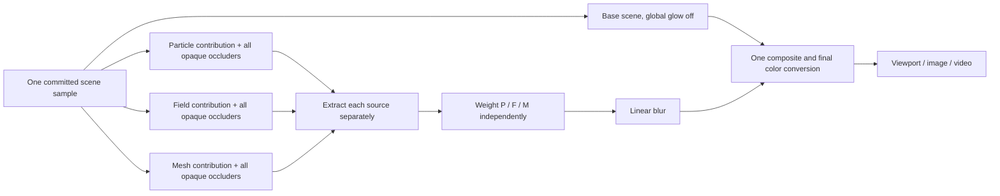

# Independent category Bloom — issue #306 architecture proposal

Status: **investigation complete; architecture and artistic policy await owner
approval. Independent Bloom is not implemented.** This proposal is the review
checkpoint required by [issue #306](https://github.com/mongstad/Wavez/issues/306)
acceptance criteria 4 and 9 and its renderer-change review boundary.

The baseline is accepted main `65fd8fa` (PR #304, application build 79), using
Godot `4.7.2.stable.official.ed1daf0bf`. The investigation PR proposes build 80
under the repository's documentation/implementation PR numbering policy. Its
production renderer and UI behavior remain the accepted implementation.

## Findings and reproduction limit

The [baseline evidence](evidence/issue-306/README.md) observes particle-only,
field-only, mesh-only and mixed WVZ1 scenes, Cinematic/Scientific selection,
capture switches, recipe restoration, native input, both themes and two window
sizes, in source and Linux validation packages on both renderers.

In these synthetic scenes, the Cinematic global slider is editable and native
dialog mouse/key input reaches `Environment.glow_intensity` for **all four scene
compositions**. Raising it from 0 to 2 changes rendered field and mesh pixels as
well as particles. Scientific disables the slider and glow; 0/2 diagnostic
intensity writes produce identical pixels. Therefore the owner's disabled
mesh/field control has **not** been reproduced with these fixtures. The owner's
original capture/recipe and exact prior interaction sequence are unavailable to
this investigation. Do not call the original report fixed or attribute it to a
particular cause.

`main.gd::_open_scene()` leaves the viewing preset and environment intact.
`_set_clean()` gates the slider on the selected viewing preset; scene category
selection changes the Simulation workspace, not Bloom. No particle-presence
gate was found in the control, scene-load or restore paths.

`visual_state.gd::apply()` and `view_preset.gd::apply()` restore explicit
environment settings independently of a preset label. A recipe can therefore
show **Cinematic** with `glow_enabled=false` and a disabled slider. Reapplying
Cinematic enables it. This is a demonstrated state path, **not evidence that it
caused the owner's reproduction**. Also, the 0.02-step slider rounds the 1.35
environment default to 1.36 in its initial displayed value; the harness uses the
exact 1.35 environment value for its default render comparisons. This small
baseline discrepancy is recorded, not changed in this investigation.

## Where current Bloom comes from

| Pipeline | Current color contribution | Consequence |
| --- | --- | --- |
| Particles and recorded trails | Unshaded additive billboards, `ALBEDO=rgb*exposure`, `EMISSION=rgb*exposure*3`, existing core/halo/ray alpha | HDR emission plus intrinsic sprite halos. Bloom 0 must remove post-process contribution, not silently replace the accepted particle representation. |
| Volume | Full-screen transparent ray march, independent opacity and color mapping, opaque depth termination, mapped `ALBEDO`/`ALPHA`, no `EMISSION` | Suitable mapped color exists, but no explicit emissive/scientific channel. A new dedicated glow seed would be an artistic policy decision. |
| Field slice | Opaque mapped `ALBEDO`, no `EMISSION` | Same artistic-policy boundary; keep slice clipping and source mapping unchanged. |
| Recorded mesh | Unshaded `StandardMaterial3D`, vertex colors as albedo, no enabled emission | Same boundary. Keep mesh color, topology, blend shapes and transforms unchanged. |
| Derived field isosurface | Uses the existing mesh-view machinery | Attribute its Bloom to **Fields**, because it is a field representation, rather than to recorded Meshes. |

One environment extracts glow from the already-composited screen. Its
`glow_bloom=0.24` admits ordinary color, so lack of explicit field/mesh emission
does **not** mean those categories cannot respond to the current global slider.
Godot documents that the Bloom property feeds the whole screen into glow;
Compatibility has a different glow implementation with fewer controls.
[Godot 4.7 glow documentation](https://docs.godotengine.org/en/4.7/tutorials/3d/environment_and_post_processing.html#glow).

That shared extraction loses category provenance. Three aliases for intensity,
three WorldEnvironments, or changing material emission under the same extraction
cannot meet independent zero-contribution semantics over the allowed exposure,
brightness, overlap and transparency cases. A screen glow map also controls
where glow lands, not which category supplied it.

## Proposed isolation architecture

Approve a stock-Godot **offscreen category-contribution prototype** before any
production integration. Keep the accepted base scene rendering and scientific
data model; isolate decorative source images and blur/composite them explicitly.
Do not duplicate capture readers, workers, CPU arrays or uploaded scientific
resources. Proxy render instances share mesh/MultiMesh/field texture resources
and committed transforms; pass materials and framebuffer attachments are new.

1. The base pass retains particle core/halo/rays, field opacity/colormaps,
   clipping, mesh material colors, guides and camera projection. Scene-wide
   glow is disabled in this path to prevent a second uncontrolled contribution.
   UI/legends/probes/guides/backdrop do not seed category Bloom.
2. Generate three **color-contribution** buffers using the same sample, camera,
   near/far planes, viewport dimensions and transforms. Other opaque objects,
   including non-emitting categories, remain black depth-writing occluders in
   each pass. Omitting them would make hidden particles/fields bloom through
   meshes. Field volume passes must sample their pass's complete opaque depth.
3. Preserve the accepted transparent ordering and premultiplication in each
   buffer. Non-emitting transparent layers retain their original alpha where
   they attenuate another layer. Additive particles retain additive behavior.
   Do not claim a new physically correct particle/volume integration. Overlap,
   transparent volumes, slices and occluded sources are prototype gates.
4. Extract each category's glow source **before summing**, then apply its gain.
   With fixed source/camera state, let `E_p`, `E_f`, `E_m` be the independently
   extracted, visibility-resolved sources and `K` a linear blur. Use
   `G = K(g_p E_p + g_f E_f + g_m E_m)`. Changing `g_p` cannot change `E_f`,
   `E_m` or their weights; `g_p=0` makes the particle contribution exactly zero.
   Do not run a shared nonlinear threshold after weighting/summing. Keep
   intermediate source textures available to validate attribution; independent
   contribution does not prohibit spatially overlapping halos in the final image.
5. Composite once with the base image. Match backend color spaces and the
   existing particle-only appearance as closely as possible; do not add
   already-tonemapped 8-bit category images or apply tonemapping twice. Godot
   exposes HDR viewport textures; its 4.7.2 GLES storage also allocates RGBA16F
   HDR render targets. This supports investigating a common viewport/canvas
   path, but does **not** establish that a 3D source pass preserves unclipped
   pre-tonemap radiance. Verify that explicitly before integration.
   [Viewport HDR contract](https://docs.godotengine.org/en/4.7/classes/class_viewport.html#class-viewport-property-use-hdr-2d),
   [4.7.2 GLES render-target implementation](https://github.com/godotengine/godot/blob/4.7.2-stable/drivers/gles3/storage/texture_storage.cpp).
6. Use the same graph for viewport display, ordinary image capture, explicit
   inspection restore and video workers. Export waits on the complete sample,
   surface and decorative pass generation before reading pixels. Camera motion,
   resize, category visibility, clipping, scene replacement and seek invalidate
   the pass generation together; avoid a previous-frame glow texture.

Backend-specific extraction/blur/compositing calibration is required: the
[4.7.2 Forward+ tonemap shader](https://github.com/godotengine/godot/blob/4.7.2-stable/servers/rendering/renderer_rd/shaders/effects/tonemap.glsl)
and [GLES post shader](https://github.com/godotengine/godot/blob/4.7.2-stable/drivers/gles3/shaders/effects/post.glsl)
apply glow in different color-processing paths. A Forward+ `CompositorEffect`
alone is insufficient because Godot does not expose that feature in
Compatibility. [Compositor support](https://docs.godotengine.org/en/4.7/tutorials/rendering/compositor.html).

If stock viewport passes cannot preserve radiance, depth, alpha or timing on
both backends, stop and present that evidence. An engine extension/fork,
Forward+-only support or an approximate SDR overlay requires **separate owner
scope approval**; none is silently substituted for this proposal.

## Defaults, controls and saved state proposed for approval

Put one 0–2 Bloom slider in each category's Rendering group, outside per-object
mapping/disclosure groups; each category setting applies to its category's
visible objects. Remove the Global effects dialog/menu once empty. Reuse current
slider, focus, theme and panel components.

Propose Cinematic gains **Particles 1.35, Fields 0, Meshes 0**. Particles retain
existing HDR-based extraction/shape as the calibration target. Fields/Meshes
would explicitly opt into decorative halos derived from their mapped display
colors when raised above 0. This adds no source emission channel and never
changes base albedo, scalar ranges, colormaps, opacity or geometry. **Owner
approval of this artistic policy is required before adding those seeds.**
Suppress all effective gains and stop/deallocate optional passes in Scientific,
while retaining the three stored Cinematic values for return. Recipe restoration
must reconcile the displayed preset, stored values, effective gains and slider
availability. Capture switches retain category view values, not stale object
bindings or framebuffer content. Hidden/absent categories produce no source.

Store gains in **presentation/view state**, consistent with current exposure and
global intensity, rather than application chrome preferences or WVZ1 data.
Extend the shared `VisualState`, portable `ViewPreset`, inspection validation and
video snapshots together with a versioned explicit category-gain schema. Replace
obsolete global Bloom ownership in the current format and document any preset
format break under the repository's current-architecture policy. No speculative
legacy mapping or migration layer is proposed.

Intentional Cinematic changes requiring visual review: field/mesh Bloom defaults
become 0; the backdrop and annotation geometry stop participating in Bloom;
particle Bloom may differ due to category extraction and backend calibration.
Scientific must use the original rendering path without a decorative pass and
pass pixel/source-state comparisons.

## Cost and admission

**Measured baseline only:** the evidence records 45 steady paused mixed-scene
frames per renderer/build, GPU/CPU timing, visible draw calls, engine texture and
buffer counters, and decoded-cache bytes. These are small, separated objects on
one RTX 3070 Ti; they are not heavy-workload or whole-process VRAM guarantees.
Visible draw-call counters do not enumerate engine post-process passes.

**Estimated prototype cost, not measured:** three additional source raster
passes (each repeats relevant opaque occluders), one source extraction/weighted
downsample, two separable half-resolution blur passes, and one composition pass:
at least **seven additional stages**. Preserving the existing multiscale particle
glow may require more blur/downsample stages. Volume ray marching runs again in
the field source pass; particle fragments and mesh transforms run again in their
passes. A small baseline's GPU time cannot predict those additional costs.

For an illustrative minimum layout, three full-resolution RGBA16F sources cost
24 bytes/pixel; three D32 depth buffers cost 12; a half-resolution weighted source
costs 2; two half-resolution blur targets cost 4. That is **42 bytes/pixel**:
about **83.1 MiB at 1920×1080** or **332.2 MiB at 3840×2160**. Reserving another
full-resolution RGBA16F output brings those to **98.9 / 395.5 MiB**. These are
explicit-attachment estimates, not upper bounds: backend HDR intermediates,
resolves, alignment, MSAA, mip chains and staging can increase them. This is a
material renderer/resource change even without duplicating payload textures.

Introduce a separate render-target budget/admission reservation, accounted
alongside field/mesh GPU resources and worker/cache headroom. Reuse allocated
attachments, skip zero/absent-category passes, release them in Scientific/on
close, and bound resize reallocations. Do not reduce scientific payload precision
or silently alias controls when admission fails; disclose unavailable Bloom.
Committed sample/geometry resources stay shared with the existing preparation
caches. No reader/cache changes have been implemented here.

Before production integration, measure GPU timestamp/frame-time distributions,
actual pass/resource inventory, engine counters and process/device telemetry at
1080p and 4K, with dense particles, overlapping fields/slices/isosurfaces,
multiple moving meshes, playback/seek, resize, image capture and real video
export. Compare Bloom off/on and Scientific bypass with identical state. Present
the costs for owner approval if they exceed the agreed budget; no performance
threshold has yet been approved.

## Review gates and remaining work

The owner first approves the isolated-pass prototype and mapped-color
Fields/Meshes policy above. The prototype must prove unclipped HDR/color
handling in **both** renderers, mixed-scene attribution and zero contribution,
opaque occlusion/transparent ordering, particle appearance and cost. This
investigation neither modifies the renderer nor claims those gates passed.

Only after those gates pass should production integration add controls,
Scientific restoration, the presentation schema, export barriers and admission.
Then validate source/release dark/light normal/compact panels and native input,
scene/preset/recipe switches, separated and overlapping mixed scenes, absent
categories, field volume/slice/isosurface, mesh wireframe/interpolation,
ordinary PNG and deterministic MP4, and Scientific pixel/source invariance.
Stop again for owner **visual review before merge**. The investigation PR is
Draft and incomplete as an implementation of issue #306.
