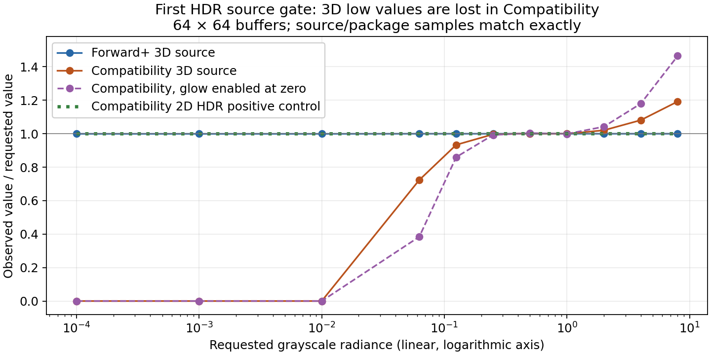

# Category Bloom: first HDR prototype gate

**Historical first-gate checkpoint.** The owner subsequently approved
[Forward+-only scope](https://github.com/mongstad/Wavez/pull/309#issuecomment-6087574544).
The [current bounded prototype report](CATEGORY_BLOOM_FORWARD_PROTOTYPE.md)
contains category-isolation, performance and export evidence and the next review
recommendation. The first-gate measurements and decision boundary below are
preserved as their original checkpoint.

On 2026-10-09 the owner approved the isolated-pass prototype and opt-in
mapped-color Fields/Meshes Bloom, both defaulting to 0. The approved particle
calibration target remains the accepted 1.35 setting. That policy approval is
recorded; it does not need to be requested again.

**Production integration is held at the first prototype gate.** Forward+ passes
the tested linear HDR source contract. Compatibility fails it in source and
Linux release validation packages. Independent category controls, their saved
state and export integration remain unimplemented. Candidate build stays 80
on the existing #306 branch and Draft PR #309.

The [approved proposal](CATEGORY_BLOOM_PROPOSAL.md) requires source radiance to be
verified before integration and says: “If stock viewport passes cannot preserve
radiance, depth, alpha or timing on both backends, stop and present that evidence.”
An engine extension/fork, Forward+-only scope or approximate color path requires
owner direction under that review boundary. This checkpoint tests the proposed
HDR viewport route, rather than claiming that every possible custom rendering
arrangement has been ruled out.

## What was implemented and measured

An isolated, manually invoked prototype creates a 64×64 HDR 3D SubViewport with
one unshaded uniform-color quad, a black background, an explicit current camera,
linear tonemapping, exposure 1 and no fog. A second HDR viewport draws the same
values directly with a canvas shader as a positive control. A third HDR viewport
samples the 3D texture on the GPU and emits binary flags for positive channels,
linear accuracy and values above 1. This distinguishes information lost before
the consumer shader from CPU readback conversion.

The test sweeps eleven radiance levels from 0.0001 to 8, grayscale and RGB values
in a 1:0.5:0.25 ratio, across five variants: opaque; transparent background;
environment glow enabled with intensity 0; shaded emission; and unshaded albedo
plus an emission multiplier of 3. All readbacks are float images. The linear
comparison allows 1% relative or 0.000001 absolute error, whichever is larger.
The native driver consumes the same script in source and standalone release
validation packages. It records 683 observation checks and 110 source samples
per run. These are source-color gates, **not** mixed-scene isolation tests.

| Renderer/build | Observation checks | Harness failures | Linear source gate | Failed samples |
| --- | ---: | ---: | --- | ---: |
| Forward+ source | 683 | 0 | Pass | 0/110 |
| Forward+ Linux validation package | 683 | 0 | Pass | 0/110 |
| Compatibility source | 683 | 0 | Fail | 90/110 |
| Compatibility Linux validation package | 683 | 0 | Fail | 90/110 |

Total: 2,732 completed observation checks. Both Compatibility processes return
**1 for the architecture failure**, and are not reported as passing Bloom
validation. Source/package sample arrays match exactly in each renderer.
The two application-version tests pass; Python compilation and the clean native
editor import also pass. Raw reports, logs and corrected exploratory attempts
are retained in the [prototype evidence](evidence/issue-306/hdr-prototype/README.md).

## Why a simple color decoder is insufficient

Representative grayscale results with environment glow disabled:

| Requested linear value | Forward+ 3D | Compatibility 3D | Compatibility 2D control |
| ---: | ---: | ---: | ---: |
| 0.0001 | 0.000099957 | 0 | 0.000099957 |
| 0.001 | 0.000999451 | 0 | 0.000999451 |
| 0.01 | 0.00999451 | 0 | 0.00999451 |
| 0.0625 | 0.0625 | 0.0452271 | 0.0625 |
| 0.125 | 0.125 | 0.116699 | 0.125 |
| 0.25 | 0.25 | 0.249146 | 0.25 |
| 1 | 1 | 0.999512 | 1 |
| 2 | 2 | 2.04102 | 2 |
| 8 | 8 | 9.53906 | 8 |

The GPU probe agrees with these comparisons. Distinct low source values become
the same zero before the consumer receives them; a post-pass decoder cannot
recover those values. Transparency and shaded emission do not resolve the
failure. Keeping global glow enabled at intensity 0 makes the high-value
distortion larger (8 becomes 11.71875). HDR allocation alone therefore does not
prove a linear 3D contribution buffer on this backend. Godot's documented
[HDR viewport contract](https://docs.godotengine.org/en/4.7/classes/class_viewport.html#class-viewport-property-use-hdr-2d)
and [GLES color-processing source](https://github.com/godotengine/godot/blob/4.7.2-stable/drivers/gles3/shaders/effects/post.glsl)
are architectural references; the values above are measured on the installed
`4.7.2.stable.official.ed1daf0bf` and RTX 3070 Ti, not inferred from those sources.

One correction to the initial proposal's particle interpretation is also needed:
the accepted particle shader writes both ALBEDO and EMISSION, but those literal
expressions do not establish additive emission radiance in unshaded mode. This
prototype's unshaded multiplier-0 and multiplier-3 sample arrays are identical on
both backends. Actual particle pass calibration must measure its rendered
albedo, additive blend and intrinsic alpha/halo behavior. The initial proposal
and baseline evidence remain historical records; this finding supersedes the
interpretation that the EMISSION expression alone proves an extra 3× HDR source.

## Remaining work and owner decision

No production rendering, UI, reader, cache, scientific shader, array, transform,
recipe or video-worker path was edited in this checkpoint. The previous
[accepted-renderer investigation](evidence/issue-306/README.md) remains unchanged.
The proposed defaults are approved policy, not active category settings yet.

The failed first gate prevents a claim that the complete proposed graph works
in both renderers. Full category attribution/zero tests, opaque occlusion,
transparent volumes, slices/isosurfaces, particle appearance, memory admission,
1080p/4K frame-time and GPU-memory costs, playback/seek/resize, Scientific bypass,
native controls/themes and ordinary image/video export are **not validated** by
this prototype. Building those production paths before resolving this gate
would leave the backend contract unsettled.

The next owner decision concerns renderer scope, not the approved artistic
defaults. Available directions are:

- Retain strict linear sources and both-renderer support; investigate an
  engine-level/raw-buffer route. Its implementation, cost, external-engine
  maintenance and licensing boundaries need a concrete follow-up design review.
- Authorize a revised Compatibility color contract that permits the measured
  loss/distortion, then prototype genuinely isolated HDR sources under that
  contract. This is a visual/accuracy concession; it is not approved implicitly.
- Restrict the new implementation to Forward+ and define explicit Compatibility
  behavior. This changes issue #306's both-renderer acceptance scope and does not
  establish that the later Forward+ isolation/export/performance gates pass.

Owner reproduction commands and exact expected outcomes are in the evidence
README. PR #309 remains Draft and issue #306 remains open for that decision;
neither architecture completion nor owner visual acceptance is claimed.
