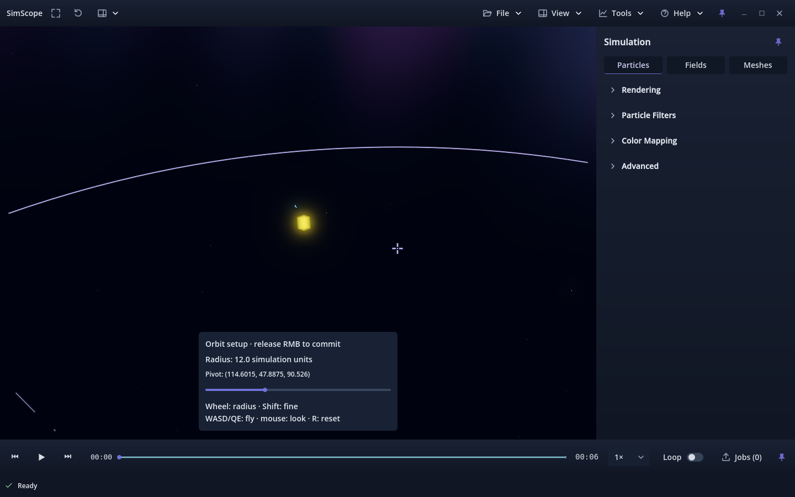
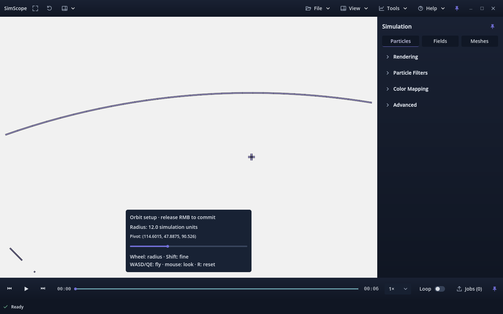

# Custom orbit pivot/radius setup — issue #120

Implemented on the existing issue-linked branch from accepted main `1a60774`
(PR #148, build 11). Candidate **v0.1.0.12** is pending owner UX review. #120 was
Ready at initial inspection on 2026-09-30, then changed to In progress; the owner
explicitly confirmed continuing that issue. No Project status writes were made.

## Interaction

1. Enable **Navigate → Free camera** and fly toward any region with WASD/QE.
2. **Hold RMB inside the simulation viewport**. RMB had no accepted camera
   binding; ordinary left-drag orbit and selection gestures retain their roles.
3. Set radius with the logarithmic slider or wheel. Wheel steps multiply by
   `exp(±0.12)`; **Shift+wheel** multiplies by `exp(±0.01)` for fine adjustment.
   The slider covers `0.0001` through `1e12` simulation units. Radius and proposed
   world coordinates are shown numerically.
4. Continue WASD/QE and mouse-look while holding RMB. The proposed pivot is
   exactly `camera_position + camera_forward * radius`; translation and look
   update it live. Navigation speed scales with radius. Automatic orbit is
   temporarily suspended; its enabled state and rate are retained.
5. **Release RMB** to commit, including when the pointer has crossed chrome.
   The target/distance become authoritative without changing the camera pose.
   Enable **O / Auto orbit**, or use ordinary left-drag, to orbit that local pivot.
6. **R** during setup abandons the proposal and performs the accepted Reset
   Camera action. R after commit clears the custom state and resets normally.
   Frame Scene also replaces it. **Esc retains fullscreen recovery** and has no
   new setup-cancellation binding.

Radius adjustment changes only the proposal until release. Window focus loss or
leaving Free camera abandons setup and restores the camera pose at entry. Free
movement after a commit retains the custom pivot and stored radius. Deliberately
resuming orbit reconciles distance/yaw/pitch from the current position, retaining
that pivot and avoiding a return to the old camera position. Normal, noncustom
wheel limits remain unchanged; custom zoom uses the setup radius limits. Near
and far clipping scale with committed custom radius to keep tiny and large
camera projections representable (`near = max(1e-6, radius * 1e-4)`;
`far = max(radius * 8, near * 1000)`). Distant geometry can lie beyond the local
camera's far plane; Reset Camera / Frame Scene restore normal scene clipping
(near `0.05`, far at least `1000`, scaled from the framed scene extent).

## Temporary guides and saved presentation

A violet pivot cross and thin world-space radius equator/dashed meridian are
projected into the viewport, with dark outlines for bright-scene contrast. They
are presentation guides, with no object/raycast, probe, selection or scientific
center inference. Guides are clipped to the available simulation area. Their
perspective footprint can remain similar while radius changes; numeric radius
and pivot coordinates expose the geometric depth explicitly. No opaque surface
is added.

The setup overlay is interactive-only. Ordinary PNG and direct scientific
PNG/bundle capture suppress the entire guide and panel through nested capture
scopes and restore any still-active preview afterward. Offline/video viewers
never construct it, including exports that include the production shell.

Portable view presets retain the generic `settings.view.custom_orbit` boolean
alongside the existing target, distance, yaw/pitch and complete transform. The
preset remains version 1 and source-independent. Shared visual snapshots also
retain the flag; deterministic video consumes the committed target/transform
through its existing world-Y sampling. Proposal radius/pivot, temporary graphics
and input state are not serialized.

## Validation

Native Godot 4.7.2 / Linux / NVIDIA RTX 3070 Ti results:

| Suite | Forward+ | Compatibility |
| --- | ---: | ---: |
| Custom orbit interaction, capture and fullscreen | 716 PASS | 716 PASS |
| Existing continuous camera | 13,044 PASS | 13,044 PASS |
| Portable presets | 838 PASS | 778 PASS |
| Viewer shell/menu contract | 667 PASS | 667 PASS |
| Edge reveal/fullscreen restoration | 210 PASS | 210 PASS |
| Redraw pacing/offline isolation | 290 PASS | 290 PASS |
| Status/Jobs | 257 PASS | 257 PASS |
| Current scientific video | 235 PASS | 225 PASS |

All **32,444 native assertions** and **two Python version tests** pass. Import,
Python compilation and whitespace checks pass. Compatibility skips the existing
60 preset quality comparisons and 10 exact GPU float-plane readback assertions.
The focused Compatibility process still emits two GL texture-leak teardown
diagnostics, 349,524 bytes each; the same types/sizes/count reproduce on accepted
main. Its strict log check initially failed. The final run explicitly compared
that baseline and accepted only those matching diagnostics, with zero assertion
failures and unchanged complete source hashes. Clean Compatibility teardown is
not claimed.

See [retained results](evidence/issue-120/summary.json) for exact renderer counts,
source hashes, logs and runtime limitations. Validation uses complete tiny
SIMSCP4 particle, scalar-volume, mesh and mixed fixtures, including arbitrary
world positions `(1300,-100,3439)` and `(-5200,670,9200)`, empty geometric targets,
small/large radii, all six movement keys, look, release across chrome, repeated
entry/commit, reset, presets, playback preservation and deterministic orbit.
Native screenshots check the entire simulation area's pixels against a
preview-suppressed reference; capture-time transport disabling is intentionally
outside that pixel comparison. Real exact-ID selection and scientific PNG/bundle
capture also exercise the direct durable path.

```sh
python tools/validate_orbit_setup.py --godot /absolute/path/godot \
  --output-dir /absolute/new/output --renderer forward_plus
# Repeat with --renderer gl_compatibility and the explicit known baseline:
# --baseline-log docs/evidence/issue-120/accepted-main-compatibility.txt
```

Current handbook, status, preset inventory, README and shortcut help describe the
new behavior. Earlier review reports/evidence, including #147's pending-review
wording at the time of that report, are preserved as historical records.

## Owner verification before acceptance





1. Open a familiar particle/volume/mesh scene. Frame Scene and try normal orbit,
   wheel zoom, upside-down tumble and reset before enabling Free camera.
2. Fly toward an off-center structure, hold RMB, and try small and large radii
   with wheel, Shift+wheel and the slider. Continue WASD/QE and mouse-look.
   Judge whether the numeric pivot and temporary guides make targeting clear.
3. Release, then enable O or left-drag. Verify the chosen region remains centered
   and the camera position does not jump. Repeat around a different region.
4. Fly again after committing, then resume orbit. Verify the custom pivot stays
   fixed and the orbit distance follows the new camera position. Save/load a
   portable preset and verify the view and pivot return.
5. Press R during and after setup, including in Fullscreen. Verify reset and
   unchanged fullscreen mode; test Esc's existing fullscreen recovery separately.
6. Re-enter repeatedly, release over the dock, and switch window focus during a
   hold. Check clean commit/cancellation and no retained guide after release.
7. Press P during setup and export short locked/orbit clips with UI both off and
   on. Verify no setup guide/panel appears in files. Check bright and dark scenes
   on Forward+ and Compatibility.

Holding/configuring/releasing, radius precision and preview clarity require
hands-on owner judgment; automated checks do not establish UX acceptance.
Windows/macOS, other GPUs and production-scale camera precision are untested.
Godot's float32 spatial precision limits very small radii at very large world
coordinates. No scientific production simulation was rerun.
