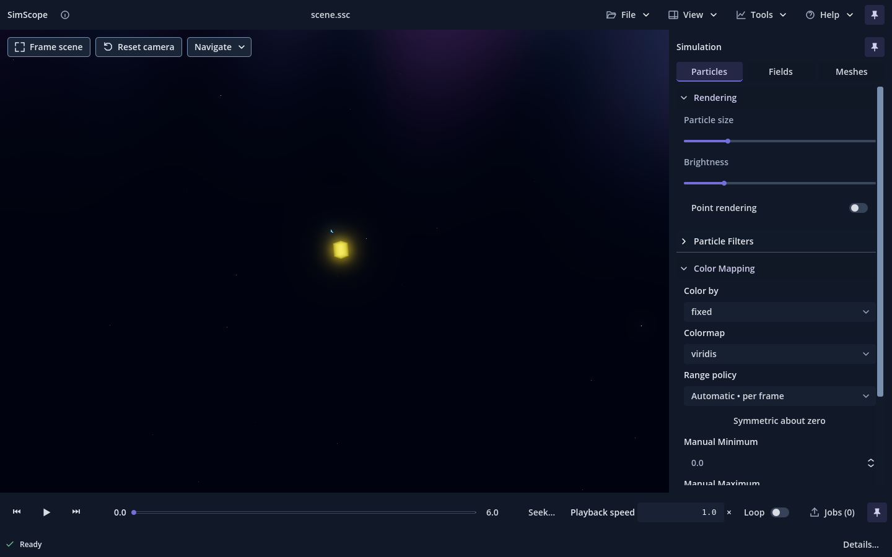
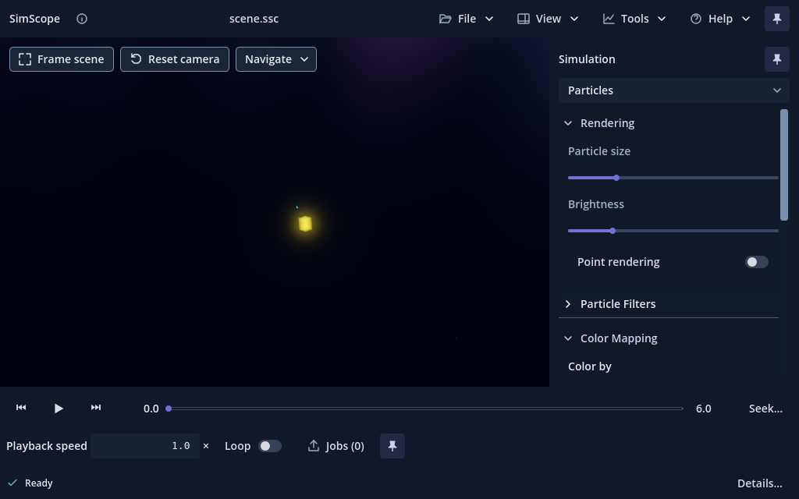

# Violet visual-system review slice — #143

Issue [#143](https://github.com/mongstad/SimScope/issues/143) was the first and
only **Ready** item when selected on 2026-09-29. This implementation is a
representative production slice, **pending owner visual review**. The issue
requires approval of this slice before broader propagation. It does not claim
completion or acceptance of the whole application restyle.

The primary visual target is the owner-provided **SimScope Scientific UI Style
Reference**, attached to the issue. Its local source is
`SimScope Theme Package/simscope_scientific_ui_style_reference.png` outside the
repository. The reference supplies the visual direction, while the accepted
application layout and scientific controls retain their behavior.

## Implemented scope

- The real top application bar, its existing menus/submenus, and local pin.
- The right-panel foundation, header/pin, category segments and compact chooser.
- The existing particle **Rendering** and **Color Mapping** groups: sliders,
  switches, selectors, numeric inputs, disclosure headers and their popups.
- The real playback/status strip: sample actions, playhead, speed input, Loop,
  Jobs entry, status readout and bottom pin.

Navigation buttons in the viewport, Particle Filters, Advanced, Fields/Meshes,
Tools, Jobs content, dialogs/file pickers and About retain the accepted theme.
Purple-logo replacement and the remaining surfaces are deferred until slice
approval. Their retained styling is intentional at this review boundary.





Additional native review images: [keyboard focus](evidence/issue-143/focus-1440.png),
[View popup](evidence/issue-143/menu-1440.png),
[selector popup](evidence/issue-143/selector-1440.png) and
[empty capture with disabled transport](evidence/issue-143/disabled-empty.png).

## Component structure

[`violet_slice_theme.gd`](../viewer/ui/theme/violet_slice_theme.gd) derives from
the existing Theme builder. A single scoped palette owns graphite/navy surfaces,
primary/secondary text, subdued violet selection washes, periwinkle focus and
thin slider accents. The accepted Theme/token resources remain unchanged.
Existing fonts and numeric typography are reused; no font dependency is added.

[`violet_style_slice.gd`](../viewer/ui/shell/violet_style_slice.gd) installs that
Theme on the production slice only. Neutral icon actions have transparent,
borderless rest styles; hover lifts the surface, pressed/pinned states use a
soft violet wash, and keyboard focus keeps its visible two-pixel ring. Category
selection uses an underline plus the restrained wash. Switches use native
CheckButton icons with distinct knob positions, including disabled states.
Their theme keys follow the [Godot CheckButton contract](https://docs.godotengine.org/en/stable/classes/class_checkbutton.html).

Pin/unpin SVG imports now retain scalable SVG source, preserving their resource
UIDs. Their existing filled/rotated silhouettes stay distinct. The slice maps
shell-icon colors to neutral/active theme colors without rewriting the original
SVG artwork or changing actions/tooltips.

Pointer entry/exit triggers an 80 ms brightness fade on slice buttons. Each new
event cancels the preceding fade; the tween stops at its endpoint. There is no
animation process callback, shader time, idle loop or permanent redraw request.

## Preserved contracts

The shell still uses the existing controllers, macro layout, category routing,
source opening, draft/commit inputs, transport, menus and keyboard actions.
Pin state, 10-pixel edge zones, dwell/grace, fullscreen hiding and restoration
remain owned by #117's existing code. Only pin artwork presentation changes.

Scientific colormaps, legends, shaders, renderer settings, source values and
export sampling are unchanged. The timeline's accepted blue/teal readiness band
keeps its semantic colors and endpoint geometry; the playhead alone becomes
violet. Success/info/warning/error remain separate semantic colors, with icons
and text. No scientific rendering code reads the slice palette.

Candidate identity is **v0.1.0.10**, accepted baseline build 9 plus one. It is
unchanged across review commits; reconcile against main before owner merge.

## Validation and limits

The [evidence summary](evidence/issue-143/summary.json) records native Godot
4.7.2/NVIDIA RTX 3070 Ti results, source invariance and renderer comparisons.
All final logs are clean. Results:

| Suite | Forward+ | Compatibility |
|---|---:|---:|
| Slice states, contrast and isolation | 50 PASS | 50 PASS |
| Full shell, routing and scale geometry | 661 PASS | 661 PASS |
| Edge reveal, pins and fullscreen | 210 PASS | 210 PASS |
| Transport and committed clocks | 210 PASS | 210 PASS |
| Redraw pacing and offline isolation | 290 PASS | 290 PASS |
| Current scientific video | 235 PASS | 225 PASS |

Total: **3,302 native checks**, plus **2 Python version tests**. Every source
invariance check passed. Each backend recorded 34 stable idle phases with zero
additional draws per 1.2-second observation. Two mixed-scene scientific export
frames per backend match accepted main exactly, with identical timing manifests.
A 711,550-pixel Forward+ viewport crop also matches the accepted shell baseline.
These comparisons cover the small synthetic fixtures, not universal workloads.

Reproducible focused checks:

```sh
python tools/validate_violet_style_slice.py --godot /absolute/path/godot \
  --output-dir /absolute/new/output --renderer forward_plus
# Repeat with --renderer gl_compatibility.
```

The focused slice suite checks text contrast on five surfaces, flat icon states,
focus, native switch dimensions/state artwork, pin shapes/tooltips, stopped
hover fades, scoped theme boundaries and unchanged scientific state/clock/camera.
The existing shell suite exercises 1440×900, 1920×1080 and 1024×640 plus logical
scale factors 1, 1.25, 1.5 and 2 at the minimum window. Edge/fullscreen, transport,
redraw pacing and current scientific-video suites remain separate regressions.

Physical 4K/KDE or mixed-monitor scaling and subjective contrast/feel require
owner review. Logical scale checks do not establish physical-display quality.
No production-capture 30–60 second GPU utilization/power profile was rerun for
this styling slice; the synthetic redraw suite checks stable idle rendering.
Broader application styling and its full visual acceptance matrix remain deferred.

Initial restricted-display/import attempts were unavailable in the sandbox;
native checks were rerun with desktop access. The initial slice run found a
pin-icon import-type mismatch, and the focused test found missing hover metadata
and an overly broad state assertion including presentation width. These were
corrected before final validation. Historical reports/evidence remain as written.
Visual audit also caught inherited focus/typography falling back to native
defaults; the derived theme now explicitly initializes its parent builder, and
focused assertions lock the intended periwinkle focus and shared text tokens.
The accepted-main idle test also failed two legend-toggle assertions because
#137 starts legends hidden. Its setup now explicitly enables the legend before
testing an on-to-off redraw; product legend defaults remain unchanged.

## Owner verification before broad propagation

1. Run this branch, open a familiar SSC, and expand **Particles → Rendering**
   and **Color Mapping**. Compare with the issue's approved reference: darker
   foundation, quieter controls, restrained violet, comfortable labels/numbers.
2. Hover, click and Tab through the top/menu/pin actions, particle switches,
   selectors, sliders, speed input and playback controls. Review distinct rest,
   hover, focus, active/pressed and disabled states. Open a selector and a
   View submenu; check tooltip readability and keyboard navigation.
3. Play, pause, step, seek and toggle Loop. Verify the existing scientific
   mapping controls and source colormaps still behave normally; readiness and
   warning/error communication should remain distinct from UI selection.
4. Unpin each surface, let it hide, and dwell at each 10-pixel edge. Enter and
   exit fullscreen; verify saved pins/visibility return and temporary fullscreen
   pin changes are discarded.
5. Review 1440×900, 1024×640 and your actual 4K/KDE scaling on both renderers.
   Leave playback paused after hover ends and check idle usage settles normally.
6. Approve or adjust this representative slice. Broader propagation must wait
   for that visual decision and continue on the same issue branch/PR.

## Owner review → Round 2

The owner completed visual review of v1 at `0d32d08` and approved the overall
violet/dark direction, while requiring more depth and refinement before broad
propagation. That commit, the report above, and all v1 screenshots remain the
historical checkpoint. Round 2 continues on the existing #143 branch and Draft
PR #145, **pending another owner visual review**. It keeps candidate build 10.

### Refinement and representative scope

- The existing slice Theme now provides a static tonal surface primitive with
  closely spaced dark levels. Top bar, dock and transport share it; the status
  foundation sits slightly deeper. No animated gradient, shader time or glow is
  introduced. Clearer section spacing, a stronger Simulation heading, numeric
  readouts and a single restrained selected-tab edge establish hierarchy.
- Top/right/bottom pins use the same silhouettes and behavior, with neutral
  unpinned ink and violet pinned ink. Rest and toggled-on fills are transparent;
  hover and keyboard focus remain visible.
- The owner subsequently deferred the supplied banner treatment while deciding
  on another approach. Round 2 retains the plain SimScope wordmark and adds no
  banner asset or new font. Branding can be revisited after that direction is
  supplied.
- Frame scene, Reset camera and Navigate now live in the top bar. F, R and O
  retain their assigned actions. Navigate gains **Alt+N**, checked against the
  current repository shortcut inventory. The scientific viewport has no
  permanent camera-control overlay.
- Representative secondary surfaces now share the slice Theme: the new seek
  popover, Source/Status/Help detail dialog, About and video-cancellation prompt.
  Tools, Jobs content, remaining particle/field/mesh forms and other application
  dialogs are still deferred. OS-owned native/portal UI remains OS-owned.

### Transport interaction

The permanent Playback speed label, numeric textbox and Seek button are removed.
A compact selector beside the timeline/end-time value offers exactly 0.25×,
0.5×, 0.75×, 1×, 1.5×, 2×, 3× and 4×. It writes the existing `physical_rate`;
recorded-time advancement, total duration and export timing are unchanged.
Signed/zero/arbitrary exact rates loaded from a recipe remain intact. A
non-preset rate displays `—×` with its exact value in the tooltip; merely
refreshing the UI never rounds or coerces it.

Double-click either the playhead or current-time readout to open the same seek
popover near that control. Dragging still scrubs the union-sample axis. The
current-time readout also supports Tab focus and Enter for keyboard access.
The popover selects its exact editable prefill, accepts seconds, `m:ss.s` or
`h:mm:ss.s`, submits with Enter, and cancels with Esc or click-away. Invalid
syntax/range stays in the popover with restrained semantic error feedback.

The edited value is **elapsed time from the first recorded sample**, matching
the displayed adaptive clock. The existing 1× baseline maps it back to source
time before calling the unchanged `_seek_time`. A capture beginning at source
100 maps `1:00.25` to source 160.25. Source units and the exact committed source
time remain in tooltips. An unchanged prefill submits the exact original clock
without a formatting/parsing round trip. Capture replacement dismisses stale
entry; Play does not open seek.

### Borderless desktop window

The interactive window suppresses native decorations and supplies far-right
Minimize, Maximize/Restore and Close actions. The wordmark, blank top-bar drag
area and bar padding act as the title area; double-click toggles maximize.
Eight invisible six-pixel edge/corner grips supply normal resize cursors.
Movement and resizing delegate to Godot's
[compositor-driven drag/resize APIs](https://docs.godotengine.org/en/stable/classes/class_displayserver.html#class-displayserver-method-window-start-drag).
Offline scientific workers do not install native window-management handlers.

On tested KDE/Wayland, Godot's minimize request drops maximization and its mode
query cannot acknowledge minimization. The chrome remembers the prior mode and
restores it only after a real focus-loss/focus-return pair; KWin verifies the
actual minimized state and restored geometry. Fullscreen minimization retains
#117's immersive session and saved edge state while the native window is hidden,
then restores fullscreen on focus return. F11/Esc retain the preceding native
mode and original pins/visibility/timers, discarding temporary fullscreen pins.
KWin may retain its fullscreen flag on a minimized X11 window; Wayland can clear
that flag. The harness requires actual minimization and restored fullscreen on
return, rather than treating the hidden window's fullscreen flag as universal.

### Round 2 verification and owner checks

New evidence lives in [the separate Round 2 directory](evidence/issue-143/round2/).
Final results are recorded in its `summary.json`; v1 evidence above is unchanged.
The focused interaction suite and dedicated PID-scoped KWin harness complement
the existing shell, transport, edge/fullscreen, redraw and scientific-video
regressions. The KWin harness verifies client/frame geometry, resize eligibility,
minimize/restore from restored/maximized/fullscreen, F11/Esc, title double-click,
pin restoration and the actual Close handler.

Physical pointer dragging/snapping and resize feel remain owner checks. An
initial XTest pointer attempt under XWayland did not reliably deliver input to
the title area, so it establishes no physical-drag result. Focused routing checks
verify delegation to the native drag/resize APIs; compositor checks verify actual
window geometry and mode transitions. Native Wayland startup emits the system's
GTK decorator-plugin initialization warning; logs retain it explicitly. The
harness allows that exact startup warning and rejects Godot errors/other warnings.
Physical 4K/mixed-monitor visual quality and production GPU utilization/power
remain unverified. There is no whole-application style acceptance claim.

1. Compare the new 1440×900 and 1024×640 production screenshots with v1 and the
   approved reference. Review depth, grouping, selected tabs and pins;
   the viewport should remain visually dominant.
2. On a familiar SSC, choose the eight speeds, scrub/step/play/Loop, and seek from
   both double-click entry points. Type a fractional/clock value, an invalid or
   out-of-range value, then verify Enter, Esc, click-away and unchanged prefill.
   Tab to the current-time readout and press Enter. Check readiness/legends retain
   their scientific/semantic colors.
3. Drag the blank title area, resize each edge/corner, minimize from restored and
   maximized windows, restore, then repeat through F11/Esc and fullscreen minimize.
   Check KDE snapping, monitor movement and desktop scaling on your actual setup.
   Unpin/reveal every edge and verify original state returns after fullscreen.
4. Review Source/Status details, About, cancellation prompt, selectors and seek
   feedback. Pause and let hover transitions settle; idle rendering should stop.
5. Approve or adjust this representative Round 2 slice before any broader
   propagation on the same branch/PR. No merge, auto-merge, issue closure,
   acceptance marking, Project movement or next issue is authorized here.

Round 2 visual audit corrected read-only dialog text falling back to Godot's
dim default. The shared slice Theme now sets its native read-only text key
explicitly, and the focused suite checks the live control color and contrast.

### Completed Round 2 results

Godot 4.7.2 / NVIDIA RTX 3070 Ti native validation completed **4,332 checks**
across the relevant suites, plus **2 Python version tests**. The final focused
UI/transport/status/desktop suites were rerun after the owner's banner deferral
and exact speed-label refinement. The broad shell/edge/pacing/video matrix ran
before those final presentation changes; the accepted-main scientific comparison
ran afterward. The [compact summary](evidence/issue-143/round2/summary.json) records
each actual run path, counts, diagnostics and limits.

| Suite | Forward+ | Compatibility |
| --- | ---: | ---: |
| Theme, contrast, scope and settled motion | 52 | 52 |
| New seek/speed/navigation/window interactions | 99 | 99 |
| Existing transport and exact clock/rate behavior | 211 | 211 |
| Existing shell, menus, layouts and state isolation | 661 | 661 |
| #117 edges, pins and fullscreen | 210 | 210 |
| #118 redraw and retained scientific image | 290 | 290 |
| Current scientific video export | 235 | 225 |
| Persistent status, jobs and cancellation lifecycle | 261 | 261 |
| Native window chrome — Wayland | 76 / 18 stages | 76 / 18 stages |
| Native window chrome — X11 | 76 / 18 stages | 76 / 18 stages |

All 34 paused phases per renderer recorded **zero new draws** with stable pixels
equal to a forced full-quality render. Complete generated capture hashes stayed
unchanged. The same mixed scientific job on accepted `main` (`61f6a78`) and the
candidate produced four identical 960×540 decoded RGBA frames and byte-identical
timing manifests on their respective renderers. The archived baseline's 183
viewer source files were verified against accepted `main`; no branch was created
or switched. Exact GPU float32 plane readback remains a Forward+-only assertion.

One initial X11 run failed the combined state/clock guard after fullscreen exit;
it did not record which key differed, so the cause remains unconfirmed. The
harness now records exact differences. Two Compatibility diagnostic reruns and
the Forward+ run passed all 18 stages with unchanged state and clock. Review
camera/time preservation during actual desktop transitions alongside drag,
resize and snapping. Startup cache warnings, the known encoder cleanup messages,
the inconclusive XTest attempt, and corrected intermediate failures are recorded
in the [Round 2 evidence notes](evidence/issue-143/round2/README.md).

The Godot editor import and new script UID generation passed with a clean native
log after its local services were blocked in the initial sandbox attempt.
Eleven new unedited production screenshots are retained separately from v1.
Round 2 remains pending owner review on Draft PR #145; build 10 and the broader
propagation boundary are unchanged.
