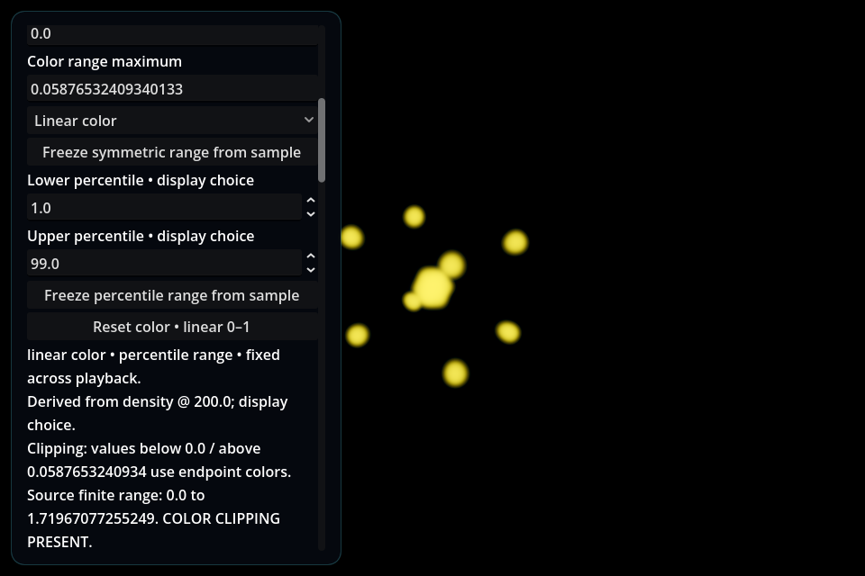
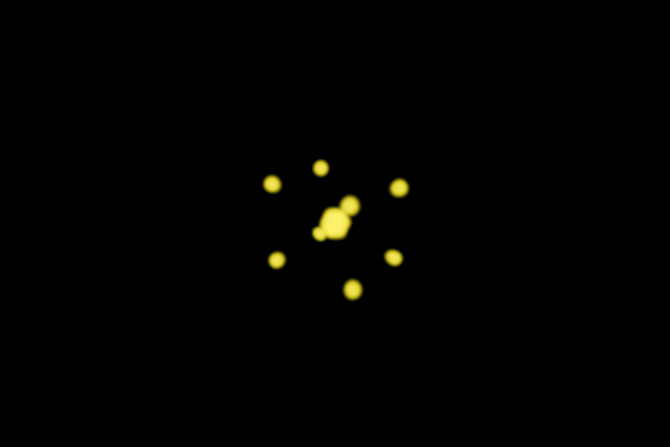
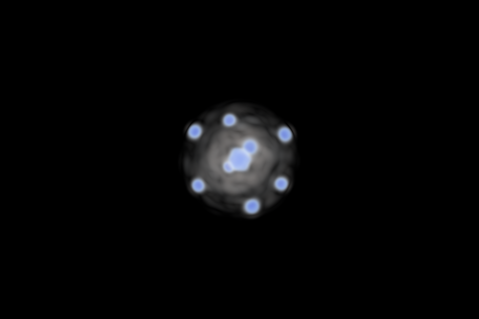

# Volume color normalization and frozen ranges

Issue **#12 / VOLUME-003**, from `456930c`, under its current
**UX4 — Panels & Information Architecture** milestone. **Pending owner review.**
This implements color policy only, on top of the independent opacity mapping
from #11. No preset, panel reorganization or field interpolation is added.

## Controls

Open **Scene layers → Settings: <volume>**. All color ranges are **fixed across
playback**; changing time or restoring a recipe does not recompute them.

| Control | Behavior |
|---|---|
| Color range minimum / maximum | Finite, increasing manual bounds; editing switches the range policy to manual |
| Linear color | Existing clamped linear scalar-to-color mapping |
| Logarithmic color • positive only | Explicit natural-log mapping; requires positive bounds and positive finite source values |
| Freeze symmetric range from sample | Resolve `[-A,+A]`, where A is the maximum absolute finite source value at the displayed field sample |
| Lower / Upper percentile • display choice | Draft percentiles, applied only by the freeze button; require `0 ≤ lower < upper ≤ 100` |
| Freeze percentile range from sample | Derive the chosen quantiles from finite original source values, then freeze the resulting bounds |
| Reset color • linear 0–1 | Restore the existing default manual range and linear normalization; leave opacity and the colormap unchanged |



The status text identifies the selected policy, normalization, frozen behavior,
derivation channel/time, endpoint clipping and current source finite extrema.
**COLOR CLIPPING PRESENT** means at least one finite source value lies outside
the selected bounds. It is not a pixel count or a calibrated measurement. When
a layer is hidden, stale source extrema are cleared. Percentile controls are
explicit presentation choices, not claims that a given percentile is scientifically
correct. Their draft edits do not change the applied policy until Freeze is used.

Color and opacity remain independent. Range edits can change color/contrast but
do not increase extinction to make a faint signal opaque. If more extinction is
needed, adjust the separate opacity controls deliberately. A percentile range
can improve color visibility while saturating a dense core; the clipping disclosure
makes that tradeoff explicit. Source arrays, probes, sampling, timestamps and
analysis values are unchanged.

## Mapping and invalid data

For source scalar `s` and saved color bounds `a < b`:

```text
linear: u = clamp((s-a)/(b-a), 0, 1)
log:    u = clamp((ln(max(s,a))-ln(a))/(ln(b)-ln(a)), 0, 1)
```

The existing linear shader denominator floor of `1e-38` remains. Log is available
only for positive bounds representable in float32 and a sample with at least one
finite value and no finite nonpositive values. Extremely small values below
`1e-38` and bounds whose float32 logarithms collapse are refused. Nonfinite samples
retain the existing shader exclusion; they do not contribute to derived ranges.
The same selected color mapping applies to volume rendering and its slice.

Zero-containing density and signed fields therefore cannot enable ordinary log
merely by entering positive color bounds. A symmetric range is incompatible with
log. No absolute-value, signed-log or epsilon transform is silently substituted.

If an already selected log policy becomes invalid after seeking or changing
channel, the field is explicitly **unavailable** and hidden until valid again or
Linear is selected. The chosen policy is retained; source probes remain accessible.
The layer manifest records the reason. Offline video fails before publishing an
invalid field frame instead of silently exporting a blank field. Earlier completed
frames, if any, follow the exporter's existing retention behavior.

## Derivation, limits and persistence

Percentiles use sorted finite float64 copies of the original source values and
linear interpolation at index `q*(n-1)`, matching NumPy's default quantile method.
The source array is never sorted or modified in place. A constant derived range,
an all-zero symmetric range or invalid-only values are refused with guidance to
choose manual bounds; no invented fallback span is applied.

Derivation uses one low-priority CPU thread, a maximum of **8,388,608 source values**
(up to 64 MiB of sorted float64 values), and physical-memory headroom checks. Changes
to the sample, source generation or settings discard an obsolete result. Reset or
recipe restoration invalidates a pending request. Work exceeding the bound is
refused; manual input remains available. Closing joins the bounded calculation.

Finite extrema/log-eligibility statistics are prepared with the existing field
CPU preparation work and reused with the loaded texture. Ordinary color edits do
not rescan or reupload an unchanged field. Interactive prefetch keeps that scan on
its existing worker; initial opening and synchronous inspection/export still use
their existing synchronous preparation path. This adds a source scan per prepared
channel/sample; no universal performance claim is made.

Recipes/jobs add the volume layer's `color_mapping`:

```json
{
  "normalization": "linear",
  "policy": "percentile",
  "percentile_low": 1.0,
  "percentile_high": 99.0,
  "source_channel": "density",
  "source_time": 200.0
}
```

Resolved bounds remain in the existing `lower`/`upper` fields. v2 uses its existing
JSON precision; v3 retains exact float64 state. Save/restore and video reuse the
saved bounds and policy rather than rerunning statistics. Manual edits clear the
derivation channel/time. Changing channel preserves frozen bounds and displays
the original derivation channel so they cannot be mistaken for fresh statistics.

Legacy states without the whole field migrate to **manual linear**, preserving
bounds and the independent opacity mapping. Partial/invalid mapping objects are
refused during visual-state validation. Defaults remain manual linear 0–1; no
channel meaning or new default is inferred from one capture.

### Candidate policies evaluated

The issue lists frozen/interval ranges as candidate policies. This implementation
provides frozen manual and single-sample-derived ranges. An interval-wide scan
would require a bounded scan/cancellation UI and explicit treatment of independent
field cadence and percentile weighting across samples. It is not implemented or
presented as available. Frozen ranges already satisfy stable comparison across
playback; interval derivation remains a separately scoped extension. There is no
automatic per-frame policy and no new universal percentile default.

## Validation — 2026-09-19

Godot **4.7.2**, NVIDIA **RTX 3070 Ti**, Linux default X11 driver. Evidence:
[summary](evidence/issue-12/summary.json),
[synthetic Forward+](evidence/issue-12/forward.json),
[synthetic Compatibility](evidence/issue-12/compatibility.json),
[real Forward+](evidence/issue-12/real-forward.json),
[real Compatibility](evidence/issue-12/real-compatibility.json).

| Validation | Result |
|---|---|
| Focused synthetic color checks | **130 PASS per backend** |
| Synthetic export | Frozen-percentile MP4 still matches reference PNG pixels; policy retained in sidecar |
| Invalid-log export | Expected refusal on both backends; no invalid MP4 published |
| Existing opacity-transfer regression | **98 PASS per backend**, including actual export and source invariance |
| v2/v3 recipes | **3,051 PASS**, headless; symmetric/percentile/log state, restored controls, legacy migration |
| Playback maintenance | **66 PASS**, plus **51 lifecycle checks PASS**, headless |
| Real capture | **106 PASS per backend**, six derived-range views plus export |
| Integrity | Independent NumPy quantiles/source probes, array hashes and before/after whole-file hashes agree |
| Final import/logs | No unexpected errors/warnings; generated resource UIDs included |

GPU tests compare logarithmic midpoint colors with an independent equivalent
linear mapping for both volume and slice. Coverage includes frozen seeks, exact
render replay, malformed mappings, stale worker results, invalid-only/constant
ranges, finite-value quantiles, unchanged opacity and invalid future log samples.

Development checks caught and corrected a GDScript type-specifier error in the
new export guard, a test variable type inference error, and a mistaken test
assumption that percentiles always clip repeated extrema. The final test compares
clipping presence against the actual NumPy result instead. No unresolved failures
remain; the invalid-log export is an intentional passing refusal test.

### Real capture provenance and observations

The earlier #11/#13 capture was no longer present at its recorded location. The
available newer external capture was read without modification:

`S2_20260919_204505_268717/free_collapse_simscope.ssc`

- 11,542,897,957 bytes; 128³ field; 401 field and particle samples ending at time 200.
- SHA-256: `0805d497ad0f69440f3aa7ac30d6cfe9642a4efd142ae406d3a685b595d7d3f5`.
- Reviewed density, psi_real and psi_imag at **200**, then sought to **0** and back
  to verify frozen bounds. Scientific view, particles hidden. Explicit magnitude
  opacity 0–maximum-absolute-source-value was held unchanged for each channel;
  strength 0.25, ray step 0.5.

| Channel | Symmetric bound A | 1st–99th percentile bounds |
|---|---:|---|
| density | 1.719670773 | 0 to 0.05876532409 |
| psi_real | 1.298467159 | −0.1740555467 to 0.03461995952 |
| psi_imag | 0.974797845 | −0.1016215784 to 0.03111908844 |

All three percentile views disclose actual clipping. Density contains zeros, so
log is refused; signed channels also refuse it. Positive synthetic samples cover
the valid log path. Density's percentile view makes the visible structures bright
while saturating their cores; it is not evidence that one percentile is the right
scientific choice. Opacity controls must be evaluated separately for faint material.




The real runs check serialized visual replay and file hashes before/after. Full
source-bound v2/v3 recipe restoration is exercised by the synthetic recipe suites,
avoiding repeated whole-file hashing of the 11.5 GB external source for every view.
No capture, cache, video or scientific array is committed.

## Reproduce and owner verification

Use fresh output directories and externally installed Godot/FFmpeg:

```sh
python tools/validate_volume_color.py --godot /path/to/godot \
  --renderer forward_plus --output-dir results/color-forward
# Add --real-capture /external/path/free_collapse_simscope.ssc for the real review.
python tools/validate_recipe_state.py --godot /path/to/godot \
  --renderer headless --output-dir results/color-recipes
python tools/validate_performance_maintenance.py --godot /path/to/godot \
  --renderer headless --output-dir results/color-playback
```

Before accepting:

1. Open the newer capture, select Scientific, hide particles and seek **200**.
   Select density and freeze **1–99%**. Verify bounds near **0–0.05876532409**,
   the clipping warning, source maximum near **1.719670773**, and unchanged opacity.
2. Select psi_real / coolwarm and use **Freeze symmetric range from sample**.
   Verify **±1.298467159**; for psi_imag verify **±0.974797845**. Use an explicit
   Magnitude opacity mapping where needed, independently of the color controls.
3. Seek to **0** and back: bounds and derivation time must remain fixed while
   current source extrema/clipping update. Edit a bound manually and confirm the
   policy changes to manual. Test an invalid reversed range.
4. On real density, even after entering positive color bounds, Log must refuse
   its zero-containing source. On the generated synthetic fixture's `ten` channel,
   color bounds **1–100** should allow Log and place 10 at the colormap midpoint.
   Numerical probes must stay unchanged.
5. Save/reload a recipe and export a short locked-camera clip. Verify frozen bounds,
   normalization and opacity reproduce. Load an older recipe and check its original
   linear view. Reset color and confirm opacity/colormap remain unchanged.
6. Repeat key checks on Compatibility and inspect controls at your usual UI scale.

Other GPUs/OSes, physical 4K/multiple UI scales, long-session performance and the
full G0–G4 suites were not rerun. The real review covers one simulation family and
one range-derivation time; it is not a universal-default or scientific acceptance.
Automated export coverage is a still plus explicit invalid-frame refusal; a moving
clip remains an owner check. Interval scans are evaluated above, not implemented.
