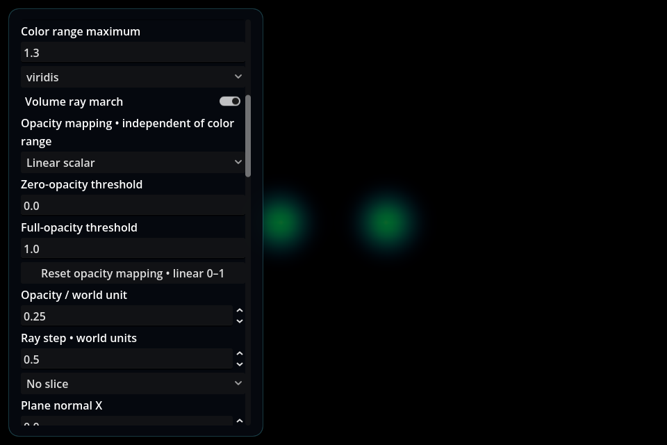
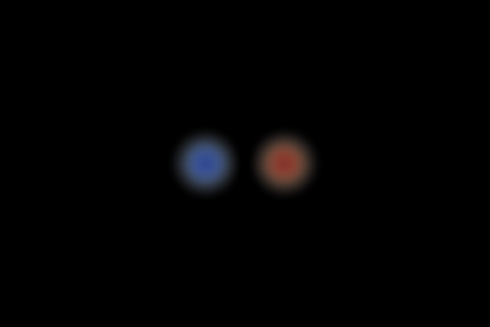
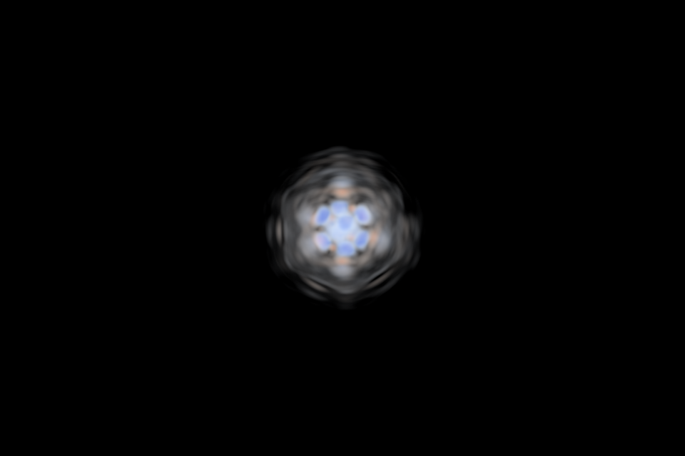
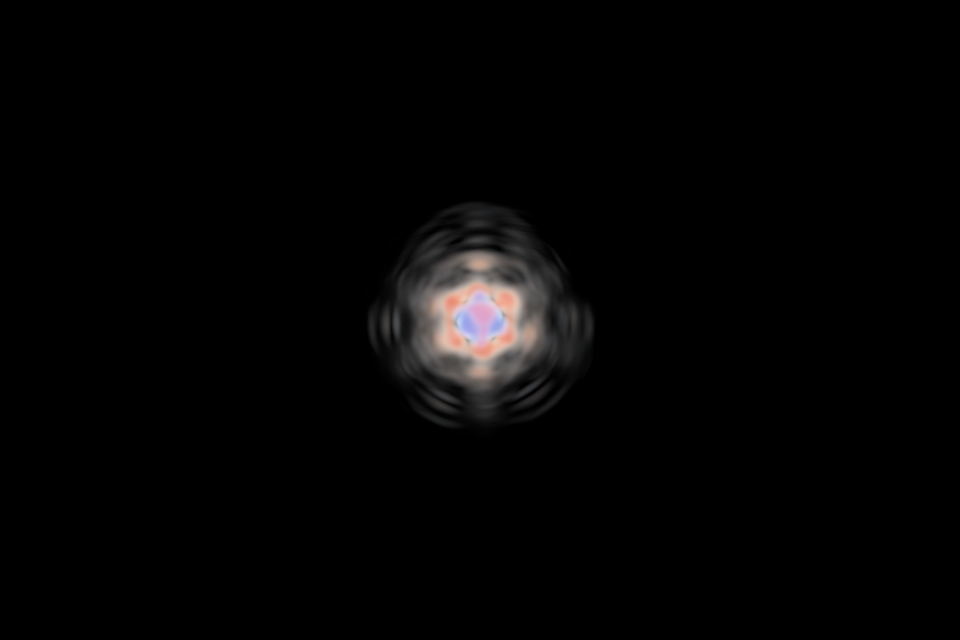
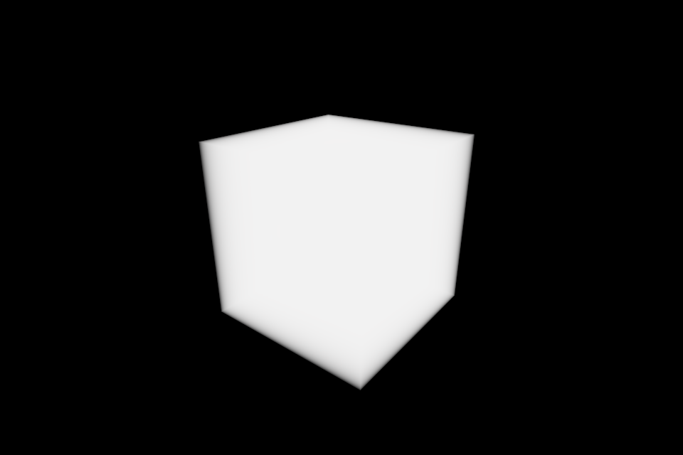

# Independent volume opacity mapping

Issue **#11 / VOLUME-002**, implemented from `fc05f2d` under its current
**UX4 — Panels & Information Architecture** milestone. **Pending owner review.**
This change addresses the color/extinction coupling identified in
[the VOLUME-004 review](VOLUME_DEFAULTS_VALIDATION.md). That report and its
review-time evidence remain historical and unchanged.

## Controls and semantics

Open **Scene layers → Settings: <volume>**. The selected scalar still controls
color using **Color range minimum/maximum** and the selected colormap. Extinction
now has its own explicit mapping:

| Control | Meaning |
|---|---|
| Linear scalar | Use the signed scalar itself for the opacity ramp |
| Magnitude • absolute scalar | Use the absolute scalar for the opacity ramp; color still uses the original signed scalar |
| Zero-opacity threshold | Values at or below this threshold contribute no extinction |
| Full-opacity threshold | Values at or above this threshold reach the selected extinction strength |
| Opacity / world unit | Maximum extinction strength, scaled by the ramp's weight |
| Reset opacity mapping • linear 0–1 | Reset mapping mode and thresholds only; preserve color, strength, ray step and source state |
| Ray step • world units | Ray-integration sampling distance; quality/performance, not an opacity or brightness mapping |



For sampled scalar `s`, zero threshold `a`, full threshold `b`, strength `k` and
world-distance integration step `dt`:

```text
q = s                 (Linear scalar)
q = abs(s)            (Magnitude)
w = clamp((q - a) / (b - a), 0, 1)
segment_alpha = 1 - exp(-k * w * dt)
```

The existing color coordinate is independent:
`clamp((s - color_min) / (color_max - color_min), 0, 1)`.
The transfer is applied after sampling the existing float32 GPU preview. Original
source arrays and numerical probes are unchanged. Nonfinite samples remain
skipped. The existing ray-length/1024 step floor, alpha early stop, depth/plane
clipping and slice behavior are unchanged.

“Full opacity” means the full selected **extinction strength**, not an opaque
pixel. Integration distance still matters. These are presentation settings, not
calibrated physical measurements or inferred scientific meaning. Magnitude is an
explicit nonlinear display choice. A symmetric color range alone does not select
Magnitude, alter opacity thresholds, or infer channel semantics.

Thresholds must be finite and strictly increasing. Magnitude requires a
non-negative zero threshold. New mappings also reject thresholds that overflow,
collapse together, or have an interval below `1e-38` in float32 display precision.
Scientific-notation input remains supported. Errors retain the last valid state.
The shader retains its existing `1e-38` denominator floor. GPU previews still
have their existing float32/range/LOD limits; recipes do not upgrade GPU precision.

A useful signed-field configuration to evaluate is a symmetric color range with
a diverging colormap, Magnitude opacity and a zero threshold at or above zero.
A positive zero threshold creates an explicit transparent near-zero region.
This is a manual display choice, not a new universal preset or automatic policy.
Settings remain per volume and stay fixed when changing channel or seeking;
users must select appropriate thresholds for the new channel's units/range.

## Defaults and compatibility

Fresh views use **Linear scalar, 0–1**, strength **0.25**, ray step **0.5**. This
preserves the previous density default. Color-range changes no longer change
extinction. Meshes, slices, particles, scientific normalization and source sampling
are outside this change.

Each volume's visual state now contains:

```json
"opacity_mapping": {"mode": "magnitude", "lower": 0.01, "upper": 1.0}
```

v2 recipes, v3 exact state, inspection sidecars and video jobs preserve the
mapping separately from color bounds and opacity strength. v2 retains its existing
ordinary JSON precision; v3 retains exact float64 serialization. Restored controls
reflect the mapping. Source layer metadata also records the chosen mapping.

Older states with no `opacity_mapping` copy their saved color bounds into a
**Linear scalar** opacity mapping. This reproduces the old rendering rather than
silently correcting an old recipe's appearance. Editing color bounds after restore
leaves opacity unchanged. An old signed recipe can therefore still show the opaque
domain until the user deliberately selects Magnitude and appropriate thresholds.
Partial, unknown or invalid mapping objects are refused during recipe validation
before applying visual state. Previously saved thresholds beyond the supported
float32 mapping range are refused rather than assigned a new interpretation.

## Validation — 2026-09-19

Godot **4.7.2**, NVIDIA **RTX 3070 Ti**, Linux desktop, default X11 display driver.
Both **Forward+** and **Compatibility** ran the same focused cases. Evidence:
[summary](evidence/issue-11/summary.json), [Forward+](evidence/issue-11/forward.json),
[Compatibility](evidence/issue-11/compatibility.json).

| Check | Result |
|---|---|
| Synthetic GPU, source, UI and recipe cases | **98 PASS per backend** |
| Actual signed MP4 still/export sidecar | Complete on both; exported PNG pixels identical to the live reference, exact chosen mapping retained |
| Full existing v2/v3 ownership/restore regression with mapping coverage | **3,031 PASS**, headless; includes worker-verified old v3 migration |
| Real capture comparisons | **26 PASS per backend**, five views each |
| Source integrity | Whole-file hashes unchanged; synthetic float64 and real float32 arrays match independent Python hashes; probes/timestamps retained |
| Default real density regression | Forward+ pixels exactly equal the retained issue #13 `late-default.png` |
| Import and final logs | Clean import; no final native/recipe ERROR or WARNING |

The synthetic test checks integrated alpha against `1-exp(-k*w*length)` on a
uniform slab, rather than only reading back shader parameters. It covers zero,
near-zero exclusion, both signs, saturation, changed color range, changed step,
legacy equivalence, invalid mappings, reset, exact replay pixels and visible
positive/negative lobes. One initial replay assertion failed because the fixture
hid its overlay without updating saved visibility; correcting that fixture made
the final runs pass. There are no remaining failed checks.



### Real capture

Read-only validation reused the external FreeCollapse capture from issue #13:
`S2_S2_phase_free_live_20260911_180247_463248/free_collapse_simscope.ssc`,
**1,165,229,241 bytes**, SHA-256
`c1931fdaa27a3a063fca1a7cbc3e5523efe2f840c816261dd48533ec7c259ccb`.
No source capture, caches or scientific arrays are committed.

At the recorded field time **80**, Scientific view, particles hidden, opacity
strength 0.25 and step 0.5:

| Channel | Color range | Opacity mapping | Observation |
|---|---|---|---|
| density | 0–1, viridis | Linear 0–1 | Unchanged default density pixels |
| psi_real | ±0.865841031, coolwarm | Magnitude 0.01–0.865841031 | Signed structure visible; no opaque surrounding domain |
| psi_imag | ±1.223627090, coolwarm | Magnitude 0.01–1.223627090 | Signed structure visible; no opaque surrounding domain |
| Both signed channels, legacy comparison | Same symmetric range | Linear using the same signed bounds | Reproduces the previously observed opaque box |

These threshold choices are explicit review examples for this capture. They are
not installed as defaults. Compositing can mix foreground/background signs within
a pixel, so colors are not a replacement for source probes. No claim of identical
pixels across rendering backends is made.





## Reproduce

Use fresh output directories, the project Python environment and an external
Godot executable. Native GPU runs also require external FFmpeg.

```sh
python tools/validate_volume_opacity.py --godot /path/to/godot \
  --renderer forward_plus --output-dir results/opacity-forward \
  --real-capture /external/path/free_collapse_simscope.ssc
python tools/validate_volume_opacity.py --godot /path/to/godot \
  --renderer gl_compatibility --output-dir results/opacity-compatibility \
  --real-capture /external/path/free_collapse_simscope.ssc
python tools/validate_recipe_state.py --godot /path/to/godot \
  --renderer headless --output-dir results/opacity-recipes
```

Omit `--real-capture` for the self-contained synthetic GPU/export regression.
The optional external review requires one volume with density/psi_real/psi_imag.

## Limits and owner verification

Validation covers one GPU and one real simulation family. Other GPUs/OSes,
physical 4K/multiple UI scales, long sessions/performance benchmarks and the full
G0–G4 suites were not rerun. Both signed channels were evaluated at one real source
time; this is not a universal-default or scientific-interpretation acceptance.

Before accepting:

1. Open the external capture, select **Scientific**, hide particles and seek **80**.
   With density, color 0–1/viridis, Linear opacity 0–1, strength 0.25 and step 0.5,
   verify the familiar density view and readable controls.
2. Select psi_real, coolwarm, color bounds **−0.865841031 to +0.865841031**;
   choose Magnitude and opacity thresholds **0.01 to 0.865841031**. Repeat with
   psi_imag, color **±1.223627090**, opacity **0.01 to 1.223627090**. Verify both
   signs are visible and the surrounding near-zero domain is transparent.
3. Change only color bounds, then only opacity thresholds. Verify the controls
   stay independent, zero/near-zero exclusion is deliberate, and an invalid upper
   threshold is refused. Run a numerical probe before/after; its source value
   must remain unchanged. Change time and confirm thresholds remain fixed.
4. Save/load an inspection recipe, then export a short locked-camera clip. Verify
   chosen mapping, view and timestamps reproduce. Load an older recipe and check
   its original appearance; its opacity bounds should initially equal its saved
   color bounds. Reset mapping and confirm color bounds remain unchanged.
5. Repeat the signed-field checks in Compatibility. Assess the example settings
   for your data without treating them as scientifically calibrated defaults.

Later color-range policies (#12), usability/presets (#10), field interpolation
(#9) and UX4 panel organization (#14) remain separate owner-controlled work.
Nothing from those issues is implemented here.
