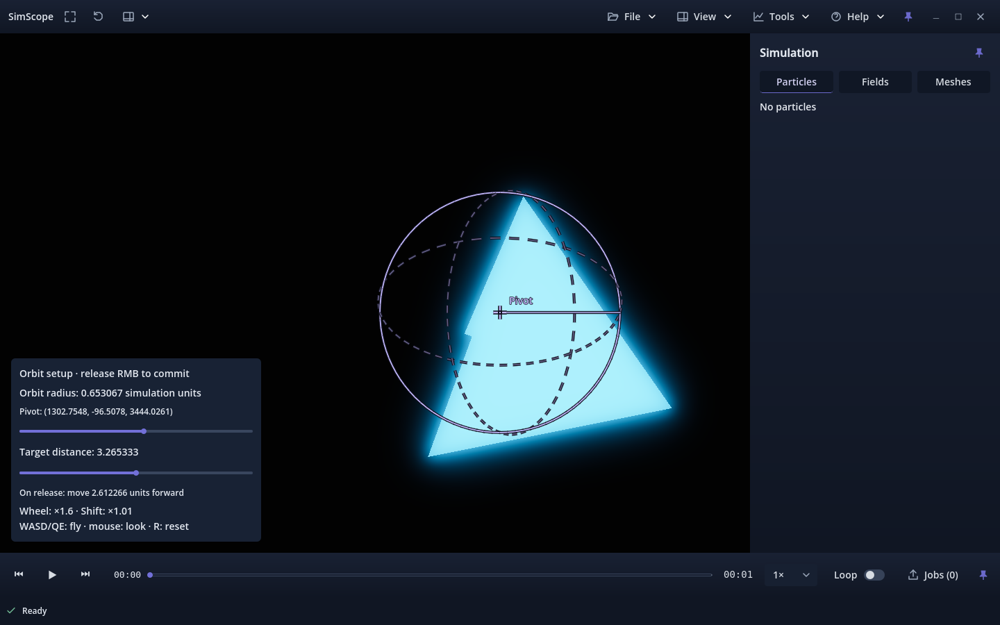
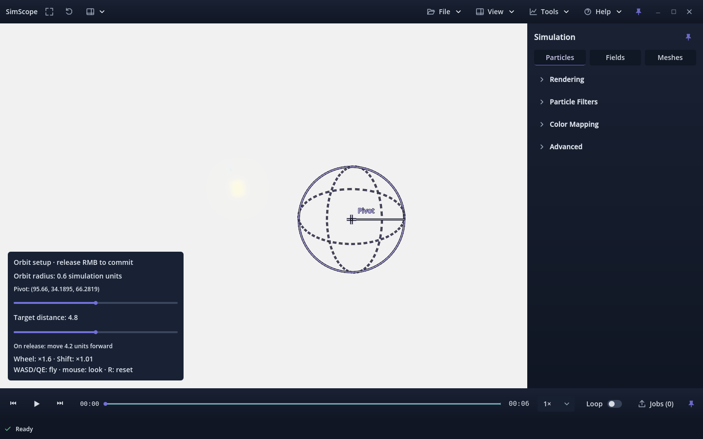

# Issue #120 — first owner-review revision

The owner rejected the initial sphere size/control and reported a black viewport
that neither Reset nor Auto Orbit recovered. This revision stays on the exact
existing #120 branch and draft PR #149. Accepted main is `1a60774`; the candidate
remains build 12. Owner verification is pending. No merge or Project write occurred.
The parent directory's first implementation report/evidence remain unchanged.

## Reproduction before editing

The retained [probe](repro-probe.gd.txt) ran against `9fa0e66` using the complete
off-center mesh fixture from the first implementation. Its exact SHA-256 is in
[summary.json](summary.json). It uses an independent 640×400 native viewport with
the same world/camera, excluding 2D chrome/preview and hiding reference guides and
stars, so scientific content cannot be confused with HUD or orbit-guide pixels.

| Native renderer | Before | Commit radius 0.01 | Reset | Auto Orbit |
| --- | ---: | ---: | ---: | ---: |
| Forward+ scientific pixels | 44,673 | 0 | 0 | 0 |
| Compatibility scientific pixels | 19,708 | 0 | 0 | 0 |

The initial observer-to-pivot distance equalled sphere radius 8.16333: the camera
was on the sphere surface, producing enormous arcs. The commit kept a finite,
unchanged transform near `(1304.5913,-95.1797,3446.3767)`, but reduced far clipping
from 1000 to 0.08. The framed mesh target was `(1300,-98.5,3440.5)`. Reset replaced
it with world origin at distance 30/far 1000; the mesh remained inaccessible.
Auto Orbit rotated the same broken reset view. The reproduction logs are clean:
this is functional clipping/framing failure, not an engine crash or NaN transform.

[Forward+ trace](forward-reproduction.json) and [Compatibility trace](compatibility-reproduction.json)
retain all target/radius/basis/origin/clip values and counts. The reproduction uses
synthetic data; the owner's exact production capture was not supplied.

## Changes and final evidence

- Initial target distance is 40% of camera distance; radius is one eighth of that
  placement distance. The sphere is fully ahead, with manageable apparent size.
- Ordinary wheel scales radius by 1.6; Shift+wheel uses 1.01. Resizing leaves the
  pivot fixed; a separate logarithmic Target distance control places it.
- The explicit release landing is on the sphere surface at the selected radius,
  preserving orientation. The panel states the movement before commitment.
- Custom far clipping includes framed scene bounds and the full orbit; bounded
  clip ratio avoids singular Forward+ projection. Flight/zoom/orbit refresh it.
- Reset uses the current source's last successful framing and default angles,
  independent of damaged live camera fields. Auto Orbit repairs clips or restores
  an invalid state. Unrepresentable radius/position proposals restore a visible
  scene and explain the rejection.

[Forward+ focused report](forward-orbit.json) and [Compatibility focused report](compatibility-orbit.json)
each contain **1,028 passing assertions** and **78 native rendered scene checks**,
including particles, volumes, meshes and mixed captures at arbitrary off-center
coordinates, real mesh captures scaled by 0.01/1000, small-radius commit, reset,
keyboard/menu/already active Auto Orbit, nonfinite target/radius/angles, invalid
basis/clipping and float32 precision rejection. Source arrays/state and complete
capture bytes remain unchanged. Temporary setup graphics still stay out of PNGs,
scientific bundles and offline/video viewers.

The [suite results](regression-results.json) retain sequential native import and
all existing camera, presets, shell, edge/fullscreen, pacing, status and current
scientific video runs on both renderers. **33,068 native assertions and two Python
version tests pass.** [Strict verification](strict-verification.json) passes all
12 complete generated captures, including payload checksums and field statistics.
Python compilation and whitespace checks also pass. Counts, hashes and limits
are consolidated in [summary.json](summary.json); renderer logs are retained here.

## Failed attempts, limitations and remaining review

- Initial development runs exposed an incorrect test lookup of the local Navigate
  menu, float rounding at a 100,000 clip-ratio threshold, and nearly invisible
  particle reset framing at the old 30-unit minimum. The test lookup was corrected,
  the ratio received margin (90,000), and Reset now restores framed distance.
- One new scaled fixture was initially missing required stable-topology vertex
  IDs. The writer rejected it before native execution; explicit IDs were added.
- An initial pytest invocation failed because pytest is not installed. The actual
  repository unittest runner passes both version tests; no dependency was installed.
- Focused Compatibility teardown retains the same two 349,524-byte GL texture
  leak diagnostics as accepted main. The final strict check allows only identical
  type/size/count after normalizing GL IDs, using the retained parent baseline.
  All other errors, script errors and warnings fail. Clean teardown is not claimed.
- Compatibility retains its existing 60 preset-quality and 10 exact GPU float-plane
  readback skips. Forward+ retains those checks.
- PNG equality checks cover the entire simulation area; capture-time transport
  disabling is outside that pixel comparison. GPU depth/spatial precision limits
  still apply to extreme world coordinates and clip spans.
- Owner feel, the original production capture, Windows/macOS and other GPUs remain
  unverified. No production simulation was rerun. Automated tests do not establish
  owner acceptance; use the [current owner checklist](../../../CUSTOM_ORBIT_SETUP.md).

