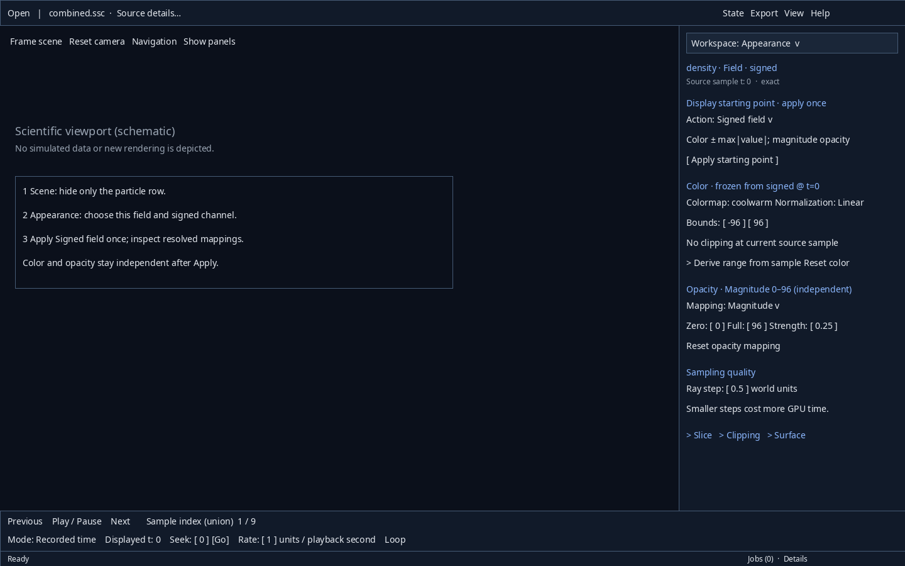
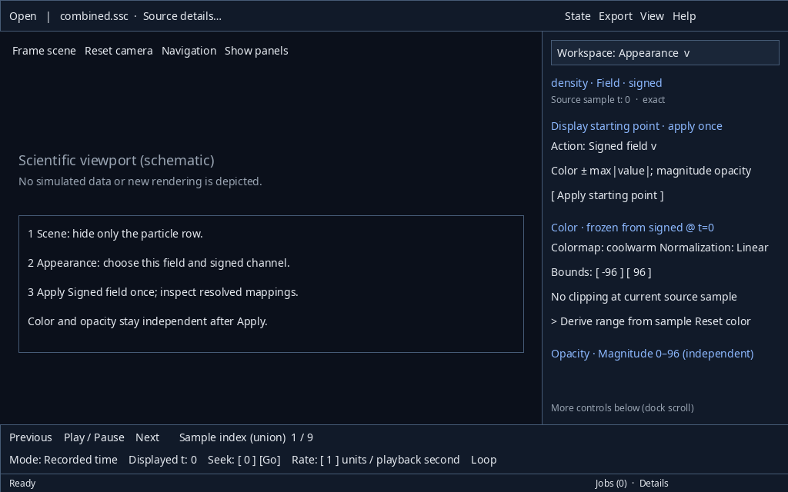
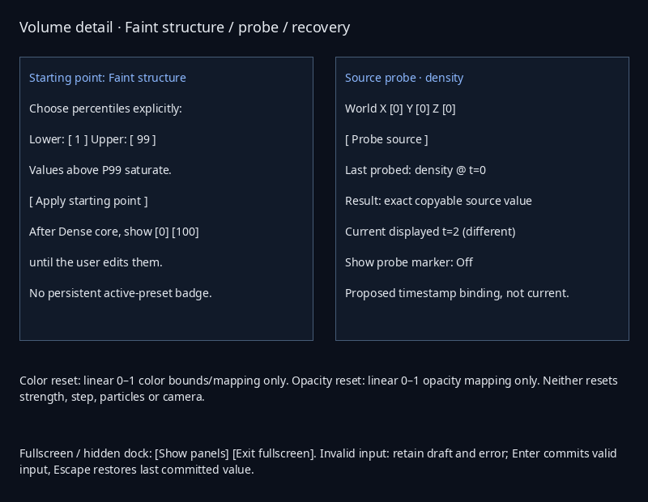

# Static wireframes — issue #14

**Proposed layouts, not screenshots of an implemented redesign.** Numbers and
field values are illustrative. Source captures are not rendered into these figures.
The [architecture](../../UX_INFORMATION_ARCHITECTURE.md) specifies full interaction
and ownership; [walkthroughs](../../UX_IA_REVIEW.md) explain W1–W8 and counting rules.

| Figure | Annotation / review task |
|---|---|
| [Empty](empty.png) | W1: primary Open, unavailable transport, no invented data |
| [Loaded Scene](scene.png) | W1/W2/W5: row context vs visibility, source probe, one dock |
| [Particle](particle.png) | W2: particle representation/mappings/history, separate viewport context |
| [Volume](volume.png) | W2/W4: one-time starting point and independent color/opacity/quality |
| [Detail sheet](details.png) | W3/W5/W8: adjacent Faint inputs, reset scope, last-probe provenance proposal |
| [Selection](selection.png) | W7: explicit source binding and exact IDs |
| [Analysis](analysis.png) | W7: effective request context and explicit Run |
| [Results](results.png) | W7: provenance/exact lookup/full export; expansion remains temporary |
| [Expanded results](results-expanded.png) | W7: temporary workbench, provenance, bounded plot and complete values/export |
| [Export/error](export.png) | W6: scrollable body, fixed actions, durable error and Jobs |
| [Invalid draft](error.png) | W8: local error, last committed mapping, recovery |
| [Compact 1024×640](compact.png) | W1–W8: local dock scrolling; fixed transport/status; no font shrinking |
| [4K scale overview](scale-review.png) | Logical allocations at 100/125/150/200%; not physical DPI evidence |

[Current real-capture inspector](current-real-preset.png) is separately labeled
baseline evidence. It is not the proposed design.

Reproduce primary static figures with `python docs/evidence/issue-14/render_wireframes.py`
from the repository root using Pillow and an installed font. `UX_WIREFRAME_FONT`
overrides the recorded Noto Sans font path; no font is bundled by this issue.
The [layout manifest](wireframe-layout.json) records sizes and wrap checks. The
[checker](check_review.py) validates links, symbols and scope. Raw 4K figures and
native trees/screenshots remain under ignored `results/issue-14-review`; only small
review artifacts are retained. All figures need later native interaction testing.
