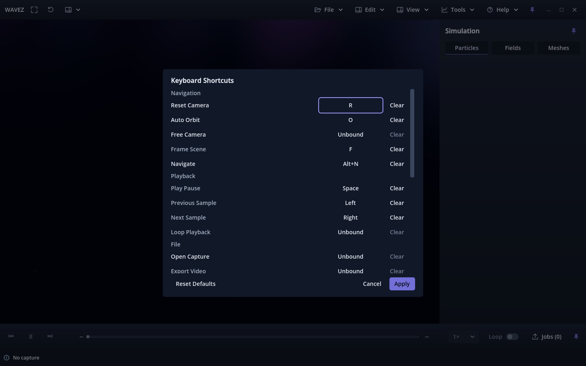
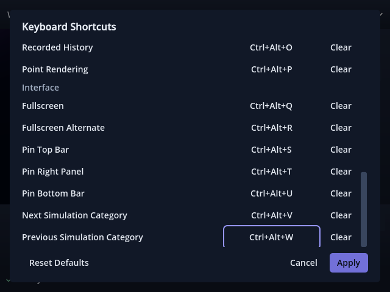

# Issue #175 validation — pending owner review

Recorded 2026-10-02 against accepted `main` `0496d12`, candidate build 17.
The issue was the sole Ready board item, and the workspace already used its
exact owner-linked branch. Previous PR #174 was owner-merged, present in both
local/main and origin/main; stale remote refs were pruned, and the previous
local issue branch was already removed. No historical evidence was rewritten.

Host: Fedora 44 KDE Plasma, Godot 4.7.2 stable `ed1daf0bf`, NVIDIA RTX 3070 Ti,
driver 615.71.09. Native tests used X11/XWayland. Source and Linux release-template
processes ran against isolated profiles; no owner shortcut preferences changed.

## Results

| Validation | Forward+ | Compatibility |
|---|---:|---:|
| Source shortcut editor plus fresh-process restart | 158 PASS | 158 PASS |
| Packaged Linux editor plus fresh-process restart | 158 PASS | 158 PASS |
| Existing shell/source/menu/fullscreen regression | 659 PASS | 659 PASS |
| Existing transport/precise-time regression | 234 PASS | 234 PASS |
| Existing native fullscreen menu/tool regression | 75 PASS | 75 PASS |
| Paused rendering, playback, seeking and channel changes | 38 PASS | 38 PASS |
| Video fixture setup, strict offline states | 40 PASS | 40 PASS |

Python application-version checks: **2 tests PASS**, candidate `v0.1.0.17`.
Clean authorized Godot import and Python compile checks passed. New scripts include
their generated UID sidecars; no runtime/cache/package/SSC files are committed.

The final shortcut runs include all 16 required actions, seven retained accepted
bindings/actions, exact modifiers, immediate staged duplicate transfer,
explicit Unbound, Apply, Cancel/Escape, failed-save retention, corrupt-value
normalization, key/button focus, menu availability, and all existing action routes.
They include the owner's final removal of permanent top/footer instructions and
the resulting extra list space. The existing broad regressions ran before that
text-only refinement; the complete focused source/package matrix was repeated
after it. Its 632 checks also cover fullscreen and pin restoration.

Bounds/focus/scroll tests used 1440 × 900, 970 × 600, an isolated 640 × 480 window,
and 3840 × 2160 at Godot content scales 2.0 and 2.5. The isolated compact case
clears the engine minimum for the test only; the product's 970 × 600 minimum stays.
The title now leads directly into the list and the footer contains no permanent
explanatory text or reserved space. A failed-save message is conditional.

## Scientific and rendering evidence

[Export comparison](scientific-export-comparison.json) renders particles, signed
fields, stable meshes and mixed layers from accepted main and the candidate on
each renderer. All **16 RGBA frame pairs**, byte-identical timing manifests and
strict scientific evidence matched. Both variants used the same fixture files
and states, 960 × 540, four frames/s, a deterministic orbit and two output frames.
FFprobe confirmed dimensions, frame count and FPS. Exact field/source hashes,
particle identities/interpolation and mesh evidence matched; Forward+ also matched
its uploaded field-byte hashes. Compatibility is not used as an exact GPU
float-byte readback oracle.

Every sample in the four used fixture files was read strictly: **22 source records**.
Complete-file SHA-256 stayed unchanged. A nondefault interactive shortcut file
was present during these offline runs; export state/evidence ignored it.
Exports without application UI were compared. Including application UI renders
the requested new Edit menu and therefore intentionally changes those menu pixels;
no exporter/camera/clock/overlay policy was changed.

The [Forward+](forward-paused-rendering.json) and
[Compatibility](compat-paused-rendering.json) profiles cover complete two-second
mixed-fixture playback, seeking, density/psi_imag changes and paused auto orbit.
All six stationary phases per renderer recorded **zero additional draws**,
unchanged camera/sample and identical pixels. The separate orbit phase rendered
at the retained approximately 60 FPS cap. Full fixture SHA-256 remained unchanged;
strict selected scientific sample oracles passed. One-second stationary phases
and tiny captures establish these regressions only, not production performance.

## Diagnostics, earlier failures and limits

The source Forward+ run and all scientific export processes had no engine errors
or warnings. Two known engine shutdown patterns remain visible in native logs:

- Compatibility fresh-process tests create a second offline viewer and report
  **two** texture-cleanup diagnostics, each `leaked 349524 bytes`. The same normal
  lifecycle reproduces on accepted main in both the
  [source engine](accepted-main-source-texture-cleanup.txt) and
  [Linux template](accepted-main-package-texture-cleanup.txt).
- Packaged first-process tests opening existing file/menu/tool windows report one
  `focus_entered` and one `tree_exited` disconnect error during shutdown. The
  [accepted-main package probe](accepted-main-package-window-cleanup.txt)
  reproduces that exact pair using only its existing flows. The validator permits
  only those exact patterns/counts and rejects every other error or warning.

Earlier development attempts failed because of sandboxed editor sockets/settings,
JSON numeric-type comparison in the test, missing temporary export-preset fields,
the obsolete `standalone` feature probe, inherited XDG_DATA_HOME hiding installed
templates, and stale four-menu/static-help test expectations. These were corrected;
the final import, source/package matrix and broad regressions passed. Manual
viewer teardown produced additional diagnostics; final focused tests use normal
application shutdown, and baseline probes use the same lifecycle. These failed
attempts are not claimed as successful checks.

The source/package results use the current Godot `template` feature tag and record
the actual executable path, confirming the external release template ran. See
[Godot feature tags](https://docs.godotengine.org/en/stable/tutorials/export/feature_tags.html).
Generated binaries/templates remain outside the repository.

Physical 4K/KDE compositor scaling, mixed monitors, real hardware key capture,
WM-reserved Meta/Super combinations, native Wayland, Windows and macOS were not
tested. No production scientific simulation or long capture was rerun. Owner
review of compactness, focus/capture feel, labels, duplicate transfer and the
saved profile remains required; automated PASS is not acceptance.

Exact hands-on steps and defaults are in
[Keyboard Shortcuts](../../KEYBOARD_SHORTCUTS.md#owner-verification-before-acceptance).
No later issue, merge, auto-merge or board-completion action is authorized here.
