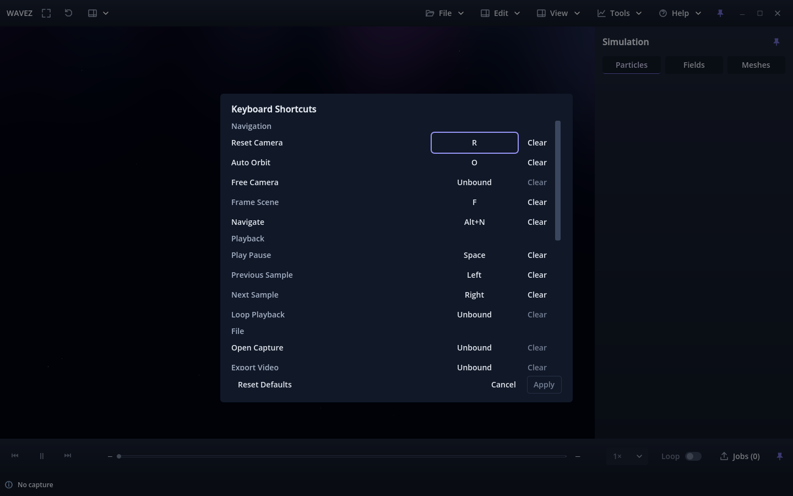

# Apply button review change — issue #175 / PR #177

Recorded 2026-10-02 after the owner requested that Apply remain inactive until a
keybinding changes. Candidate build 17 and the existing issue-linked branch remain
unchanged. The earlier [implementation evidence](../README.md) is preserved.

Apply now starts disabled, enables when the staged map differs from the active
map, and disables again when all edits are reverted. Starting capture, capturing
the current key or resetting an already-default map does not enable it. Clearing,
duplicate transfer and resetting a nondefault map do enable it. Cancel/reopening
returns to disabled. Disabled Apply is skipped in keyboard focus traversal;
unchanged drafts cannot save or close through the Apply handler.

| Focused editor and fresh-process restart | Checks |
|---|---:|
| [Forward+ source](forward-source.json) | 183 PASS |
| [Compatibility source](compat-source.json) | 183 PASS |
| [Forward+ Linux package](forward-package.json) | 183 PASS |
| [Compatibility Linux package](compat-package.json) | 183 PASS |

All **732 checks passed**, including the original action/duplicate/persistence
coverage and the new Apply-state transitions and clean/edited footer focus loops
at each of the five compact/scaled layouts. Each process used isolated preferences;
complete fixture hashes stayed unchanged. Normal Apply, failed persistence and
fresh-process restart still pass. `git diff --check` passed.

Host and runtime match the original validation: Fedora 44 KDE, Godot 4.7.2,
RTX 3070 Ti/NVIDIA 615.71.09, X11/XWayland. Complete native and restart logs are
included. The same accepted-main Compatibility texture cleanup and packaged
native-window disconnect diagnostics remain; no new diagnostic patterns occurred.
The validator rejects errors/warnings outside those previously reproduced patterns.

The broader shell/transport, scientific export comparison and paused-rendering
profiles were not repeated for this editor-button change. Their earlier results
remain historical evidence. Physical KDE/compositor scaling, actual hardware
capture and other platforms remain unverified as previously documented.

Owner check: open preferences and verify Apply is disabled. Change a binding and
verify it enables; restore the original binding and verify it disables. Repeat
with Clear, duplicate transfer and Reset Defaults. Tab/Shift+Tab must skip Apply
when disabled and include it after a change. Apply/Cancel and restart persistence
must retain their existing behavior. Hands-on acceptance remains pending.
