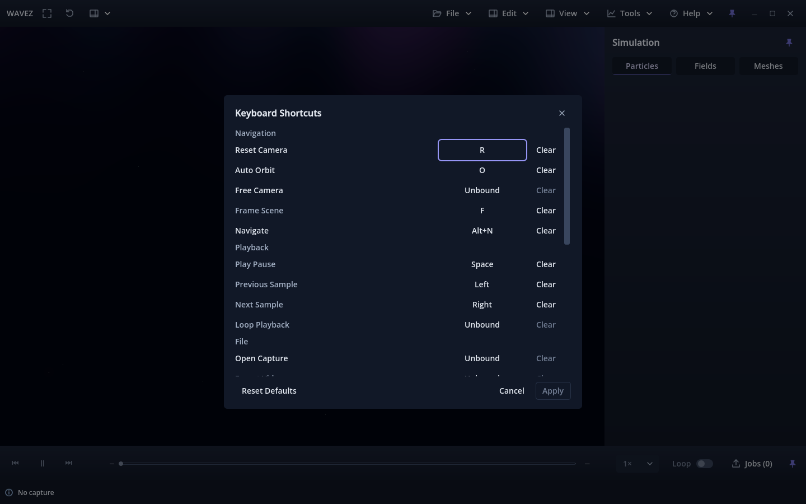

# Close button and keep-open Apply — issue #175 / PR #177

Recorded 2026-10-02 for the owner's follow-up dialog review. Candidate build 17
and the existing issue branch remain unchanged. Earlier implementation and
[Apply-state evidence](../apply-review/README.md) retain their original wording.

The top-right X uses the main shell's cached close icon, 32×32 minimum size,
IconAction variation, inherited theme and violet hover treatment. It dismisses
the editor and discards unapplied edits without warning, including during capture.

Apply saves/activates bindings while keeping the editor open. Its saved map
becomes the clean draft, capture ends, any prior save error clears, and Apply
disables until another edit. Keyboard Apply moves focus to enabled Cancel.
Subsequent Cancel/X discards only later unapplied edits; saved changes survive.

| Focused editor plus fresh-process restart | Checks |
|---|---:|
| [Forward+ source](forward-source.json) | 213 PASS |
| [Compatibility source](compat-source.json) | 213 PASS |
| [Forward+ Linux package](forward-package.json) | 213 PASS |
| [Compatibility Linux package](compat-package.json) | 213 PASS |

All **852 checks passed**. New coverage compares the shell/dialog close icon,
size, variation and all normal/hover/pressed/disabled/focus styles; clicks X through
the actual viewport input path during an unapplied capture; checks repeated Apply,
keyboard Apply focus, clean-state disablement, Cancel/X after Apply and successful
retry after a failed save. Header X and fixed-footer focus loops work in all five
normal, compact and simulated content-scale layouts. Existing action dispatch,
duplicate transfer, restart persistence and source-hash checks still pass.

The first four runs passed 212 checks each; the final four runs added keyboard
activation/focus verification and passed 213 each. Native/restart logs for the
final matrix are included. No new diagnostic patterns occurred; only the exact
accepted-main Compatibility texture-cleanup and packaged window-disconnect
patterns documented in the [original evidence](../README.md) remain.

Runtime/host remain Fedora 44 KDE, Godot 4.7.2, RTX 3070 Ti/NVIDIA 615.71.09,
X11/XWayland, with isolated profiles. Broader shell/transport, scientific export
and paused-rendering profiles were not repeated for these dialog-only changes.
Physical KDE/compositor scaling, real hardware capture and other platforms retain
their previously documented limits. Historical reports were not rewritten.

Owner checks: change a binding and close with X; verify no warning and no saved
change. Reopen, edit and Apply; verify the dialog stays open and Apply disables.
Apply another change in the same dialog, make a third unapplied edit and close
with X or Cancel; only the first two applied changes must remain after reopening
and restart. Review the matching shell/X hover and focus appearance. Acceptance
remains pending owner review.
