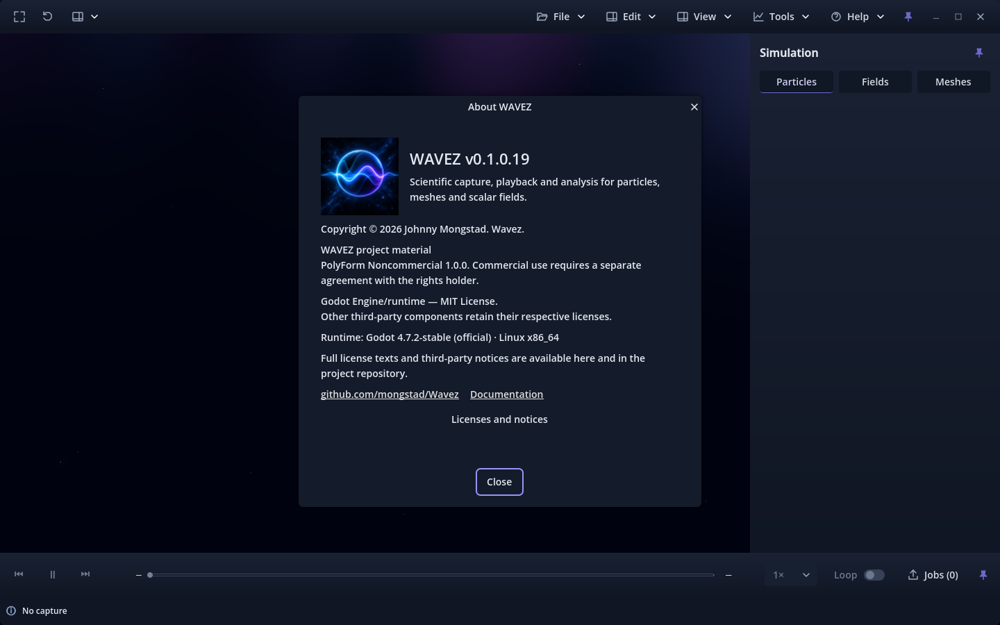
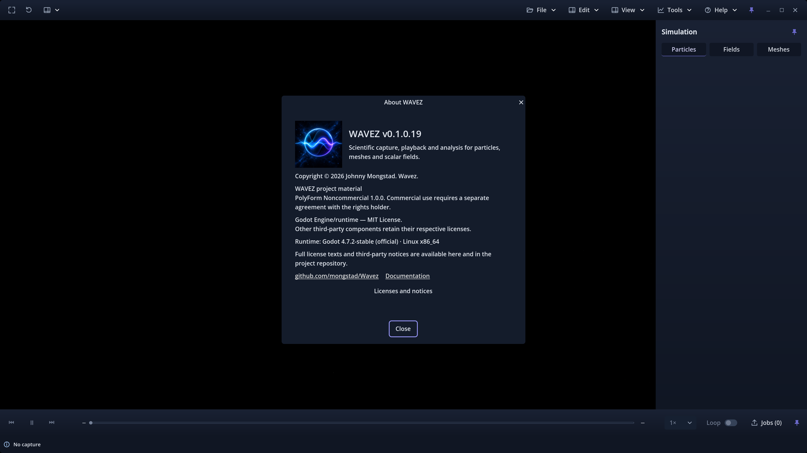
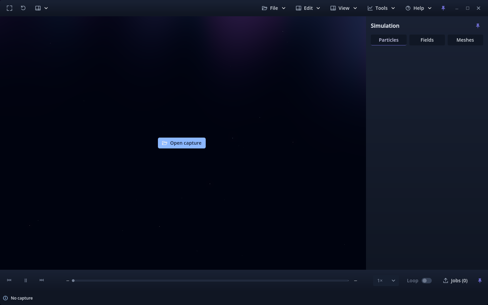
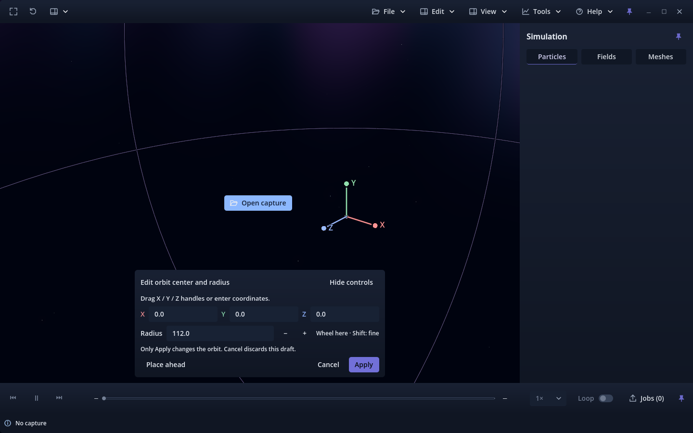

# Issue #176 — rounded outer surfaces, pending owner review

Recorded 2026-10-02 against accepted main `29072a8` (owner-merged PR #183),
candidate build 19. #176 was the sole Ready Project item. The exact owner-linked
branch `176-ux-add-subtle-corner-rounding-to-custom-dialogs-and-windowed-shell`
was already checked out, clean and identical to accepted local/main and
origin/main. Origin was fetched/pruned; the previous local #180 branch was absent.
#175 is merged into this baseline. #161 remains open; its shared-framework
coordination is conditional on landing first, not an omitted merged predecessor.

The [current behavior and inventory](../../ROUNDED_SURFACES.md) describes the
shared six-pixel radius, square embedded-header joins, cached mode-dependent
shell styles and square scientific viewport. Current documentation is updated;
prior reports and review-time evidence remain as written. No scientific/runtime
controller or format implementation was changed. The only existing validation
harness adjustment is a 1e-6 pixel tolerance for KWin restoration coordinates,
replacing exact float equality; width/height/position must still agree.

## Final results

Godot 4.7.2 stable `ed1daf0bf`, NVIDIA RTX 3070 Ti, driver 615.71.09; KDE Plasma
native Wayland and X11/XWayland. External release templates; isolated package
profiles. No engine, template, binary, cache or scientific capture is committed.

| Validation | Forward+ | Compatibility |
|---|---:|---:|
| Focused source corners/seam, native Wayland | 100 PASS | 100 PASS |
| Focused Linux release package, native Wayland | 100 PASS | 100 PASS |
| Existing shell/menu/tool/scientific-state regression, X11 | 659 PASS | 659 PASS |
| Orbit-editor accepted-main comparison, candidate / baseline checks | 829 / 408 PASS | 829 / 408 PASS |
| Playback/idle profile, candidate / baseline checks | 44 / 44 PASS | 44 / 44 PASS |
| KDE chrome resize/minimize/maximize/fullscreen/close | 76 PASS, 18 stages | 76 assertions, 18 stages; strict diagnostic gate failed |

Focused reports: [Forward+ source](forward-source.json),
[Compatibility source](compat-source.json), [Forward+ package](forward-package.json),
[Compatibility package](compat-package.json). All four rendered **actual 3840 × 2160**
windows at content scales 2.0 and 2.5, plus 1440 × 900 and 970 × 600.
They sample both About seam edges above/across/below the header/body boundary,
check mode-dependent square/round cached styles, internal square joins, dimensions,
preferences footer bounds and camera/scientific state preservation.
Visual inspection covers shell, About, shortcut editor, orbit editor and Tools.

Clean final Godot import, Python compile, `git diff --check` and
`python -m unittest tests.test_application_version` (**2 tests**) passed.
No new build increment beyond the single accepted-main + 1 candidate is proposed.

## Scientific and draw comparisons

[Forward+ orbit comparison](forward-orbit-comparison.json) and
[Compatibility orbit comparison](compat-orbit-comparison.json) match **300 camera
samples and 72 playback samples per renderer**, all **eight exported RGBA frame
pairs** (four per renderer), and byte-identical timing sidecars. Whole fixture
hashes remained unchanged. These exports exclude application UI, whose requested
outer-surface pixels intentionally change. The six stationary editor cases had
zero additional draws on Forward+; Compatibility had zero in five and **one**
in the field case. This remains below the existing suite's accepted bound and is
reported explicitly, not described as universally zero.

[Baseline Forward+](baseline-forward_plus-profile.json) /
[candidate Forward+](candidate-forward_plus-profile.json) and
[baseline Compatibility](baseline-gl_compatibility-profile.json) /
[candidate Compatibility](candidate-gl_compatibility-profile.json) use the same
two-second mixed particle/signed-field/stable-mesh fixture. All **nine source
records** were read strictly before measurement. Each run verified five strict
selected field oracles, complete-file SHA-256 and unchanged source stat.
Baseline/candidate oracle lists and committed playback endpoints matched exactly.

All seven stationary phases per run recorded **zero additional draws** and
unchanged pixels/camera/sample. Full playback wall time was 1.997 → 1.989 seconds
on Forward+ and 1.998 → 1.889 seconds on Compatibility. Existing five-second
orbit phases measured 60.20 → 60.19 FPS and 60.20 → 60.20 FPS respectively.
No slowdown or continuous idle redraw was observed on these fixtures. This is
short, uncontrolled-desktop evidence with other validation windows present during
some phases; no production performance, GPU isolation or statistical significance
is claimed. No production simulation or long capture was rerun.

## Diagnostics, failed attempts and limits

The source/package focused matrix passed while retaining the exact libdecor GTK
fallback pair reproduced on accepted main. Full logs are preserved:
[baseline Wayland startup](baseline-wayland-startup.txt),
[Forward+ source](forward-source-native.txt),
[Compatibility source](compat-source-native.txt),
[Forward+ package](forward-package-native.txt),
[Compatibility package](compat-package-native.txt).
No other diagnostic is accepted by the focused runner. The baseline startup also
records the Compatibility shader-cache recompilation warning described below.

[Forward+ KDE report](forward-kde-chrome.json) records all 18 compositor stages
and 76 checks. Compatibility also completed 18 stages and 76 assertions, but its
wrapper rejected `WARNING: Failed to load cached shader, recompiling.` despite
repeat attempts. That warning also appeared on accepted main. Therefore its
strict KDE validation is **qualified/failed at the diagnostic gate**, not a clean
suite PASS. [Compatibility stage evidence](compat-kde-chrome.json) and
[final native log](compat-kde-native.txt) retain the exact outcome.

Earlier attempts: the new test initially needed an explicit float declaration;
Compatibility shell initially rejected the same shader-cache warning, then passed
on repeat; KWin exact coordinate equality failed on a ~1e-13 pixel difference and
was corrected to a 1e-6 pixel tolerance. A first profiling fixture contained an
inactive second volume, unsupported by the existing selected-field verifier;
a second fixture omitted mandatory stable mesh IDs. Both were replaced by the
fully validated nine-record fixture. These attempts are not successful checks.
An extra X11 package run passed but its 4K request was clamped by KDE; the final
Wayland matrix above verifies actual 4K rendered dimensions.

The native OS window remains rectangular: visible Wavez chrome is rounded without
masking scientific content or adding platform-specific shape/transparency hacks.
Physical 4K monitor/compositor scaling, mixed monitors, real pointer-driven
resize/drag feel, Windows and macOS remain untested. File/Tools redesign under
#161 is not included. Owner judgment of visible shell corners and edge softness
is required; automated results are not acceptance.

## Reproduction and owner review

```sh
python tools/validate_rounded_surfaces.py --godot /path/to/godot --output-dir /tmp/rounded-source --renderer forward_plus --display-driver wayland
python tools/validate_rounded_surfaces.py --godot /path/to/godot --output-dir /tmp/rounded-package --renderer gl_compatibility --display-driver wayland --export
python tools/validate_viewer_shell.py --godot /path/to/godot --output-dir /tmp/shell --renderer forward_plus
python tools/validate_window_chrome.py --godot /path/to/godot --output-dir /tmp/chrome --renderer forward_plus --display-driver wayland
python tools/validate_orbit_center.py --godot /path/to/godot --reference-root /path/to/accepted-main-snapshot --output-dir /tmp/orbit --renderer forward_plus
```

Repeat with the other renderer and use new output directories. The playback comparison uses `tools/profile_paused_rendering.py` with
`--viewer-dir` pointing to each baseline/candidate viewer, a shared single-field
mixed `--capture`, and `--seconds 1 --actions --full-playback --hash-source`.
Follow the [exact owner checks](../../ROUNDED_SURFACES.md#owner-verification-before-acceptance).
No merge, auto-merge, issue closure, board completion or later issue was performed.








