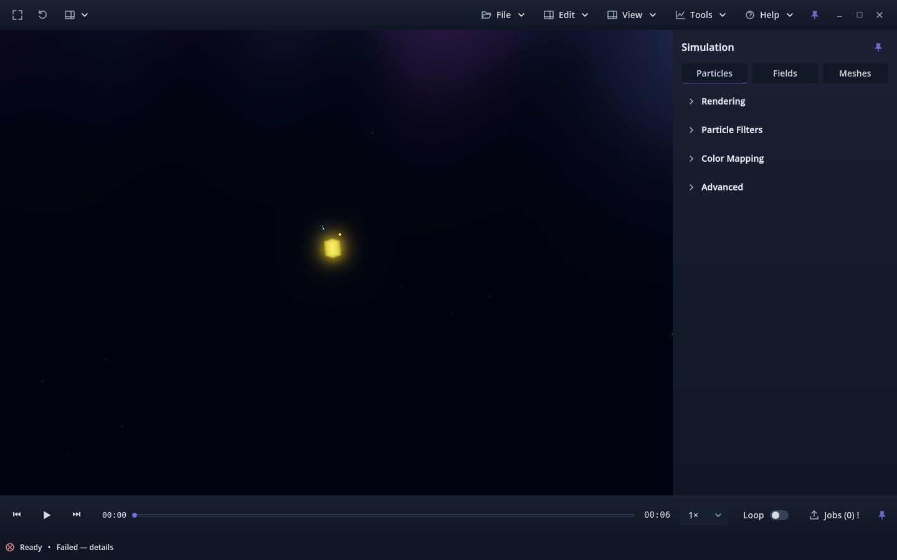
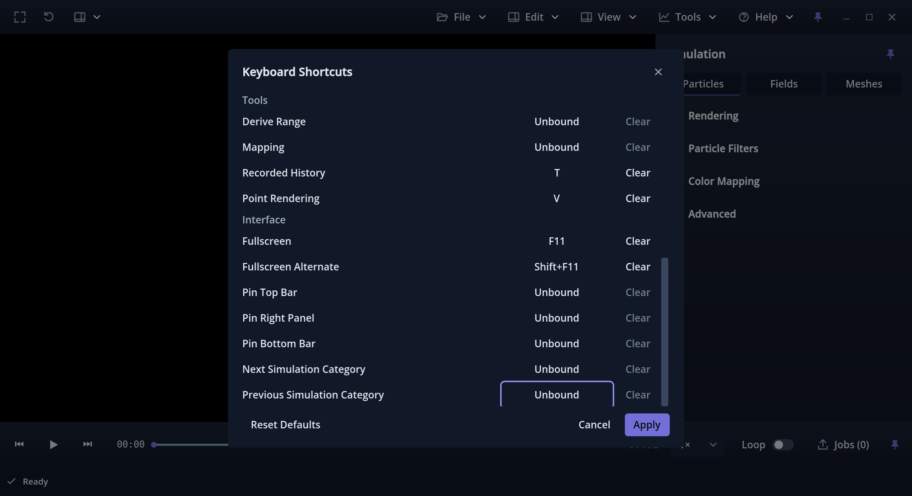

# Issue #180 — shell label removal, pending owner review

Recorded 2026-10-02 on accepted main `b76b4fb`, candidate `v0.1.0.18`.
Issue #180 was the sole Ready item on Wavez Development Project 1. The exact
owner-linked branch is `180-ux-remove-wavez-text-from-main-shell-top-bar`; it
started at the same commit as local/main and origin/main with a clean tree.
Previous PR #177 was owner-merged at that baseline, origin was fetched/pruned,
and the previous local issue branch was already absent. No predecessor is listed
on #180; all accepted main work is present.

## Change

Remove the visible WAVEZ Label and its now-unused window-drag signal hookup.
Move the existing Frame scene / Reset camera / Navigate container to the first
position in the command row. The existing 12-pixel margin, 8-pixel separation,
48-pixel bar, flexible blank drag area, menus, pin and window controls remain.
Blank bar and flexible drag-area signals still invoke the same native window
movement and double-click maximize/restore handler. No invisible label or fixed
spacer reserves its former width. About, application name and branding assets
are unchanged. The policy-required candidate build increases once from 17 to 18.

Current status and the shell behavior document describe this refinement.
Prior reports, screenshots and review-time evidence retain their original wording.
No scientific, camera, playback, capture, preference or export implementation changes.
Application-UI-inclusive exports naturally show the removed label; this is the
requested presentation change, not a scientific pixel-equivalence claim.

## Validation

Godot 4.7.2 stable `ed1daf0bf`, NVIDIA RTX 3070 Ti; KDE through X11/XWayland.
Existing native regressions used tiny synthetic fixtures. The Linux packages used
externally installed release templates, isolated preference profiles and normal
application startup, plus the existing validation autoload. Packages and runtime
binaries remain outside the repository.

| Check | Forward+ | Compatibility |
|---|---:|---:|
| Existing native shell regression | 659 PASS | 659 PASS |
| Linux release package controls/preferences + fresh-process restart | 213 PASS | 213 PASS |

[Forward+ shell](forward-shell.json), [Compatibility shell](compat-shell.json),
[Forward+ package](forward-package.json), [Compatibility package](compat-package.json)
record all checks and actual runtime geometry. Every fixture's complete-file SHA-256
remained unchanged. Shell checks cover menu hierarchy/routes, About identity,
opening/error recovery, camera reset, scientific state, presets, tools, fullscreen,
responsive dock layout and production export routes. Package checks cover active
camera actions, menus, pins, fullscreen restoration and preference restart.

Godot import: PASS without errors/warnings. `python -m unittest
tests.test_application_version`: **2 tests PASS**. `git diff --check`: PASS.
No new permanent test suite was needed for this small removal.

Commands (from the repository root; output directories must be new):

```sh
python tools/validate_viewer_shell.py --godot /path/to/godot --output-dir /tmp/shell-forward --renderer forward_plus
python tools/validate_viewer_shell.py --godot /path/to/godot --output-dir /tmp/shell-compat --renderer gl_compatibility
python tools/validate_keyboard_shortcuts.py --godot /path/to/godot --output-dir /tmp/package-forward --renderer forward_plus --export
python tools/validate_keyboard_shortcuts.py --godot /path/to/godot --output-dir /tmp/package-compat --renderer gl_compatibility --export
python -m unittest tests.test_application_version
```

Visual inspection confirmed no shell label or label-sized gap at the left edge,
aligned camera controls and retained menus/window controls in source and package
screenshots. The normal source view and scaled package view are preserved here:





## Diagnostics and limitations

Both native shell runs had no errors/warnings. The existing package validator
permits only previously baseline-reproduced Godot shutdown diagnostics documented
under [#175](../issue-175/README.md#diagnostics-earlier-failures-and-limits):

- Both first-process package runs reported one nonexistent `focus_entered`
  disconnect and one nonexistent `tree_exited` disconnect on shutdown.
- Compatibility restart reported two texture cleanup messages of 349524 leaked
  bytes each after the existing dual-viewer lifecycle.

Exact logs are preserved in [Forward+ native](forward-package-native.txt),
[Forward+ restart](forward-package-restart.txt),
[Compatibility native](compat-package-native.txt) and
[Compatibility restart](compat-package-restart.txt). No other diagnostics were
accepted. The checks passed with these known diagnostics, not a clean-log claim.
The baseline was established by #175; it was not rerun for this label-only change.

The package tests requested 3840 × 2160 at content scales 2.0 and 2.5, but KDE
constrained both to **2560 × 1394**. Actual logical dimensions were 1280 × 697
and 1024 × 557.6. These prove the recorded scaled layouts only. Physical 4K/KDE
compositor scaling remains **unverified**; no Xvfb/alternate 4K display was available.
Normal and compact 1440 × 900, 970 × 600 and isolated 640 × 480 package checks
passed. The product's normal 970 × 600 minimum is unchanged.

Real pointer-driven window drag/maximize feel, native Wayland, mixed monitors,
Windows and macOS were not tested. No production capture or scientific simulation
was rerun; no new deterministic scientific frame comparison was necessary for
this presentation-only removal. Automated checks do not establish owner acceptance.

## Owner verification before acceptance

1. Launch the candidate normally on both Forward+ and Compatibility, including a
   Linux release package. Confirm the upper-left camera controls start at the
   normal margin, with no WAVEZ text or leftover gap, before and after opening a capture.
2. Click Frame scene, Reset camera and Navigate; exercise Free camera and Auto
   orbit. Open File, Edit, View, Tools and Help and confirm their existing routes.
3. Drag a blank portion of the top bar to move the window; double-click it to
   maximize and restore. Exercise the top pin and window minimize/maximize/close
   controls; enter Fullscreen and press Escape to verify restoration.
4. Repeat at 970 × 600 and on a physical 4K KDE display at the owner's normal
   compositor scaling. Check alignment, spacing, readable menus and hit targets.
5. Open Help → About WAVEZ: branding remains present and the candidate identity
   is `v0.1.0.18`. Open a capture and check ordinary playback/export behavior.

Stop for owner review; no merge, auto-merge, manual issue closure or board completion.
