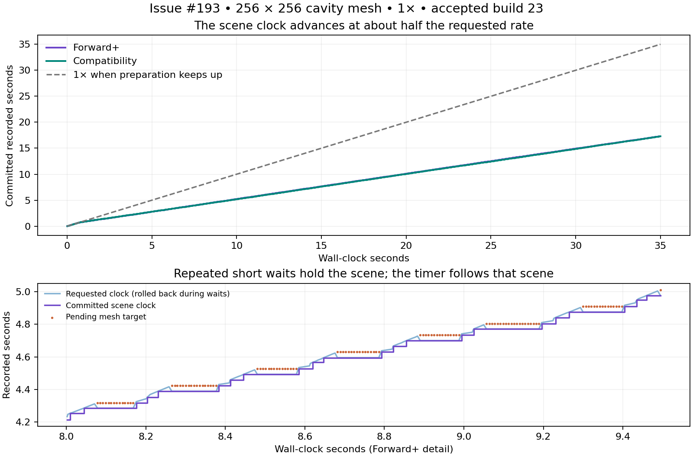
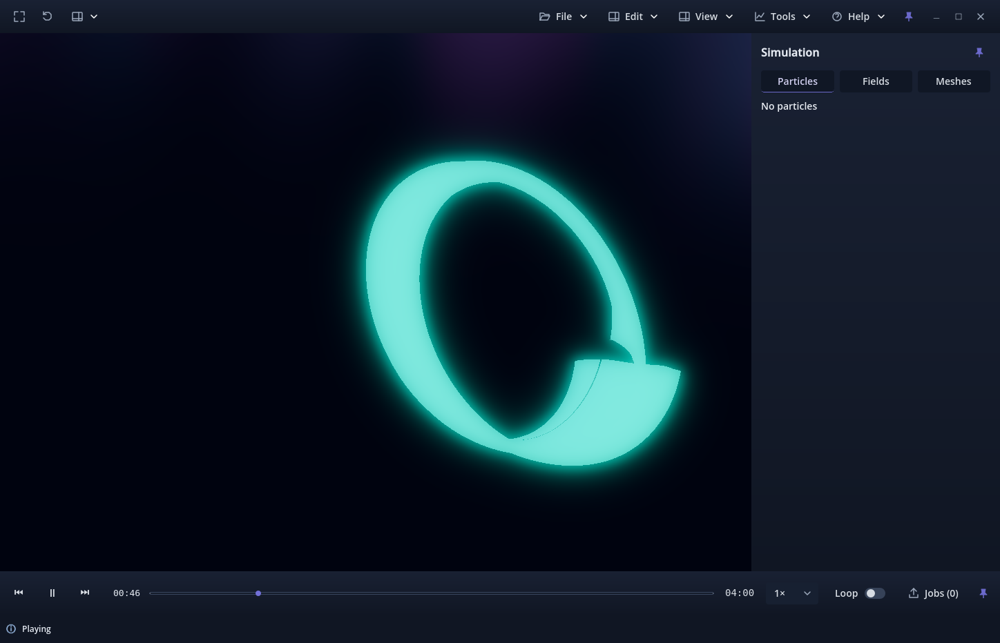

# Issue #193 — Mesh cache, timeline and timer investigation

Investigation of accepted `991a55abf14869f6df1424f6563d7485c70a689f`
(PR #192, build 23), measured 2026-10-02. #193 was the sole Ready issue, first
on Wavez Development; the existing linked branch was checked out at that base.
This report and opt-in instrumentation propose build 24 for owner review.
**No playback, cache, timer, timeline or export behavior is changed.**

## Findings

1. **Mesh preparation exists and works, but cannot sustain 1× here.** One CPU
   worker prepares the current sample pair plus up to four future pairs. The
   adaptive allowance admits all five on this host. Preparation takes about
   **207 ms per pair without a selected scalar, 243–248 ms with `radius`**;
   the approximately 10 Hz source needs a new pair about every 100 ms at 1×.
   The initial cache drains, after which playback repeatedly waits for the next
   pair. There were no admission failures, corrupt-sample errors or unbounded
   cache growth in these observations. Healthy admission is not sufficient
   preparation throughput.
2. **The bar already includes meshes.** Teal is the intersection of prepared CPU
   intervals for every required visible layer, including mesh pair keys. Blue is
   selected-field coverage; a mesh-only scene has no blue interval. Five ready
   pairs span about **0.5 s of 240 s**. At the measured 818 px track width this is
   **1.70 px**; the native thumb is 12 px. Once the worker falls behind, one ready
   pair spans about 0.1 s / **0.34 px**. The band sits behind the thumb, so real
   preparation is easy to miss. GPU staging is not what this band measures.
3. **The elapsed timer is correct for the committed scene.** It displays
   `(committed_sample.requested_time - first_source_time) / 1.0`, floored to
   completed seconds. It is neither a stopwatch nor the lower source sample's
   timestamp. The label refreshes each process callback. Across **29,071 observed
   callbacks**, its text always matched the committed-clock formatting oracle.
4. **The reported two-to-three seconds are real transport slowdown.** The first
   35 s Forward+ run advanced only **17.290 s**; Compatibility advanced **17.298 s**.
   Consecutive whole-second label changes averaged **2.066 / 2.070 wall seconds**.
   With `radius`, the mean was **2.435 / 2.447 wall seconds**. Flooring explains
   the stepped label, but does not cause this sustained loss of recorded-time rate.
5. **High render cadence and slow progression coexist.** Those 35 s runs drew
   at approximately **141 / 125 callbacks per second**, while committing about
   14 samples per second in Forward+. Repeated copies of the held scene still
   render. Between holds, stable-topology positions interpolate on the GPU;
   scalar colors retain the established held-source semantics.
6. **Classification:** intentional scientific backpressure, a CPU preparation
   throughput shortfall on this workload, and weak presentation of short readiness
   windows/recurring short waits. We found no wrong 1× multiplier, deliberate
   slow-motion setting, missing mesh-coverage path, or multi-second label refresh
   interval. Short individual holds do not cross the existing 400 ms continuous
   stall threshold, so status generally remains **Playing** despite cumulative
   slowdown. This is a presentation limitation, not evidence that time advances
   normally.
7. **Recommended follow-up:** target the existing mesh CPU pair pipeline, with
   a measured budget below 100 ms per new pair for this source at 1×. Preserve
   its bounded memory, exact source checks and committed-scene contract. No
   particular optimization patch is yet proven sufficient or approved. Do not
   advance a cosmetic timer while scientific content waits, or enlarge the cache
   as the sole sustained-throughput fix. Any status clarification for repeated
   short holds is a separately reviewable presentation change. Stop here for
   owner review before implementing either.



## Authoritative paths

| Concern | Existing path and behavior |
| --- | --- |
| Cache demand | [`mesh_playback.gd:104–164`](../../../viewer/layers/mesh_playback.gd#L104): `_jobs()` requests current + four directional future pairs; `request()` applies RAM admission. Current + at most one staged GPU mesh are retained per visible mesh; other lookahead remains CPU-only. At most one GPU upload per process frame. |
| Worker | [`mesh_buffer.gd:61–145`](../../../viewer/layers/mesh_buffer.gd#L61): one low-priority thread, private file handle, finite cache, obsolete-job pruning and cancellation. Each job decodes/validates both endpoints and calls `MeshPrepare.pair()`. Adjacent jobs decode their shared endpoint again. |
| CPU work | [`mesh_prepare.gd`](../../../viewer/layers/mesh_prepare.gd): source-to-display positions, topology/normals, optional scalar colors, index preparation, morph displacement and bounds. GPU submission is separate. |
| Clock | [`main.gd:353–388`](../../../viewer/main.gd#L353) passes engine delta to [`scene_layers.gd:332–385`](../../../viewer/layers/scene_layers.gd#L332). Pumps must succeed before `requested_time += delta * physical_rate`. Scientific display requests target 30 Hz. Pending sampling rolls requested time back to the last committed time; the mesh controller retains the pending target. Its later successful pump commits that target and resets `display_accum`. Waiting time is not accumulated for catch-up. |
| Commit/interpolation | [`scene_layers.gd:223–294`](../../../viewer/layers/scene_layers.gd#L223) publishes clock and per-layer source indices together. [`mesh_view.gd:64–79`](../../../viewer/layers/mesh_view.gd#L64) sets GPU blend weight from the committed pair alpha; no new geometry is generated for every rendered frame. |
| Elapsed label | [`viewer_transport.gd:152–181,219–229`](../../../viewer/ui/shell/viewer_transport.gd#L152) refreshes each callback, derives elapsed from the committed clock at normal rate 1.0. [`time_seek_popover.gd:32–36`](../../../viewer/ui/shell/time_seek_popover.gd#L32) floors whole seconds. Selected speed does not rescale nominal elapsed/total labels. |
| Position and coverage | Commit sets slider value to the lower **union sample index**, not fractional requested time. [`prepared_timeline.gd:64–116`](../../../viewer/ui/shell/prepared_timeline.gd#L64) refreshes readiness at most every 200 ms, recognizes mesh `ready_keys`, intersects visible-layer intervals and maps source times onto the shared sample-index axis. The slider therefore moves at source-boundary cadence even when geometry interpolates more frequently. |
| Status | [`scene_layers.gd:332–341,383–384`](../../../viewer/layers/scene_layers.gd#L332) resets its stall timer on progress; [`viewer_status.gd:142–177`](../../../viewer/ui/shell/viewer_status.gd#L142) refreshes approximately every 200 ms. Buffering during play requires a continuous 400 ms hold. The measured holds were usually 0.11–0.15 s each. |
| Export boundary | [`render_job.gd:15–16`](../../../viewer/video/render_job.gd#L15) selects `start + n/fps * rate`; [`render_worker.gd:186–197`](../../../viewer/video/render_worker.gd#L186) samples that time synchronously through the shared sampler. Interactive wall-clock waits do not determine output frame timestamps. This is a code trace, not a newly executed video-export regression. |

## Measurements

Real source: `cavity_collapse_torus_channels_240s.ssc`, 4,093,738,157 bytes,
one stable-topology `collapse_surface`, 65,536 vertices, 130,050 triangles,
2,401 samples over 0–240 s. Recorded vertex scalars are `radius`, `z_height` and
`twist_phase`; positions are float32 and vertex IDs int64. Source timestamps are
used as recorded, not assumed to be exact decimal tenths. Complete-file strict
verification passed all 2,401 records. SHA-256 still matches the #191 evidence;
see [provenance](provenance.json) and [verification output](strict-verification.txt).

Host: AMD Ryzen 7 5800X, 8 cores / 16 threads, 50,404,560,896 physical bytes
(46.94 GiB), RTX 3070 Ti, NVIDIA 615.71.09, Godot 4.7.2, native KDE/Wayland.
Default window was 1448 × 932 including the server-reported surface;
native fullscreen was 2560 × 1440. Runs were sequential, with automatic ordinary
viewer processing, 3 s paused warm-up, orbit disabled, and no forced playback
ticks, fixed FPS, cache enlargement, fake memory or source modifications.

| Case | Wall seconds | Recorded seconds per wall second | Draw callbacks/s | Holds | Mean wall seconds per timer-second change |
| --- | ---: | ---: | ---: | ---: | ---: |
| Forward+, default color, 1× | 34.990 | 0.494 | 140.6 | 167 | 2.066 |
| Compatibility, default color, 1× | 35.002 | 0.494 | 124.9 | 167 | 2.070 |
| Forward+, default color, 0.25× | 12.016 | 0.250 | 143.6 | 0 | 3.996 |
| Compatibility, default color, 0.25× | 12.032 | 0.249 | 129.7 | 0 | 4.007 |
| Forward+, reverse from 120 s, −1× | 15.016 | −0.506 | 140.3 | 69 | 1.979 |
| Compatibility, reverse from 120 s, −1× | 15.002 | −0.508 | 124.0 | 70 | 1.958 |
| Forward+, `radius` from 40 s, 1× | 15.034 | 0.431 | 143.0 | 60 | 2.435 |
| Compatibility, `radius` from 40 s, 1× | 15.003 | 0.430 | 125.6 | 60 | 2.447 |
| Forward+, native fullscreen, `radius`, 1× | 15.013 | 0.431 | 142.8 | 59 | 2.451 |
| Compatibility, native fullscreen, `radius`, 1× | 14.994 | 0.426 | 135.3 | 60 | 2.426 |

The 0.25× controls consume 2.5 pairs/s and have no holds. In the first 0.4 s of
the fully warmed 1× Forward+ run, committed time remains within 34.3 ms of wall
time, consistent with the 30 Hz display cadence; slowdown follows depletion.
This distinguishes ordinary rate calculation from the underflow behavior.

Representative Forward+ correlation (full one-second trace in
[correlation.csv](correlation.csv); exact metrics in [summary.json](summary.json)):

| Wall s | Requested s | Committed s | Pending mesh target s | Lower source index | Label | CPU ready pairs |
| ---: | ---: | ---: | ---: | ---: | --- | ---: |
| 0.007 | 0.007 | 0.000 | — | 0 | 00:00 | 5 |
| 5.002 | 2.792 | 2.792 | 2.825 | 27 | 00:02 | 1 |
| 10.001 | 5.186 | 5.186 | 5.221 | 51 | 00:05 | 1 |
| 15.002 | 7.695 | 7.680 | — | 76 | 00:07 | 1 |
| 20.002 | 10.084 | 10.084 | 10.118 | 100 | 00:10 | 1 |
| 25.001 | 12.510 | 12.503 | — | 125 | 00:12 | 1 |
| 30.002 | 14.899 | 14.899 | 14.927 | 148 | 00:14 | 1 |

Forward+ spent an observed 18.947 s in 167 no-progress wait intervals. Their mean
was 113 ms and maximum 160 ms; none crossed the continuous status threshold.
This sampled hold sum is not an exact subtraction from elapsed wall time: the
pending target advances on recovery, commits are quantized, and boundary intervals
are sampled. Engine deltas summed to 35.006 s over the 34.990 s observation,
ruling out a 0.5× engine-time scale (reported scale/rate were both 1).

The quota peak was **1,073,267,600 bytes / 1023.55 MiB**, five prepared pairs,
one in-flight charge of 214,653,520 bytes and at most one GPU stage. The steady
cache commonly had only one ready pair. These are conservative accounting
charges, not actual RSS. Forward+ main callback p95 was 3.656 ms, maximum 17.574 ms;
mean GPU stage submission was 6.056 ms. No RAM refusal explains the waits.

A separate opt-in decode probe at `radius`, 80 s measured **245.49 ms total
worker time per completed pair**, of which **95.94 ms** was in the two
decode/validation calls. The remaining **149.55 ms** includes pair preparation
and worker bookkeeping; it is not a separately isolated normals measurement.
Reusing an adjacent decoded endpoint is a concrete optimization candidate, but
these totals show that decode reuse alone cannot plausibly reach 100 ms.
Do not select a broad concurrency or cache-policy redesign from this report alone.

The final build-24 smoke run disabled the detailed `PlaybackProfile` timers:
`radius` still advanced at **0.425 recorded s/wall s**, with 247.79 ms per completed
pair and zero label mismatches. The observer remained enabled. Its final memory
snapshot had zero process swap and 867.5 MiB peak RSS; this is not a system-wide
swap-pressure test. A separate camera audit confirmed that the active viewport
camera belonged to the observed viewer, with no additional main scene.



## Reproduce and review

The opt-in harness is [`profile_mesh_transport.gd`](../../../viewer/layers/profile_mesh_transport.gd).
It does not run during ordinary application startup. Write a job outside the repo:

```json
{
  "capture": "/absolute/path/cavity_collapse_torus_channels_240s.ssc",
  "output": "/tmp/mesh-transport/raw.json",
  "screenshots": true,
  "cases": [
    {"name": "forward", "start": 0, "seconds": 35},
    {"name": "quarter-speed", "start": 20, "rate": 0.25, "seconds": 12},
    {"name": "reverse", "start": 120, "rate": -1, "seconds": 15},
    {"name": "scalar", "start": 40, "channel": "radius", "seconds": 15},
    {"name": "fullscreen", "start": 60, "fullscreen": true, "seconds": 15}
  ]
}
```

Create the output directory first. From the repository root, using the externally
installed engine, run the following once per renderer in separate output directories:

```sh
XDG_CONFIG_HOME=/tmp/mesh-transport/config XDG_DATA_HOME=/tmp/mesh-transport/data \
  /absolute/path/godot --path viewer --script res://layers/profile_mesh_transport.gd \
  --rendering-method forward_plus --display-driver wayland --resolution 1440x900 \
  --audio-driver Dummy -- --mesh-transport-job=/tmp/mesh-transport/job.json
python tools/summarize_mesh_transport.py /tmp/mesh-transport/raw.json \
  --output-dir /tmp/mesh-transport/summary
```

Use `gl_compatibility` for the other renderer. `decode_probe: true` replaces the
worker with a subclass timing `super._decode` for a separate attribution run;
default measurements retain the product worker. `profile: false` disables the
existing stage profiler. No files are written during timed observation; bounded
case data is written afterward. Keep raw output outside Git: the committed summary
records its path/hash, and preserves a compact one-second correlation trace.

Owner checks before accepting the investigation:

1. Open the same source, select 1×, pause for at least 3 s, then time about 35 s
   of playback with a stopwatch. Compare the committed timer to the table;
   exact throughput depends on host conditions.
2. Open Tools → Performance and observe mesh CPU cache usage as Play consumes
   the initial five-pair window. Check the tiny teal span beside/under the thumb.
3. Select `radius`, seek near 40 s and repeat. Then try 0.25×: the expected
   no-underflow clock rate is one recorded second per four wall seconds.
4. Scrub to distant times, reverse, and use the application's Fullscreen action.
   Confirm that geometry, timer and slider remain mutually consistent.
5. Review/approve the diagnosis and choose a follow-up CPU optimization scope
   before authorizing a behavioral patch. This investigation does not establish
   that any proposed optimization meets the follow-up acceptance matrix.

## Validation and limits

- Ten native matrix observations, one decode attribution and one final smoke:
  29,071 callbacks, zero timer mismatches; no reported cache/pressure failures.
  Both renderers exercised normal processing, distant seeks, reverse playback,
  scalar selection and native fullscreen. These characterize the existing
  slowdown; they are not a passing 1× performance acceptance test.
- Full scientific source verification: **2401/2401 records**. Source SHA matches
  the accepted previous report. No simulation rerun.
- Version tests: **2/2 passed**. Python compile and `git diff --check` passed.
  Final Godot import completed with no errors/warnings after isolated settings
  and local socket access were available.
- Initial sandboxed import exited zero but logged denied editor sockets/settings
  writes; it was not counted as clean. See [original diagnostics](initial-sandbox-import.txt).
  Native runs emitted the known libdecor GTK fallback pair, retained verbatim in
  the `*-native.txt` logs. No product errors were suppressed. Plotting also used a
  temporary Matplotlib cache because the home configuration directory was read-only.
- Render cadence counts `frame_post_draw` callbacks, not independently measured
  monitor scanout or proof of unique scientific geometry every frame. Status and
  coverage use their normal UI refresh cadence. Timing is sampled, and CPU totals
  can include the edge of an in-flight job. Instrumentation overhead is not zero.
- Fullscreen measurements set native window mode; immersive edge-reveal/input
  gestures, physical 4K/mixed-DPI review, a continuous full 240 s traversal,
  all scalar channels, long soaks and other hosts/platforms were not tested.
- No playback implementation changed. Particle/field suites, packaged Linux and
  deterministic video export were not rerun in this investigation. A future fix
  must validate 1× when preparation keeps up, timer semantics, bounded preparation,
  reverse/scrub/fullscreen/channel changes, both renderers, field/particle
  transport and deterministic export before acceptance.
- Earlier #191, PERF-003 and other historical reports/evidence remain unchanged.
  The only existing runtime file change is the required candidate build identity.

**Pending owner review. No behavioral fix, merge or auto-merge is authorized by
this report.**
