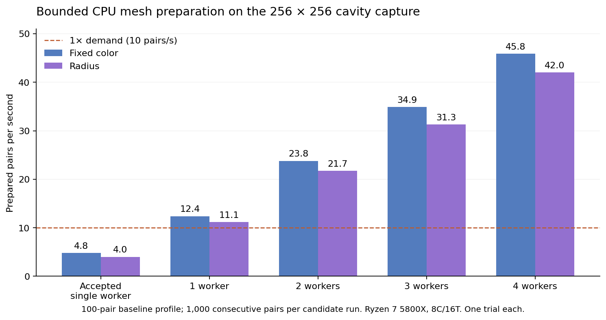

# Issue #195 — sustained CPU mesh preparation

Candidate **v0.1.0.25**, implementation `7f7f869b83c3d6bc205add23a5e46535921f0b7c`,
measured 2026-10-02–03 (Europe/Oslo), **pending owner review**.
The sole Ready issue was #195; work used the existing issue-linked branch
`195-perf-mesh-parallelize-cpu-mesh-preparation-for-sustained-real-time-playback`.
Accepted baseline: `0e4405580556306ce8fec0673f927b154caa04aa`, including owner-merged PR #194.

Four CPU workers sustained **45.85 fixed-color pairs/s** and **41.99 radius pairs/s**.
Both full 240-second Forward+ playbacks reached 240 recorded seconds in approximately
240 wall seconds, with **zero preparation holds and zero timer mismatches**.
The implementation changes CPU preparation and reuse; transport clocks, source
cadence, mesh quality, channels, GPU interpolation and export timing are preserved.



## Workload and method

The read-only acceptance file is `cavity_collapse_torus_channels_240s.ssc`:
4,093,738,157 bytes, SHA-256
`fa64ef312dec6d3cf55a45b197c0a4963e1fc21ef7eac25937b58739bc1b27c3`.
It has 2,401 mesh samples, 65,536 vertices and 130,050 triangles, with position,
triangle, vertex-ID, radius, z-height and twist-phase channels. Strict verification
of **all 2,401 records** passed; repeated independent source hashes stayed unchanged.
No scientific solver was run.

Host: Ryzen 7 5800X (8C/16T), 50,404,560,896 physical RAM bytes (46.94 GiB),
RTX 3070 Ti, NVIDIA 615.71.09, Godot 4.7.2 stable, Linux/KDE Wayland. Native
measurements requested a 1440×900 window. CPU comparisons ran serially, without
other validation processes. OS file caches were not flushed. These are individual
runs on this host, not confidence intervals or a hardware-independent guarantee.

[summary.json](summary.json) contains measured distributions, phase totals,
per-core host CPU counters, process CPU equivalents, cache/RAM bounds, raw artifact
paths and SHA-256 digests. Raw captures, executables and large frame traces remain
outside Git. The finite transport observer retains its observations, so its RSS
includes report overhead; its growth across successive cases is not a production
cache-retention measurement.

## Investigation before optimization

The accepted worker was instrumented before changing its algorithm. Each baseline
profile consumed 100 successive pairs starting at sample 100. The
[reproducible instrumentation patch](baseline-instrumentation.patch) contains only
phase timing and the benchmark harness. It applies to an archive of accepted main;
its three resulting scripts were compared byte-for-byte with the measured copy.
Historical [#193 evidence](../issue-193/README.md) remains unchanged.

Milliseconds of worker-slot work per completed pair:

| Phase | Before fixed | Before radius | Four workers fixed | Four workers radius |
|---|---:|---:|---:|---:|
| File I/O | 0.28 | 0.29 | 0.20 | 0.20 |
| Decompression | 6.01 | 6.06 | 3.30 | 3.27 |
| Assembly / typed conversion | 3.76 | 3.77 | 2.03 | 2.00 |
| Descriptor / commit validation | 0.44 | 0.44 | 0.25 | 0.24 |
| Stable-ID validation | 31.35 | 31.69 | 0.11 | 0.11 |
| Topology validation | 53.88 | 54.33 | 0.31 | 0.21 |
| Exact topology comparison | — | — | 0.14 | 0.14 |
| Position conversion | 12.09 | 12.08 | 11.54 | 11.46 |
| Normal generation | 41.66 | 41.94 | 45.70 | 45.27 |
| Scalar / fixed colors | 3.12 | 41.42 | 0.09 | 9.21 |
| Index packing | 11.63 | 11.68 | 0.22 | 0.21 |
| Next positions / bounds | 33.32 | 33.42 | 0.01 | 0.01 |
| Cached endpoint bounds | — | — | 5.43 | 5.38 |
| Morph delta | 6.04 | 6.09 | 7.24 | 6.99 |
| Other packing | 0.07 | 0.07 | 0.06 | 0.06 |
| Other measured worker work | 5.28 | 5.28 | 9.15 | 9.08 |
| **Total worker-slot time** | **209.19** | **248.80** | **86.05** | **94.16** |

The last row sums concurrent task durations; it is not wall time between completed
pairs. Residual worker work includes wrappers, source checks and bookkeeping,
not an isolated CPU-only kernel. Baseline wall time outside measured worker time
was about 0.14–0.15 ms per pair. The dominant costs justified endpoint/topology
reuse and coarse parallel jobs before lower-level optimization. Normals remain
the largest CPU cost. Stored/raw payload-hash buckets are zero under the **existing**
interactive integrity policy; descriptor, structure, decode and semantic validation
remain active. Strict verification remains the payload-integrity authority.

## Throughput and worker choice

Each candidate run consumed **1,000 consecutive pairs**, starting at sample 100,
using the ordinary five-pair rolling demand window, with no full-file preload.
This traverses 100 recorded seconds of new data. Native full-file runs below
provide the longer wall-clock test; success is not based only on these saturated
intervals. Baseline capacity was 4.78 pairs/s fixed and 4.02 pairs/s radius.

| Workers | Fixed pairs/s | Radius pairs/s | Fixed / radius process CPU cores | Fixed / radius peak RSS MiB |
|---:|---:|---:|---:|---:|
| 1 | 12.40 | 11.15 | 0.97 / 0.99 | 228.9 / 230.5 |
| 2 | 23.78 | 21.74 | 1.83 / 1.85 | 252.9 / 254.9 |
| 3 | 34.86 | 31.27 | 2.66 / 2.70 | 269.4 / 276.8 |
| 4 | **45.85** | **41.99** | **3.46 / 3.52** | **286.1 / 286.3** |

Four workers provide the best measured headroom while leaving substantial host
capacity. Their aggregate busy-lane equivalents were 3.95; process CPU equivalents
include startup/teardown and are sampled separately. Host-wide per-core utilization
is retained in the JSON because threads migrate and unrelated host work contributes.
First/last ten-second rates were 45.38/46.30 fixed and 41.48/42.28 radius: production
did not decay as the window traversed fresh samples. All saturated runs used zero
process swap; endpoint residency peaked at three to five samples in these runs.

With four workers, pair assembly **after endpoint reuse** averaged 12.05 ms fixed
(p95 13.21) and 20.91 ms radius (p95 22.56). Request-to-ready latency **including
queueing and endpoint preparation** averaged 98.18 ms fixed (p95 117.08) and
108.35 ms radius (p95 127.75). These are distinct from throughput. Decode-related
phases totaled approximately 5.77/5.71 worker-ms per pair; remaining measured work
was approximately 80.28/88.45 ms. Full distributions for all counts are in the JSON.

## Implementation and ownership

The [current policy](../../MESH_PREPARATION_BUDGET.md) specifies the details:

- Up to four persistent low-priority CPU lanes, selected from CPU capacity and
  constrained by live physical RAM. Current/nearest pairs precede directional
  lookahead; canceled work keeps its charge until it retires.
- Independent file handles and endpoint keys containing path, source stamp,
  generation, object and sequence. Five adjacent pairs share six endpoints.
  Position conversion, normals, fixed colors and endpoint bounds are reused.
- Exact ordered-ID, count and connectivity comparison before stable-topology reuse.
  Mismatches receive full validation. Oriented indices and wire lines are shared;
  startup lanes may independently validate the initial endpoints.
- Scalar colors use a packed palette with unchanged clamp/round/nonfinite rules.
  Channel and colormap changes reuse source geometry but rebuild prepared colors.
- Separate bounded endpoint and pair shares. #191's division changes from four
  to five shares; fields reserve four shares instead of three. The pair estimator
  is unchanged. Physical headroom also bounds concurrent scratch. No swap capacity
  or whole-capture reservation is introduced.
- Existing GPU staging, one upload per frame, scientific inspection and strict
  synchronous export remain in their existing paths.

## Native transport and responsiveness

See the measured case table in [transport.md](transport.md). Forward+ fixed and
radius each ran the full 240-second file. Compatibility fixed/radius each ran for
90 seconds; reverse 1×, quarter speed, z-height, twist-phase and fullscreen each
ran for 40 seconds. These use the ordinary interactive loop, never forced ticks.

Forward+ p95/p99 main callbacks were **17.74/18.80 ms** fixed and **17.88/18.90 ms**
radius; maxima were 24.91 and 28.14 ms. Both observed approximately 143 draw
callbacks/s, which is not a physical monitor-FPS claim. Ready runway averaged
0.272/0.258 seconds, peaked at 0.5 seconds and stayed bounded to six decoded
endpoints. Demand-paced preparation is approximately 9.98 pairs/s because the
initial lookahead is already prepared before timing; saturated capacity is the
separate result above. Full-run peak RSS, including observation data, was
1,135.2/1,361.9 MiB, with zero process swap.

Real-capture source and packaged interaction tests measured cold scrub completion
at **122–163 ms**, active close at **1–4 ms**, and viewport camera-input dispatch
at **0.96–1.21 ms**. Per-channel switch distributions and callback costs are retained
in the JSON. These are programmatic input-dispatch measurements, not human
input-to-photon latency. Production fullscreen entry/exit, hide/reveal, rapid seeks,
all three scalar channels, palette changes, generation replacement, concurrent
publication cancellation and RAM refusal/recovery passed. A constrained four-lane
pool reduced itself to one active lane and continued to finish its window.
All four source/package RAM runs recorded zero system `pswpin`/`pswpout` delta.

## Regression results

| Check | Result |
|---|---|
| Native import | Pass, no errors/warnings |
| Mesh playback, headless | 2,731 checks, 0 failures |
| Mesh playback, Forward+ / Compatibility | 3,001 / 3,001 checks, 0 failures |
| Real-capture budget/lifecycle, source Forward+ / Compatibility | 207 / 210 checks, 0 failures |
| Real-capture budget/lifecycle, Linux release Forward+ / Compatibility | 207 / 209 checks, 0 failures |
| Payload integrity, including reuse with changed invalid IDs/indices | 479 checks, 0 failures |
| Particle playback | 2,457 checks, 0 failures |
| Rolling cache | 81 checks, 0 failures |
| Field parallel / concurrency | 1,800 / 109 checks, 0 failures |
| Field budget (192³), Forward+ / Compatibility | 56 / 56 checks, 0 failures |
| Performance maintenance | 66 checks, 0 failures |
| Current deterministic video, Forward+ / Compatibility | 235 / 225 checks, 0 failures |
| Accepted-baseline export comparison, both renderers | 46 checks, 0 failures; identical pixels, scientific sidecars and timing records |
| Application version | 2 tests, pass |
| Strict complete capture verification | 2,401 records, pass |
| Scene playback lifecycle | **51 checks, 1 pre-existing failure**, identical on accepted baseline |

The lifecycle failure is `incomplete append cannot publish a source timestamp`;
[baseline log](lifecycle-baseline.log) and [candidate log](lifecycle-candidate.log)
retain the exact result. It is outside this mesh optimization and was not changed.
Interaction counts can differ slightly because some checks run only when a tick
has pending work. Source/package runs used candidate build 25.

## Failed attempts and limits

Early development caught an overly large fixed endpoint-metadata charge that
refused the empty-mesh fixture; the final accounting passes the full mesh suite.
The new test helper initially mistook old-token cached frames for completed new
work; it now waits on current ready keys. A copied baseline needed Godot import,
and the first package attempt could not find installed templates because the test
runner over-isolated its data directory. Those setup failures were corrected and
rerun successfully. Initial parser errors during development were corrected before
the successful measurements. An early radius profiling JSON was accidentally
replaced by a candidate run; the published baseline radius metrics use the fresh,
verified repeat, not that overwritten report.

Native Wayland runs retained the known libdecor GTK initialization/fallback pair;
no other engine warnings/errors were accepted in the budget tests. Synthetic
payload tests intentionally exercise decoder errors according to their existing
oracle. Multi-hour playback, other physical RAM/CPU configurations, Windows/macOS,
physical mixed-DPI/4K, concurrent external simulations and subjective sustained
camera feel were not tested. Finite rolling ownership supports recordings longer
than RAM, but the four-minute file is not proof of an overnight soak.

## Reproduction and owner checks

Use an externally installed Godot executable and the original capture. From the
repository root, run (replace `/path/...` with real absolute paths):

```sh
python tools/profile_mesh_pipeline.py --godot /path/to/godot \
  --capture /path/to/cavity_collapse_torus_channels_240s.ssc \
  --output-dir /tmp/new-mesh-pipeline --pairs 1000
python tools/validate_mesh_budget.py --godot /path/to/godot \
  --capture /path/to/cavity_collapse_torus_channels_240s.ssc \
  --output-dir /tmp/new-mesh-budget --renderer forward_plus --export
python tools/verify_ssc.py /path/to/cavity_collapse_torus_channels_240s.ssc
```

For the baseline cost profile, archive commit `0e440558` to a separate directory,
apply `baseline-instrumentation.patch` there with `git apply --unidiff-zero`,
import its `viewer` with Godot, then
pass that directory with `--viewer` and `--workers 1 --pairs 100` to the profiling
tool. Do not replace the implementation branch. For transport, use
`res://layers/profile_mesh_transport.gd` with `--mesh-transport-job=/path/job.json`;
[transport-jobs.json](transport-jobs.json) records the measured cases. The former
`decode_probe` switch is superseded by the worker's phase counters. The summarizer
continues to read historical observation reports.

Before acceptance:

1. Open the cavity capture at 1×, first fixed color, then radius. Let each traverse
   the full file; the committed timer should track wall time without repeated holds.
2. Switch to z-height and twist-phase, change colormaps, scrub far apart, hide/reveal,
   reverse and use 0.25×. Confirm the selected sample/colors remain correct.
3. Orbit/zoom while playing, enter/exit fullscreen, move/resize the window, and close
   during a far seek. Confirm the interaction feels responsive on the owner display.
4. Review the pre-existing lifecycle failure and unrun platform/soak limits, and
   verify candidate BUILD is still current accepted main + 1 before merging.

No merge, auto-merge, issue closure or Project completion was performed.
