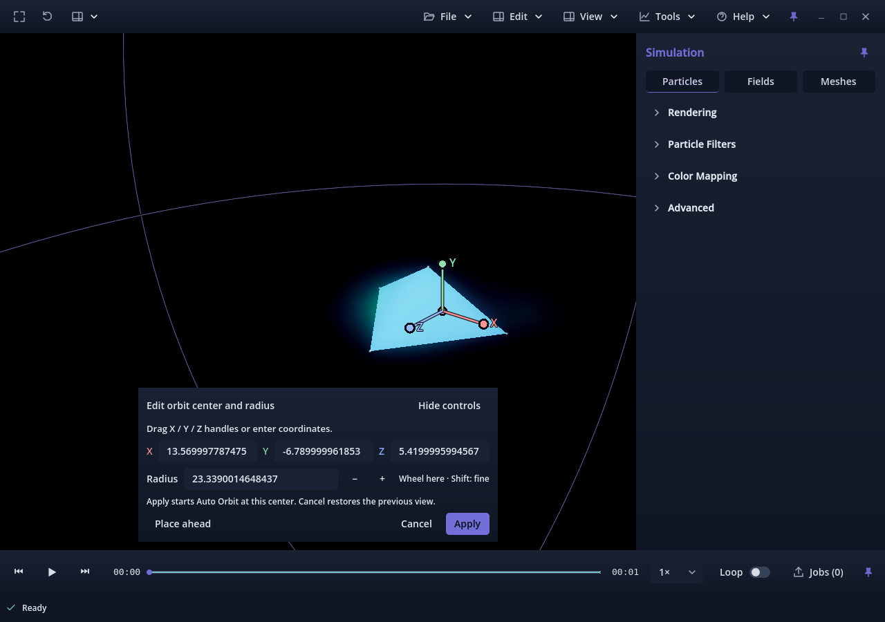
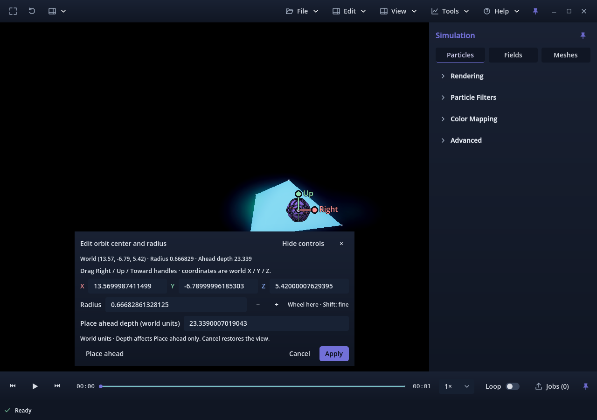
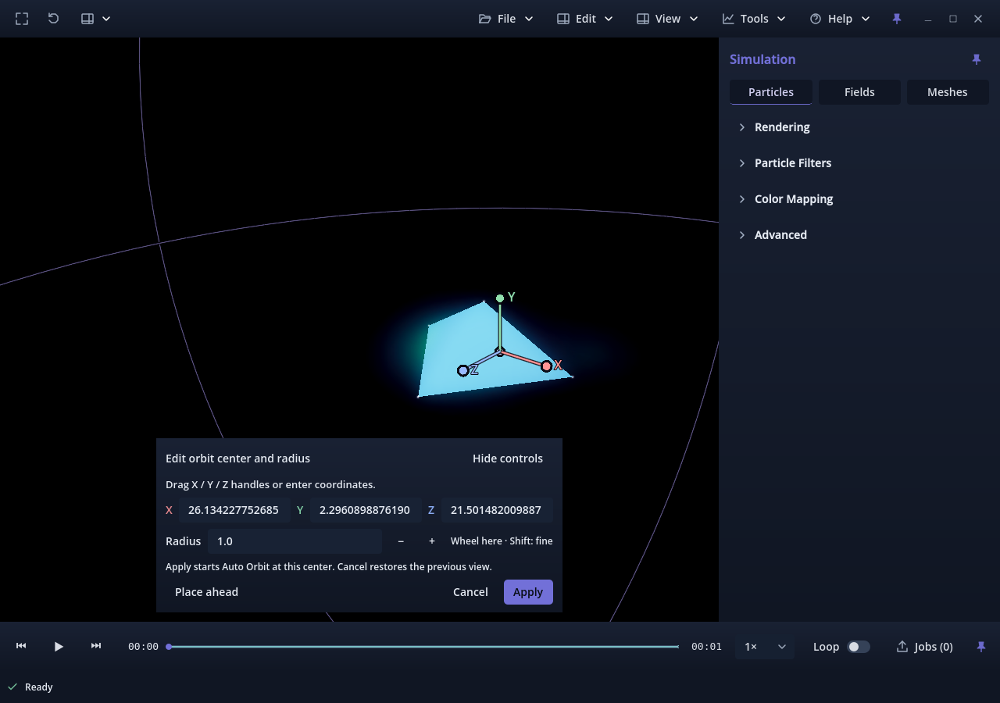

# Issue #212 — second-attempt review evidence

Date: 2026-10-09. Candidate v0.1.0.78; **pending owner physical review**.
Accepted baseline: `6bd497d60c75c435f38cdffe1dd87d8cdd56bc97`, PR #300.
The only Ready Project item was #212. The owner-created, issue-linked branch
`212-ux-nav-make-edit-orbit-center-view-relative-Attempt_02` was clean and exactly
at accepted main before edits. PR #301 was closed/discarded; no commits were
cherry-picked from it. Historical reports are not rewritten.

## Root cause established before implementation

On accepted main, editor radius initializes from `camera_distance`. Frame Scene
sets that distance to 2.8 bounding radii, so the default guide diameter is **2.8
times the entire scene bounding diameter**. Place ahead then uses radius as its
placement distance. Setting radius to 1 puts the camera on the sphere's surface,
which explains the enormous projected guide without any world-scale multiplier.
For the identical mixed fixture, initial radius was 23.3390014648437, scene
diameter 16.6707153320312, and the radius-one placement depth was
0.999999701976776. The root cause was measured before implementation and these same-fixture values
were repeated against an unchanged main archive; see
[baseline diagnostics](before.json) and the retained [diagnosis driver](baseline-diagnose.gd.txt).

A marker and the accepted-main guide remained at identical world coordinates
while translating the camera. This reproduction establishes the depth/scale
coupling defect, **not** the cause of every visual report in discarded PR #301.
The earlier unknown owner pose was not reconstructed or claimed resolved.

Source inspection also showed: Place ahead retains Button focus, which
blocks the existing Free Camera key path; unchanged fields are always parsed
back from formatted text; the editor has no explicit Escape/close cancellation.
The current patch addresses those cases without changing manual navigation.

## Before / after, annotated



**Before annotation:** Radius 23.339 is also the camera distance. The world-sphere
diameter is 280% of the scene bounding diameter; most of the guide is outside
the viewport. The scene and camera pose match the after image.



**After annotation:** Radius 0.666829 and ahead depth 23.339 are independent.
The sphere diameter is 8% of the transformed scene diagonal. Its center is at
world `(13.57, -6.79, 5.42)`. Right/Up handles show the entry-view axes; the Toward
axis is initially end-on and becomes available from an oblique view. This image
is a synthetic illustration, not owner acceptance of the visual experience.



**Radius-one annotation:** Accepted-main Place ahead uses depth 1, putting the
camera on the surface. The candidate keeps depth 23.339 when radius changes to 1;
its physical sphere is exactly a one-unit mesh scaled by 1. Both perspective and
orthographic pixel comparisons verify this independently of the UI text.

## Validation and limits

The [summary](summary.json) and per-run JSON files contain exact results, fixture
hashes, transformed bounds, draft values, camera matrices, renderer pixel errors,
and package hashes. [Final Forward+ diagnostics](precision-forward.json) store
full-precision numeric camera/center arrays in addition to the earlier compact
text snapshots. All generated captures and external runtimes remain outside
the repository. Native/package tests use Godot 4.7.2 on Linux/NVIDIA RTX 3070 Ti.

| Check | Result |
| --- | --- |
| Focused gizmo, headless | 2,772 checks, zero failures |
| Focused gizmo, native Compatibility | 2,833 checks, zero failures; 36 pixel comparisons |
| Focused gizmo, native Forward+ | 2,833 checks, zero failures; 36 pixel comparisons |
| Focused gizmo, release-template validation package, each renderer | 2,833 checks, zero failures; 36 pixel comparisons |
| Connected Auto Orbit, headless and both native renderers | 364 checks each, zero failures |
| Connected speed/hold/persistence, headless | 97 checks, zero failures |
| Application version | 2 tests pass; candidate v0.1.0.78 |
| Source preservation | 14 protected manual-navigation/background functions byte-identical to accepted main |
| Navigation suite, headless, main and candidate | **FAIL**: 1 identical failure / 1,393 checks |
| Navigation suite, each native renderer, main and candidate | **FAIL**: 1 identical failure / 1,747 checks |

The identical navigation failure is `Real process loop advances the held orbit
shortcut`. Direct held-orbit, steering, combined movement, and other assertions
complete, but the suites are **not PASS**. The baseline and candidate logs are
retained separately. This patch does not alter that shared input/process path.

The 10,000-scale fixture exposes accepted-main's degenerate float32 camera
frustum (`near=0.05000000074506`, `far=1166950.25`), producing
`create_frustum_points: Condition "!res" is true` in Compatibility. The
[baseline log](large-baseline.txt) records it. Large-scale gizmo measurements use
an explicitly recorded test near plane of `camera_distance * 0.00001`; the
production clipping policy is unchanged. Large-scale rendering with the original
near plane is **unverified**, not a passing candidate result.

Seven static asymmetric WVZ1 fixtures cover particles, transformed meshes,
transformed fields, mixed layers, 0.001/10,000 scales, off-origin bounds, and
separated lobes. Their scalar payloads vary with source time. The test compares
bounds to independently calculated transformed fixture geometry, verifies
source-time progression during chosen-center orbit, and checks scientific node
transforms and input SHA-256 hashes. It covers separate XYZ/depth/radius edits,
all three handles from an oblique view, immediate Place ahead→W, combined RMB/W,
configured held-orbit actions, both LMB inversion states, wheel zoom, normal and
Fullscreen, empty fallback, inside-sphere cues, radius-one geometry, a complete
fixed-plane revolution, repeated exact Apply/Cancel, and viewport PNG exclusion.

The pixel test renders a known unit sphere at the same world position in the
**production scientific World3D**, and compares it with the annotation viewport.
For the reference pass only, scientific layers, editor panel, and bloom are
hidden to prevent compositing/UI colors from contaminating the marker mask;
all are restored for normal screenshots. This is geometry/projection evidence,
not segmentation of an arbitrary research volume. Twelve comparisons occur
while actual movement keys remain held in the live Viewer process loop, sampling
both images from the same completed render frame. They do not manually update
the camera/guide, force a draw, or substitute projected-coordinate predictions.

The package checks use the external Linux release template and unchanged
production modules, with a temporary validation entry scene because release
executables do not honor editor `--script` startup. This is a **validation-entry
package**, not full coverage of the ordinary launcher, file picker, or workers.
The ordinary production package also built successfully.

Focused scope is appropriate: this is an editor/annotation change with two
narrow automatic-orbit dispatch sites and editor-only Escape precedence. Format,
playback/cache, shader payload, background, manual navigation and persistence
implementations are unchanged. Unrelated full suites and scientific simulations
were not run. Long sessions, mixed DPI/4K, physical mouse mappings, research-scale
visual feel, and full offline video trajectories were not validated. The transient
Apply-time plane is not added to preset/video schemas; offline orbit behavior
remains its existing contract.

Initial non-passing iterations included a fixture channel-shape error, unsupported
GDScript number formatting, default R resetting the test camera, mask contamination
by volume/fog/bloom/UI, an insufficiently oblique handle test pose, and an idle
`frame_post_draw` wait. These were corrected and clean runs replaced them; none
was counted as a pass. A release executable started with unsupported `--script`
was stopped and replaced with the proper validation-entry package. The initial
sandboxed native run had no display; authorized native runs used the real GPU.

## Reproduce

```sh
python tools/validate_orbit_gizmo.py --godot /absolute/path/to/godot \
  --output-dir /absolute/new/output --renderer forward_plus
# Repeat with gl_compatibility; add --export for a validation-entry package.
python tools/validate_camera_tumble.py --godot /absolute/path/to/godot \
  --output-dir /absolute/new/auto --renderer forward_plus --suite auto-orbit
python tools/validate_camera_tumble.py --godot /absolute/path/to/godot \
  --output-dir /absolute/new/navigation --renderer forward_plus --suite navigation
```

Use a fresh output directory for each run. Test fixtures are generated there.
Run the navigation command against an independent `git archive` of accepted main
as well; never switch implementation branches to construct the baseline.

## Owner verification before acceptance

1. Open the research-scale scene with your actual shortcut profile. Confirm
   W/A/S/D/Q/E, simultaneous RMB steering, your R/T orbit bindings, middle-button
   or wheel zoom, LMB tumble/invert-Y, speed controls and background before editing.
2. Aim at one lobe; open Navigate → Edit orbit center. Check the small default,
   its physical scale against a known feature, world values, and visible depth.
   Click Place ahead and immediately press W without clearing focus manually.
3. Fly around and behind the point. Its screen position should change, but world
   XYZ/radius/depth must remain fixed. Expose and drag each Right/Up/Toward handle;
   edit world XYZ, depth, and radius separately. Depth only affects the next Place
   ahead. Check radius 1 against known world dimensions, close/far views and inside.
4. Apply. Observe a full camera revolution around the stationary chosen lobe on a
   fixed plane; no scientific object or cinematic background should rotate with
   it. Play source time separately. Test immediate manual takeover.
5. Repeat unchanged Apply, then navigate during another edit and Cancel/×/Escape.
   Check exact restoration, including previous Auto Orbit mode. Repeat normal and
   Fullscreen; Escape first cancels the editor, then retains fullscreen recovery.
6. Save a viewport PNG and inspect for missing gizmo/panel pixels. Repeat in
   Compatibility and Forward+ and on your usual Linux package launch path.

Do not merge on synthetic results alone. No owner acceptance, merge, auto-merge,
manual issue closure, or Project completion is claimed or performed.
