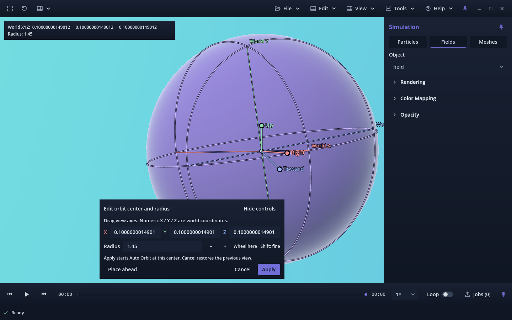
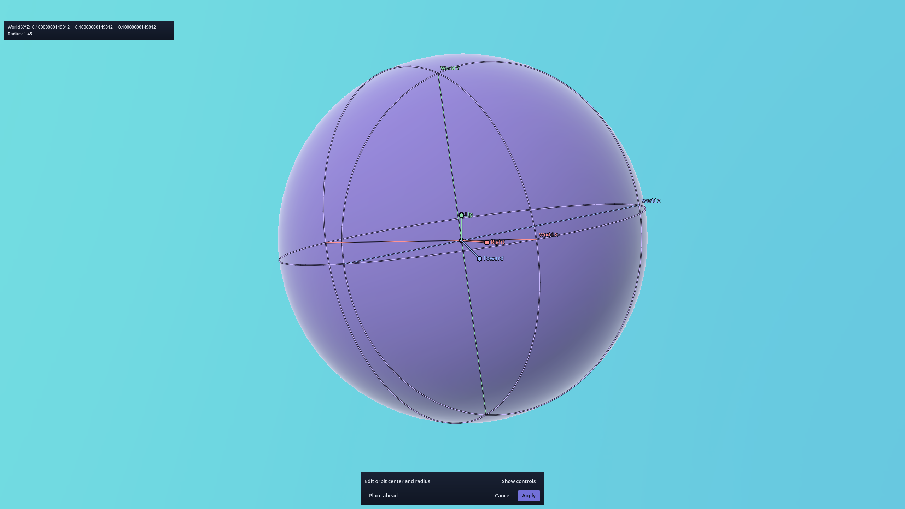
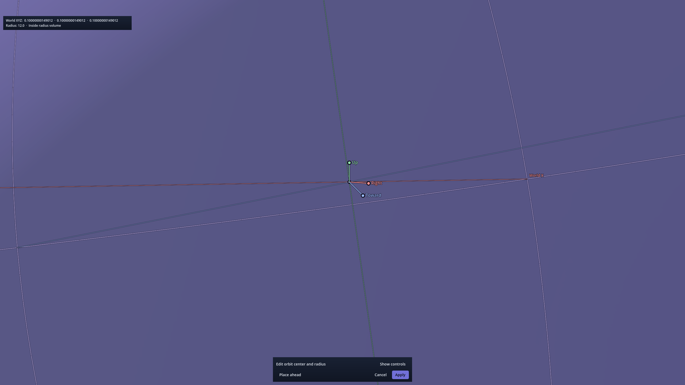
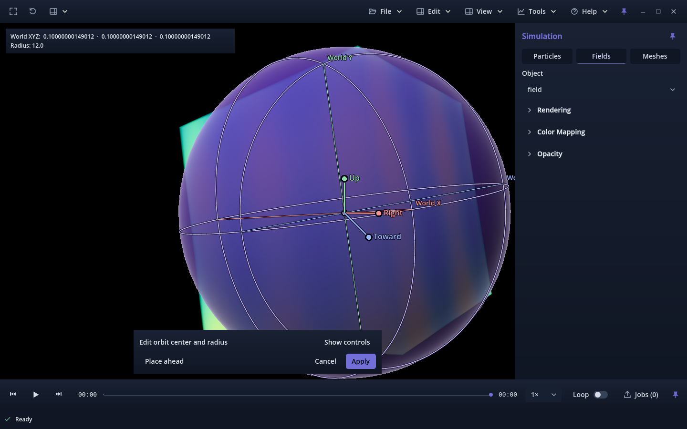
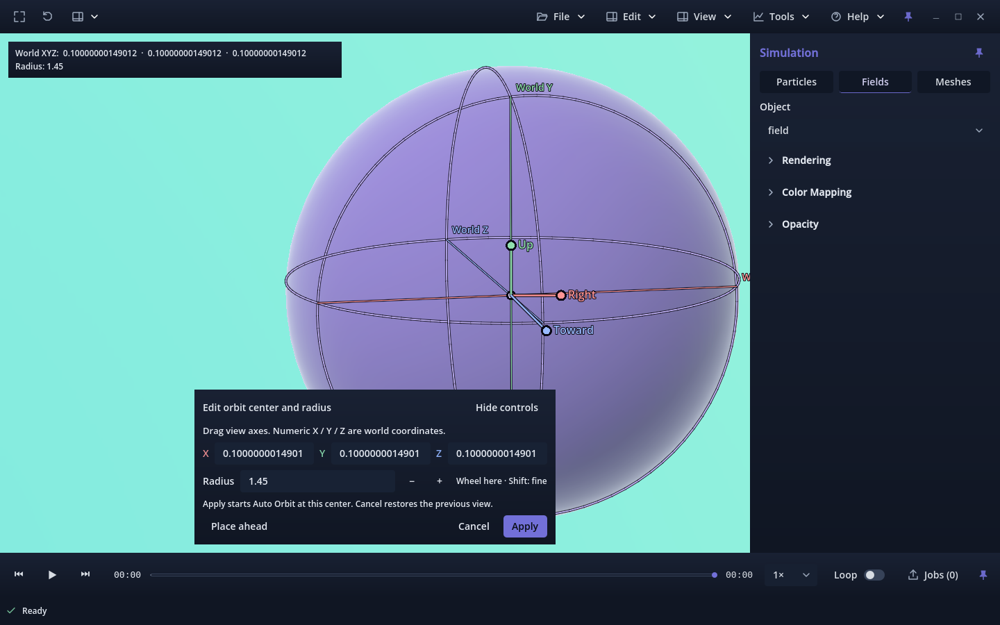

# PR #301 — Automatic placement anchoring

Candidate **v0.1.0.78** on `212-ux-nav-make-edit-orbit-center-view-relative`,
continuing reviewed commit `3aef86738ca44e50ff6cd1411587dac420e9e8f7`.
Accepted main remains `6bd497d60c75c435f38cdffe1dd87d8cdd56bc97` / build 77.
The owner explicitly requested removal of the Lock Position toggle after confirming
the gizmo was stationary in another simulation. The [initial](../README.md),
[lock](../lock-refinement/README.md) and [equator](../equator-refinement/README.md)
reports remain unchanged historical evidence.

## Final behavior

The draft was already a fixed world-space point in both toggle states. The toggle
selected the camera's orbit/zoom pivot; it did not prevent follow-camera writes.
Its checkbox, flag, callback and locked/unlocked readout labels are now removed.
Opening the editor automatically uses the draft for orbit/zoom inspection, leaving
the opening camera pose unchanged. RMB still steers in place and W/A/S/D/Q/E still
translate the camera. These gestures leave the exact draft XYZ and radius unchanged.
Place ahead, captured-view handles, numeric world XYZ and radius controls remain
explicit edits. Editing the center sets the pivot for subsequent inspection.

Apply ends temporary placement before updating the accepted camera target/radius,
retains the complete camera basis and starts the existing equatorial Auto Orbit.
Cancel restores the exact pre-edit camera and navigation state. The shaded sphere,
world-axis references, persistent readout, scientific sources, shortcuts and video
worker are unchanged. Current usage: [placement](../../../ORBIT_CENTER_VIEW.md),
[Auto Orbit](../../../AUTO_ORBIT.md).

## Completed validation

The placement matrix covers particles, fields, meshes and mixed captures, small
and large world scales, normal/Fullscreen, all six movement keys, real routed
LMB/RMB/wheel events, held orbit, all handles, numeric edits, Place ahead, Apply
and repeated Cancel. The dense 32³ field adds close/side viewpoints, collapsed
controls and large-radius interior/exterior cases. Tests require actual camera
movement while retaining exact draft values and scientific transforms.

| Run | Checks / result | Report / log |
| --- | --- | --- |
| Placement, headless | 1,278 PASS | [report](headless.json), [log](headless.txt) |
| Native Forward+ | 1,290 PASS | [report](forward.json), [log](forward.txt) |
| Native Compatibility | 1,290 PASS | [report](compatibility.json), [log](compatibility.txt) |
| Linux release validation package, Forward+ | 1,290 PASS | [report](package-forward.json), [log](package-forward.txt) |
| Same compiled package, Compatibility | 1,290 PASS | [report](package-compatibility.json), [log](package-compatibility.txt) |
| Retained view-relative placement | 3,472 PASS | [report](retained-view.json), [log](retained-view.txt) |
| Retained equatorial Auto Orbit | 8,240 PASS | [report](retained-equator.json), [log](retained-equator.txt) |
| Connected Auto Orbit/manual/editor transitions | 364 PASS | [report](connected-auto-orbit.json), [log](connected-auto-orbit.txt) |
| Application version | 2 PASS | [log](version.txt) |

All completed camera runs shut down cleanly with no runtime diagnostics and
unchanged fixture SHA-256 hashes. Native shading checks measured more than 5,200
opaque sampled pixels and 2,100 distinct shades per normal view, and more than
13,400 / 3,600 respectively in Fullscreen. The release validation entry scene uses
the production Viewer/resources and first-party Python archive. Godot binaries,
package files and generated captures remain outside Git; input events stay inside
Godot and do not control OS input devices.

[Source proof](protected-sources.json) verifies **1,968 unchanged files** against
the preceding reviewed revision, including **1,717 historical evidence files**.
Guide/shader, shortcuts, visual-state serialization, scientific layers/native
code/exporter and video sources match exactly. Seven camera-control/Auto Orbit
functions and the placement-navigation math are unchanged. The renamed driver
and current CLI use `--placement-refinement`; historical commands describe their
original revisions. [Intermediate harness evidence](intermediate-harness.json)
records an exact snapshot assertion across a floating-point camera calculation,
then its correction to compare explicit draft edits without camera navigation.
The exact Cancel and scientific-state assertions remain active.

[Documentation](documentation.json), [branding](branding.json), Python runner
compilation and whitespace validation pass. The broader navigation suite's
previously reproduced accepted-main held-key process-loop failure remains recorded
in the [preceding evidence](../equator-refinement/README.md); it was not rerun or
counted as a pass for this focused simplification.

## Visual evidence

| Normal, expanded controls | Side viewpoint |
| --- | --- |
|  |  |

| Fullscreen, collapsed controls | Inside a large radius |
| --- | --- |
|  |  |

| Compatibility, large radius exterior | Linux release validation package |
| --- | --- |
|  |  |

## Limits and owner review

Physical input feel, the owner's research-size phi capture, other OSes, mixed-DPI/4K,
long sessions and video encoding were not rerun. Existing world-vector precision,
clipping and zoom limits remain. Inspect a chosen lobe using Place ahead and the
handles/XYZ controls, navigate around it, then Apply. The camera should circle that
fixed center at the selected radius. PR #301 remains open for owner review; no merge,
auto-merge, issue closure or Project transition was performed.
