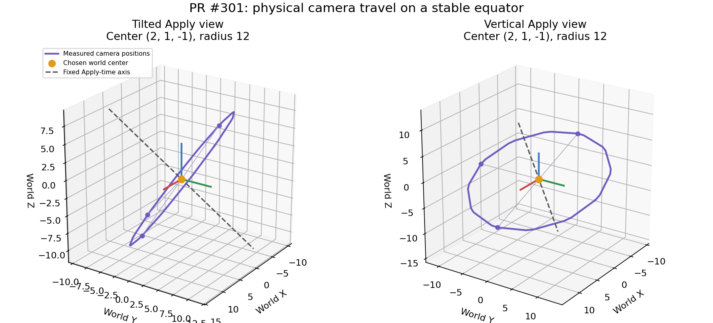
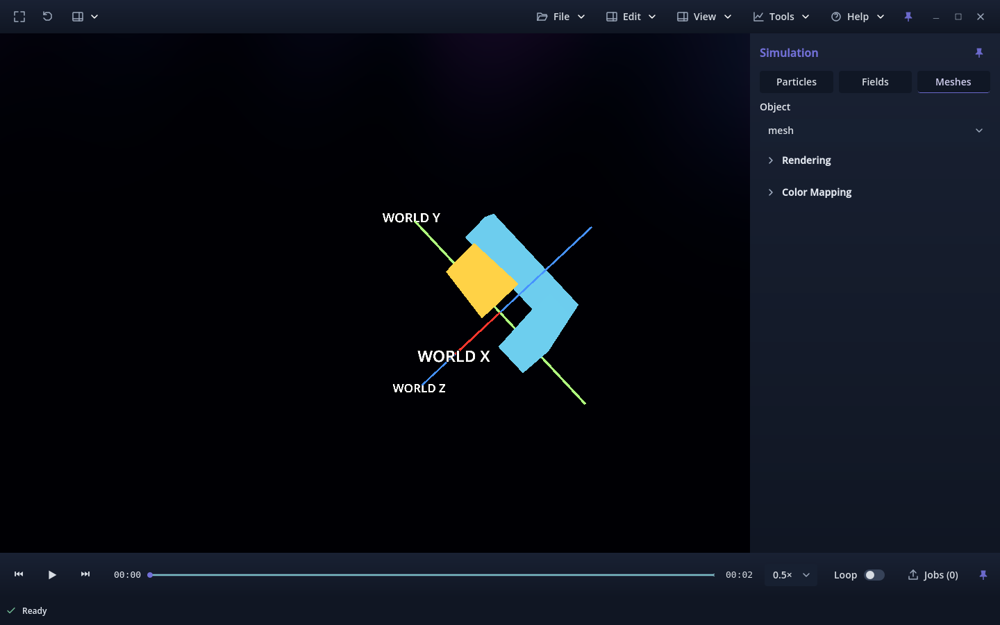
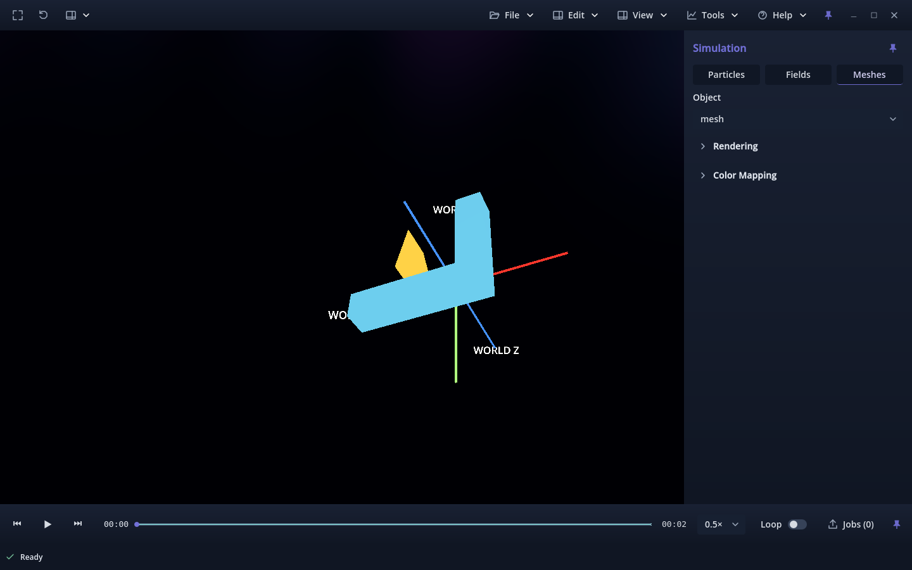
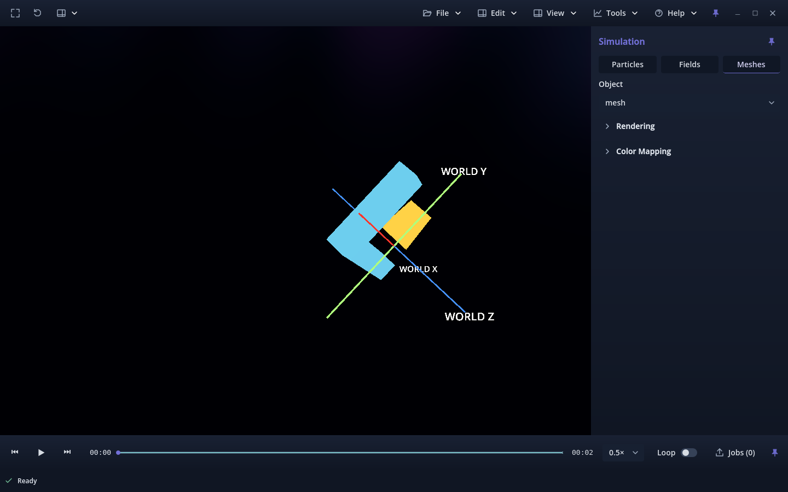
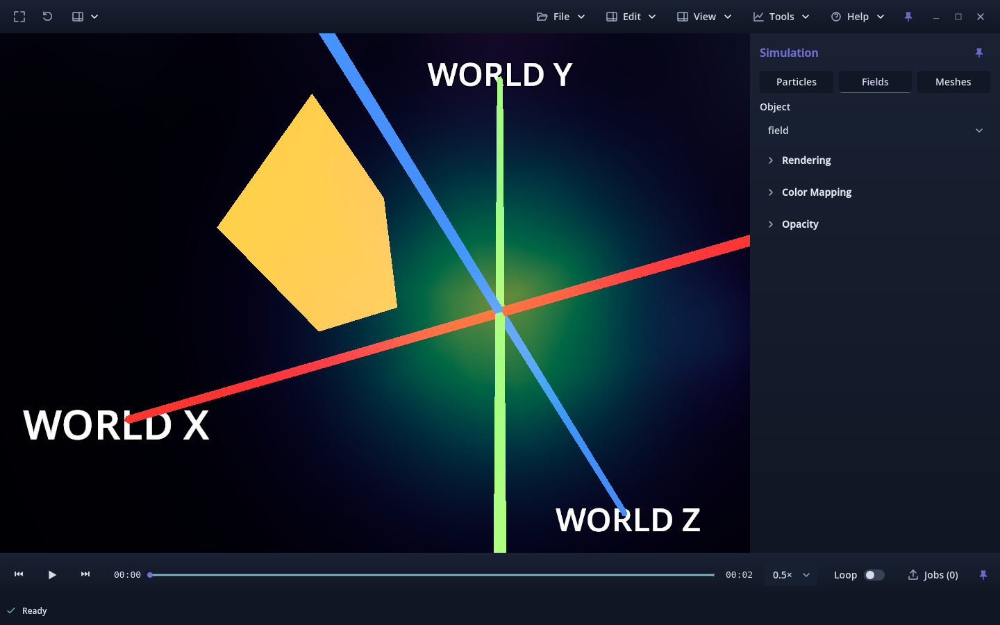
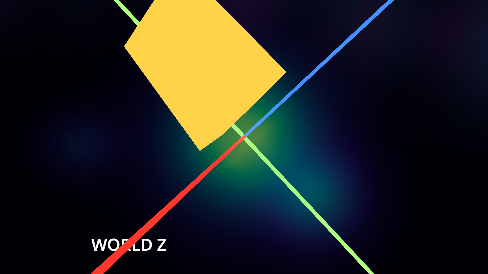
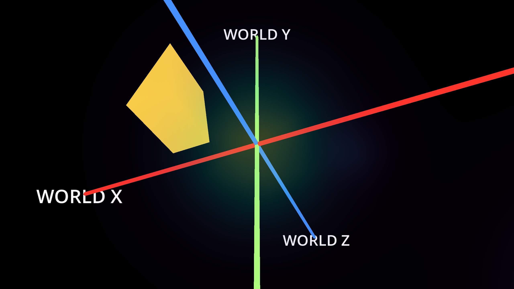
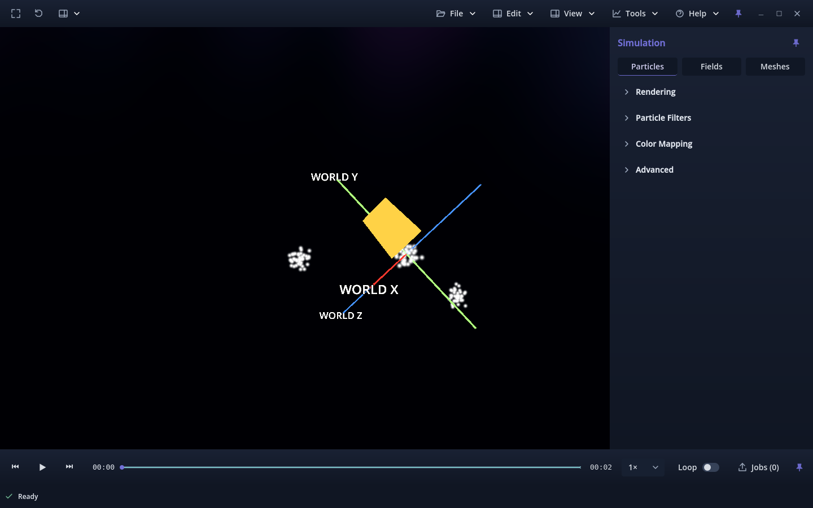
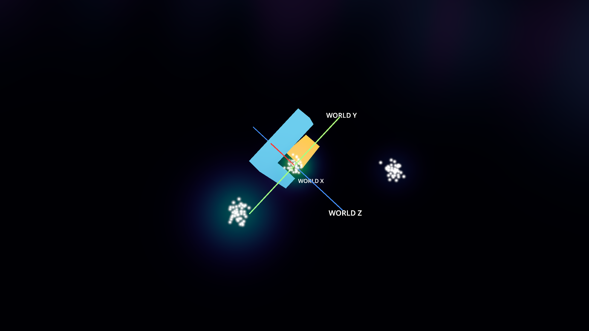
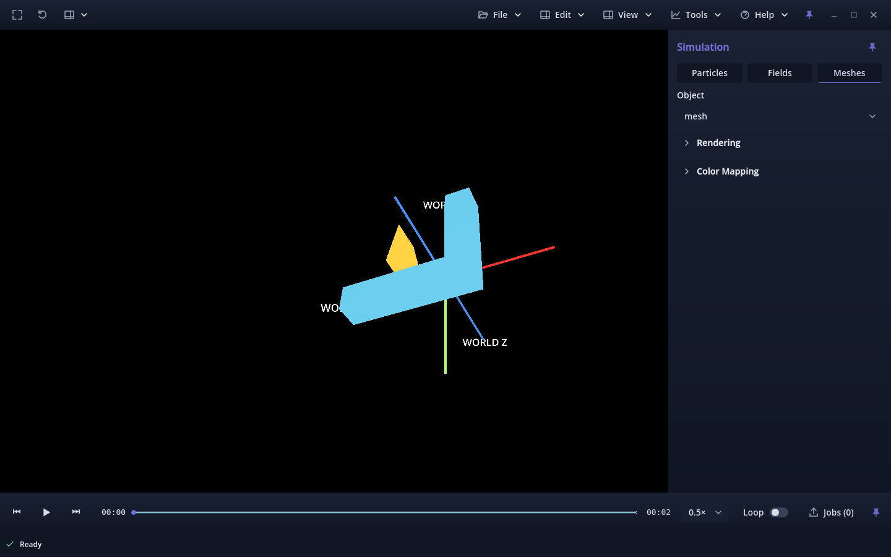

# PR #301 — Auto Orbit camera travel refinement

Candidate **v0.1.0.78**, on the existing branch
`212-ux-nav-make-edit-orbit-center-view-relative`, continuing reviewed commit
`f5411c4253e7cc3d5da01a301dc879e6f44aee89`. Accepted main remains
`6bd497d60c75c435f38cdffe1dd87d8cdd56bc97` / build 77 (PR #300).
The explicit owner review request authorizes this In review issue's refinement.
[Initial evidence](../README.md) and [Lock Position evidence](../lock-refinement/README.md)
remain byte-identical historical records. Build 78 is unchanged through review.

## Investigation before implementation

The old automatic tick incremented yaw, then `_update_camera()` rotated the
camera basis around world Y and placed the camera one radius from its target.
It did **not** rotate scientific roots, object/world transforms or source arrays.
It still looked toward the target. For a tilted view this produced a latitude
circle and rotated the camera's up direction. At a world-Y pole, physical travel
collapsed to almost zero while the view rolled in place, making a stationary
object appear to rotate.

A pre-change probe completed **6 diagnostic checks**, with no runtime warnings
or errors: [source](cause-probe.txt), [measurements](cause.json), [log](cause.txt).
The center was `(2,1,-1)`, radius 8, and the step was one radian. An asymmetric
stationary prism, world reference node and viewer root retained exact transforms.
These checks diagnose existing behavior; they do not claim the desired orbit passed.

| View | Before: camera travel | Before: up-axis change | Refined: camera travel | Refined: plane error |
| --- | ---: | ---: | ---: | ---: |
| Tilted, pitch 0.75 | 5.612645 | 0.653590 | 7.670809 | 2.68e-7 |
| Vertical, pitch π/2 | 4.30e-7 | 0.958851 | 7.670809 | 4.77e-7 |

Travel/plane error are world units; up change is the distance between unit vectors.
The tilted old pose departed 1.834185 units from the Apply-view equatorial plane.
The [refined fallback probe](fallback-refined.json) repeats the same measurements
through the empty-view process path; [log](fallback-refined.txt). Up change is
below 7.3e-8 in both refined cases.

## Current behavior and boundary

Apply captures the full current camera basis. Its up direction defines the stable
axis, and the plane through the selected world center perpendicular to that axis
defines the equator. Automatic poses are calculated from that reference and angular
phase. The camera physically travels around the center at the selected radius,
keeps its up axis stable and looks toward the center throughout the circle.
Using the Apply view avoids an orientation snap and gives the same physical
circle from tilted, rolled and polar views.

The shared camera helper drives both the loaded-scene and empty-view process
paths. The only scientific-layer-file edit replaces its old automatic-camera call;
the remainder of sampling, clocks, preparation and playback is byte-identical.
All scientific/source/world transforms remain fixed. A field's screen raymarch
quad intentionally follows the camera as before; its source grid and world-to-grid
mapping are not moved by Auto Orbit.

Enabling Auto Orbit captures the current view. LMB temporarily pauses automatic
motion; a deliberate tumble establishes a new view-up plane on release. RMB,
held orbit keys and W/A/S/D/Q/E retain their existing manual takeover behavior.
Wheel changes radius while retaining the plane. Frame/Reset and restored full
camera state resume from their resulting views. Cancel restores the suspended
orbit's exact pose, plane and phase. Existing saved camera/target/radius state
reconstructs the plane without a format change. Deterministic video still disables
interactive Auto Orbit and uses its separate configured world-Y camera motion;
the video worker is byte-identical.

The owner-accepted Lock Position, captured-view handles, numeric world XYZ/radius,
shaded guide and persistent world references are preserved. The guide and shader
are byte-identical to the reviewed revision. Apply adds the orbit-frame capture;
the rest of the placement editor is unchanged. Current usage:
[Auto Orbit](../../../AUTO_ORBIT.md), [placement](../../../ORBIT_CENTER_VIEW.md).

## Completed validation

The new driver uses asymmetric **stationary** and **evolving** WVZ1 particles,
L-shaped meshes, a three-lobe 32³ phi field and mixed captures. A fixed rendered
world-axis reference and off-axis prism make perspective changes explicit.
There are **48 stationary path cases**: four scene types × normal/Fullscreen ×
tilted/rolled/vertical views × close radius 3 / large radius 12. Each covers a
full circle with unequal tick durations and signed speed. Every step checks
physical camera position against the circular path, radius, plane, up direction,
look-at centering and unchanged world/source/reference transforms. Full turns
return to their initial position; quarter turns require substantial physical travel.
Stationary source-array fingerprints are unchanged.

Evolving playback uses actual production `scene_layers.tick()` at the same
recorded-time rate, with preparation awaited. Auto Orbit On/Off yields identical
committed time **1.2**, scientific sample dictionaries and decoded array fingerprints
for each type. Both runs change scientific content from sample zero; only the
automatic run moves the camera. No scientific solver was rerun.

| Run | Result | Report / log |
| --- | --- | --- |
| Equator, headless | **8,240 PASS** | [report](headless.json), [log](headless.txt) |
| Native Forward+ | **8,288 PASS** | [report](forward.json), [log](forward.txt) |
| Native Compatibility | **8,288 PASS** | [report](compatibility.json), [log](compatibility.txt) |
| Linux release validation package, Forward+ | **8,288 PASS** | [report](package-forward.json), [log](package-forward.txt) |
| Same compiled package, Compatibility | **8,288 PASS** | [report](package-compatibility.json), [log](package-compatibility.txt) |
| Preserved view-relative placement, headless | **3,472 PASS** | [report](retained-view.json), [log](retained-view.txt) |
| Preserved locked placement/dense-field matrix, headless | **1,278 PASS** | [report](retained-lock.json), [log](retained-lock.txt) |
| Connected Auto Orbit/manual transitions | **364 PASS** | [report](connected-auto-orbit.json), [log](connected-auto-orbit.txt) |
| Connected navigation | **FAIL: 1,393 checks / one failure** | [report](connected-navigation.json), [log](connected-navigation.txt) |
| Byte-verified accepted-main navigation baseline | **FAIL: same 1,393 / one failure** | [report](navigation-baseline.json), [log](navigation-baseline.txt) |
| Version tests | **2 PASS**, candidate v0.1.0.78 | [log](version.txt) |

The navigation failure is `Real process loop advances the held orbit shortcut`,
before editor usage. It reproduces unchanged on freshly checked accepted-main
camera/layer/test sources. This suite is **not** counted as passing; no unrelated
fix is included. Focused placement tests still require actual held-orbit movement.

Final successful camera runs completed and shut down with zero runtime diagnostics
and unchanged fixture SHA-256 hashes. Imports warmed up five pre-existing missing
UID sidecars, then completed cleanly. A temporary release test entry scene runs
the production Viewer/resources and first-party Python archive; release templates
do not execute `--script`. External Godot binaries/captures remain outside Git.

[Protected-source proof](protected-sources.json) checks **1,932 unchanged files**
from the reviewed revision, including scientific modules and historical evidence,
plus guide/shader/shortcut/video-worker hashes. `scene_layers.gd` is otherwise
byte-identical after replacing its camera call. **16 generated captures / 60 records**
passed strict descriptors, commit proofs, decoded checksums, constraints and field
statistics verification, with unchanged source bytes. Intermediate fixture/test
harness corrections are recorded in [the harness note](intermediate-harness.json).
[Documentation validation](documentation.json) checks Markdown links, Git
permalinks and three executable API examples. The compact [branding audit](branding.json)
has no unclassified references or changed historical evidence. Runner compilation
and whitespace checks pass; final staged files are checked for artifacts and credentials.

Reproduce with `tools/validate_orbit_center_view.py --equator-refinement`, an
external `--godot`, a fresh `--output-dir`, and `--renderer headless`, `forward_plus`
or `gl_compatibility`. Add `--export` for the Linux validation build; reuse its
binary with `--packaged`. Events stay inside Godot; no OS input devices are controlled.

## Visual evidence

These trajectories plot measured native camera positions in fixed world coordinates,
with the selected center and captured axis. Quarter-view screenshots show the
unchanged asymmetric object and world axes from physically different camera positions.
The test disables bloom and uses a bright reference prism for readability; production
render settings are unchanged. The fixed rods/prism are test-only references.

| Asymmetric stationary mesh: first quarter | Second quarter | Third quarter |
| --- | --- | --- |
|  |  |  |

| Close phi lobe, normal | Close phi lobe, Fullscreen | Compatibility phi view |
| --- | --- | --- |
|  |  |  |

| Stationary particles | Mixed Fullscreen | Compatibility mesh |
| --- | --- | --- |
|  |  |  |

## Limits and owner review

Physical mouse feel, the owner's research-size phi capture, other OSes, mixed-DPI/4K,
long-session performance and video encoding were not rerun. Native/package camera
tests cover both renderers; accepted guide visibility remains backed by the historical
native lock evidence and this revision's focused lock regression/hash proof. Existing
camera clipping, zoom bounds and world-vector precision limits remain.

Select a lobe in the owner's phi field, place the center with Lock Position and
the existing handles/XYZ controls, then Apply. Confirm the camera circles that lobe
at the chosen radius with stable up direction and continuous centering, while
recorded simulation evolves. Repeat from a tilted/vertical view and in Fullscreen.
RMB should immediately return to in-place steering. Cancel during a new placement
session should recover the exact original orbit. PR #301 remains open for owner
review; no merge, auto-merge, issue closure or Project transition is authorized.
