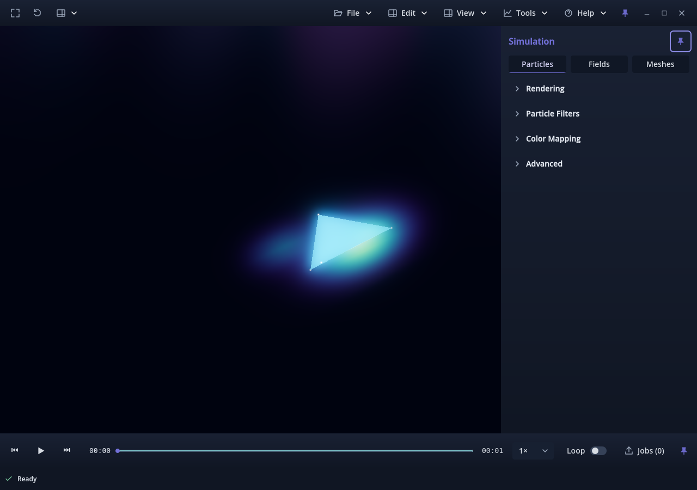
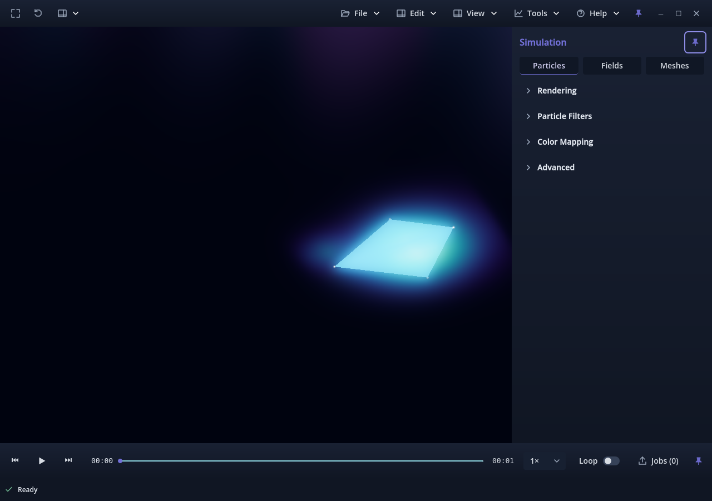
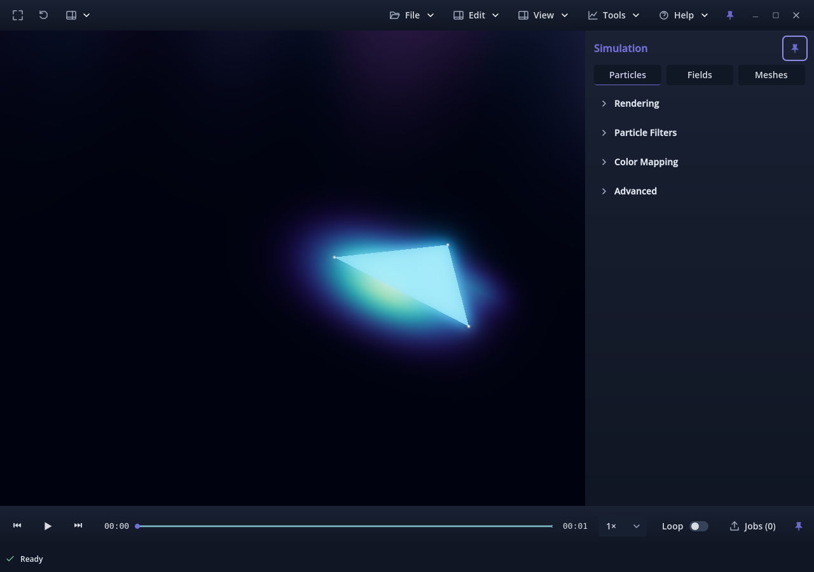
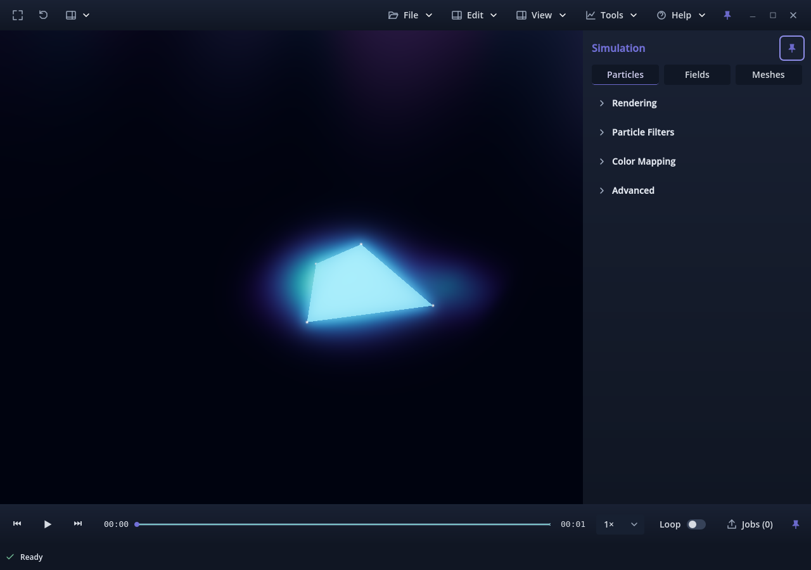

# Observer orbit correction for PR #302

Candidate **v0.1.0.78**, pending owner physical review. This correction implements
the owner's clarified spaceship/planet behavior. It supersedes the Apply behavior
recorded in [attempt-02](../attempt-02/README.md); those earlier reports remain
unchanged as historical evidence.

## Resulting behavior

Apply does not change the observer's position. It turns the camera to look at the
chosen world-space center and derives orbit distance from that position. The
camera then travels on a fixed plane around that center, continuously facing it.
Gizmo radius controls only the visible marker/handles; it is no longer assigned
to `camera_distance`. Reopening preserves these separate quantities. Repeated
unchanged Apply and changing only marker size preserve the existing camera pose
and orbit distance exactly.

The orbit plane uses the current up direction projected perpendicular to the
new line of sight. Looking directly along the old up/down axis uses the existing
right axis to avoid a degenerate basis. A center exactly at the camera has no
orbit direction/distance: Apply leaves the editor open with a request to move
away. It does not invent a position. Cancel still restores pre-edit camera state.

Only the orbit editor's commit/reopen logic and its explanatory labels change in
production. The existing `advance_orbit`, manual navigation, scientific geometry,
annotation rendering, source playback, and export code are unchanged from the
preceding revision. Candidate build remains 78 for this same PR.

## Validation

See [summary.json](summary.json), the per-run reports, and the quarter-turn
screenshots. Tests assert **exactly zero position change on Apply** for seven
fixture types/scales, with the target deliberately offset from the original line
of sight. They independently compare observer distance versus gizmo size, verify
immediate travel and target-facing direction throughout a full revolution, fixed
orbital plane, return to the start, repeated Apply/Cancel, and separate source-time
progression. Additional cases put the target above, below, behind and oblique to
the initial view; they also change only gizmo size and test coincident-center
rejection. Scientific node transforms and fixture SHA-256 hashes remain unchanged.

| Focused check | Result |
| --- | --- |
| Gizmo/observer suite, headless | 2,838 checks, zero failures |
| Gizmo/observer suite, native Forward+ and Compatibility | 2,899 checks each, zero failures |
| Same suite in release-template validation-entry packages, both renderers | 2,899 checks each, zero failures |
| Rendered landmark alignment | 36 comparisons per native/package run; zero pixel-edge difference |
| Connected Auto Orbit transitions, headless and both native renderers | 372 checks each, zero failures |
| Application version | 2 tests pass; unchanged candidate v0.1.0.78 |
| Staged diff | `git diff --check` passes |

The first headless Auto Orbit attempt stopped at import warnings while Godot
regenerated cached UIDs for unrelated ignored diagnostic scripts. The unchanged
retry passed all 372 checks; [the initial import log](initial-import-warnings.txt)
is retained separately and is not a test pass.

The focused scope covers the changed camera transition and its immediate orbit,
editor, input and rendering paths. No unrelated suites were run. The preceding
revision's navigation suite failure (identical on accepted main) and extreme-scale
near/far clipping failure remain documented in attempt-02; those suites/baselines
were not rerun for this editor-only correction and are not claimed as passes.
The large-scale fixture retains the explicit test near-plane adjustment. The
package runs retain the temporary validation entry point and do not certify the
ordinary launcher or workers. Physical research-scene feel, mixed DPI/4K, long
sessions and offline video trajectories remain owner checks. The existing live
Apply-time plane remains transient rather than a new saved schema.

The following native Forward+ images show successive quarters of a single
observer orbit. The target stays at the same world point; each view is obtained
by moving the camera, not transforming the scientific nodes.

## Owner check

1. Fly to the desired viewing distance from a research-volume lobe. Place the
   gizmo on that lobe, deliberately off the current center of the screen.
2. Click Apply. There should be **no position jump**: the view turns to face the
   point, then starts travelling around it. The chosen point stays centered as
   different sides become visible and other structures shift in the view.
3. Repeat from a different starting distance. Change only Gizmo radius; that
   should resize the marker without choosing your orbit distance or moving you.
4. Check a full revolution, manual takeover, repeated Apply and Cancel. Confirm
   the scientific scene stays fixed while source playback can continue separately.

Synthetic checks do not establish owner acceptance. Stop for physical review;
no merge, auto-merge, issue closure or Project completion is performed.
