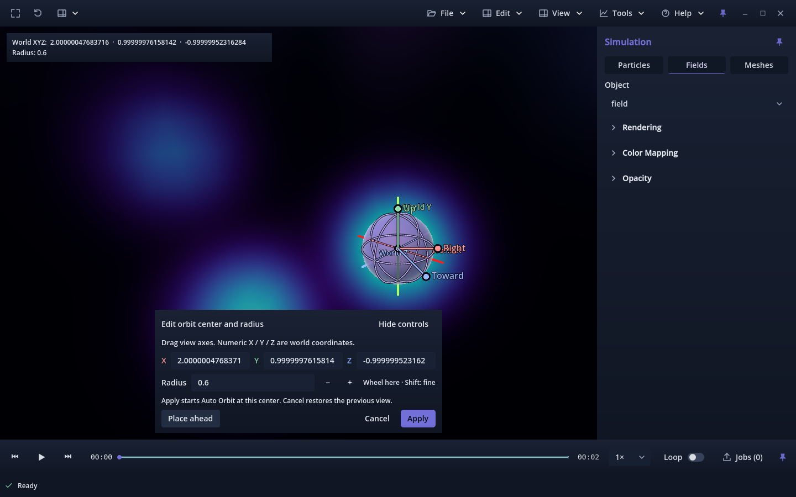
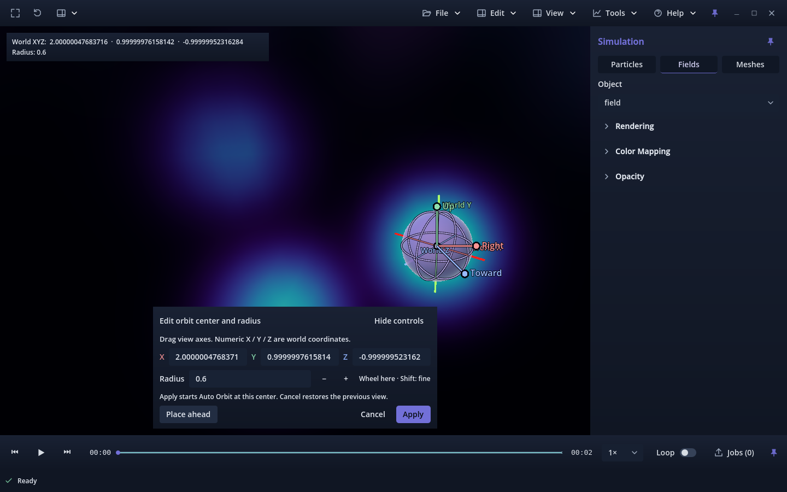
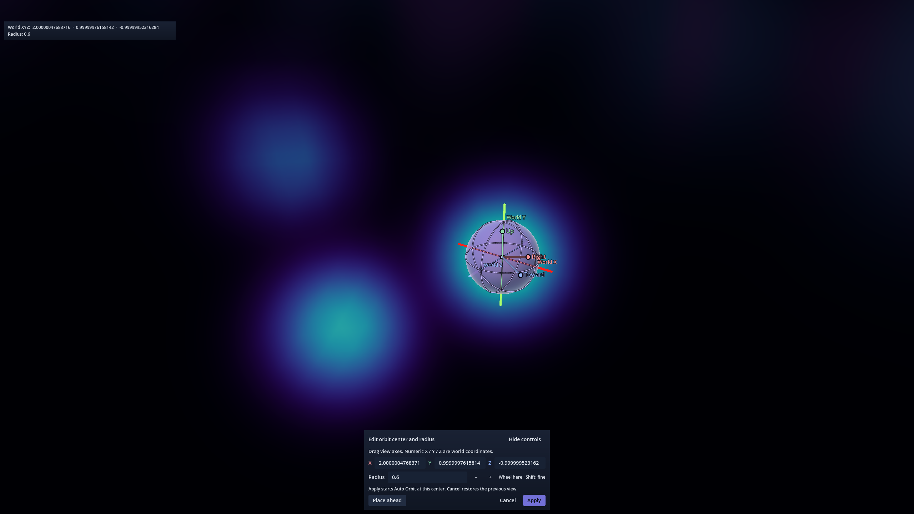

# PR #301 — Place ahead depth and stationary inspection

Candidate **v0.1.0.78** continues `2418284795aad9f3670e67fc2f9eb7594d9bf3fc`
on `212-ux-nav-make-edit-orbit-center-view-relative`. Accepted main remains
`6bd497d60c75c435f38cdffe1dd87d8cdd56bc97` / build 77. The owner reported
gizmo motion and an apparent size reset on Place ahead, then confirmed that
the Radius number itself stayed unchanged. Earlier [automatic placement](../automatic-placement/README.md),
[equator](../equator-refinement/README.md), [lock](../lock-refinement/README.md)
and [initial](../README.md) evidence remain unchanged historical records.

## Cause and refinement

The actual Place ahead button put the center one **draft radius** in front of
the camera. After a radius edit, clicking it changed placement depth, making
the sphere appear resized. In a stationary phi fixture, Radius remained **0.6**
and the camera pose stayed exact, but depth changed **8 → 0.6** and projected
radius changed **64.833 → 864.442 pixels**. The pre-change [probe](cause-probe.txt),
[measurements](cause.json) and [log](cause.txt) complete five diagnostic checks;
these diagnose the old behavior, rather than passing the requested refinement.

Place ahead now centers the draft along the current view at its **existing view
depth**, independently of orbit radius. It leaves the radius and camera unchanged.
A center behind/too near the camera uses the current navigation distance. Once
placed, the draft is a fixed world-space point; only Place ahead, handles and
explicit numeric edits change it. Camera movement changes the scene and gizmo's
screen projection together. The tested WASD path did not change draft XYZ/radius
or detach the rendered guide from the stationary world reference.

Only the editor's placement calculation and tooltip change in production.
The lock toggle stays removed. Navigation, shaded guides, XYZ/radius controls,
Apply/Cancel, stable equatorial Auto Orbit, scientific transforms and playback
remain preserved. Current usage: [placement](../../../ORBIT_CENTER_VIEW.md).

## Completed checks

The current placement driver adds actual button clicks with an edited radius,
preserved placement depth/projected radius, behind-camera recovery and real
process-loop W/A/S/D/Q/E movement. Each of 16 particle/field/mesh/mixed ×
small/large × normal/Fullscreen cases checks the exact placed XYZ/radius,
stationary reference transform, rendered guide center, matching main/annotation
projections and paused scientific sample. All **96 movement measurements per run**
require actual camera travel and report **zero reference pixel error**.

| Run | Checks / result | Report / log |
| --- | --- | --- |
| Placement, headless | 1,918 PASS | [report](headless.json), [log](headless.txt) |
| Native Forward+ | 1,934 PASS | [report](forward.json), [log](forward.txt) |
| Native Compatibility | 1,934 PASS | [report](compatibility.json), [log](compatibility.txt) |
| Linux release validation package, Forward+ | 1,934 PASS | [report](package-forward.json), [log](package-forward.txt) |
| Same compiled package, Compatibility | 1,934 PASS | [report](package-compatibility.json), [log](package-compatibility.txt) |
| Retained handles, Apply/Cancel and immediate Auto Orbit | 3,472 PASS | [report](retained-view.json), [log](retained-view.txt) |
| Stationary phi illustration | 10 PASS | [report](phi-visual.json), [log](phi-visual.txt), [probe](phi-visual-probe.txt) |
| Application version | 2 PASS | [log](version.txt) |

Completed camera runs shut down cleanly with zero runtime diagnostics and unchanged
fixture hashes. The Linux validation package uses production Viewer/resources;
external Godot, captures and package binaries remain outside Git. Synthetic input
events stay inside Godot. [Protected-source proof](protected-sources.json) verifies
**1,997 unchanged files**, including **1,745 historical evidence files**, against
the preceding reviewed revision. Main camera code, scientific layers/native/exporter,
guide/shader, shortcuts, serialization and video sources match exactly. Editor
open/dismiss/commit/navigation/process/input functions are unchanged.

The [intermediate harness note](intermediate-harness.json) records a new first-key
test failure caused by starting before the button's focus transition completed.
The harness now waits one frame after clicking, then releases GUI focus; actual
camera-motion and exact world-state assertions remain active.

[Documentation validation](documentation.json), [branding audit](branding.json),
Python runner compilation and whitespace checks pass.

## Stationary phi and world references

The illustration disables bloom and uses fixed test-only world-axis rods for
readability. Place ahead retains depth **7.999998** and projected radius **64.833**
pixels at Radius **0.6**. After actual A-key travel, the same phi lobe, rods and
gizmo shift together on screen; World XYZ and Radius remain identical.

| Just placed | After camera travel with A |
| --- | --- |
|  |  |

## Limits and owner review

Physical input feel, the owner's research-size phi capture, other OSes, mixed-DPI/4K,
long sessions and video encoding were not rerun. Existing clipping/zoom/precision
limits remain. The broader navigation suite's accepted-main held-key failure remains
documented in [earlier evidence](../equator-refinement/README.md); it was not rerun
or counted as passing here. PR #301 stays open for owner review, without merge,
auto-merge, issue closure or Project transitions.
