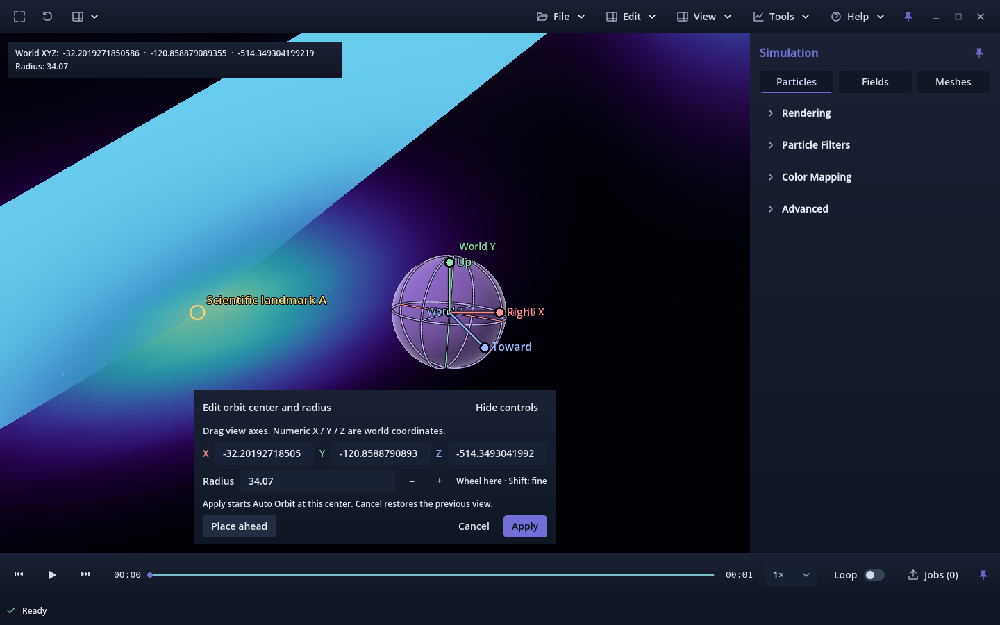
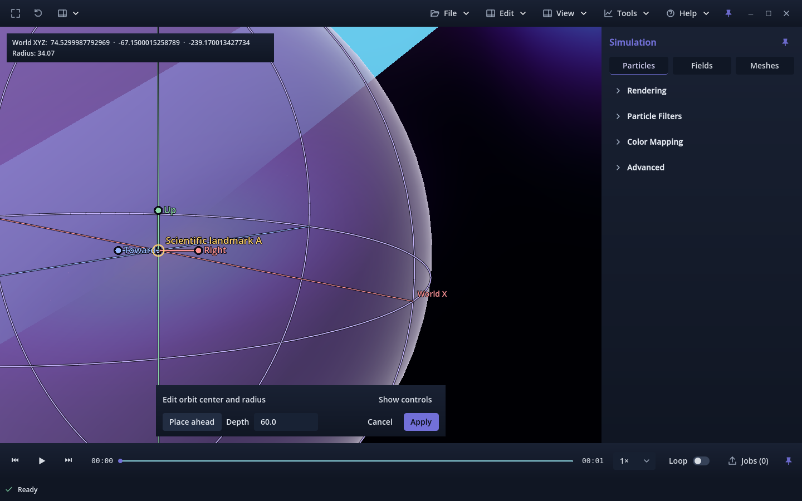

# PR #301 — World placement investigation and correction

Baseline: `782caa2ad28675845332fd57f742a82457e318da`. Existing issue #212 branch,
accepted main `6bd497d60c75c435f38cdffe1dd87d8cdd56bc97`; candidate remains
**v0.1.0.78**, pending owner review. No merge, auto-merge or issue closure.
Earlier evidence folders remain unchanged historical records.

## What was wrong

Two workflow defects are reproduced on the baseline:

1. **Hidden placement depth.** Place ahead projected the old draft onto the current
   forward ray at the old draft's current view depth, falling back to navigation
   distance behind the camera. Free Camera carries its navigation target with the
   camera. Flying close to a visible feature therefore does not establish the
   feature's depth. A sphere placed much farther away can overlap that feature in
   the initial image, then separate through ordinary perspective/parallax.
2. **Keyboard focus.** The real Place ahead button kept focus. The existing Free
   Camera path protects focused controls, so an immediate W key produced exactly
   zero travel. Both baseline depth cases fail this assertion without clearing
   focus in the test.

In the stationary transformed fixture, the same full camera pose looks at
landmark A 60 units ahead. A prior navigation distance of 360 places the center
300 units beyond it. Initial projections coincide; the subsequent sideways
translation separates the sphere from A by **363.066 pixels** in the native
baseline. The stored center/radius remain exact. Further W navigation silently
changes the next placement depth from **360 to 329.76**. See
[baseline native measurements](baseline-forward.json) and
[baseline headless measurements](baseline-headless.json). These are diagnostic
baseline FAIL reports with exactly two expected focus failures, not candidate passes.
The final native baseline verifies every button signal (20 clicks), completes
1,932 checks and 33 pixel probes; none of the failures come from missed clicks.

The rendered gizmo itself agrees with its world position. The separate viewport
copies the main camera's global transform/projection, renders the sphere at the
stored center with scale equal to radius, and maps its texture into the same
viewport. World-axis rings use the main camera. Meshes apply `data_to_world`;
volumes compose that affine transform with grid origin/spacing and inverse-map
camera rays; particles carry viewer-world positions. The existing annotation
intentionally draws over dense fields, so scientific depth occlusion cannot
reveal that a sphere has been placed beyond the visible structure.

The independent [Forward+](render-audit-forward.json) and
[Compatibility](render-audit-compat.json) pixel audit has 31 records per renderer,
zero failures, and byte-identical sphere images after all three pose round trips.
Actual mask bounds agree with main-camera projected mesh vertices within 2.023
logical pixels, including raster edge sampling. Center projection error is zero
in normal/fullscreen, and at most 0.0162 pixels with 1.5 UI scaling. Near/far views
and eight live process-loop A frames show no rendering lag. The retained
[probe](render-audit-probe.txt) uses independent stationary boxes; its libdecor
fallback messages are environmental and are not claimed as clean runtime logs.

## Check against the owner's captures

The owner tentatively supplied the FreeCollapse `S0_20261004_005538_117820` run.
Session logs confirm orbit editing there and in the later
`S0_20261004_013659_785112` run. [Bounded metadata evidence](owner-context.json)
records exact local paths, selected log lines, file sizes and transforms.
All volume samples in both captures have identity `data_to_world`, a 192 cubed
cell grid, origin (-47.75,-47.75,-47.75) and spacing 0.5. The actual field bounds
are **[-48,48] on all three axes**, corroborated by the geometry sidecars.
This was derived from the declared transforms; the scene origin was not assumed.

At the reported approximate center (74.53,-67.15,-239.17), radius 34.07, the
sphere cannot intersect either volume: its closest possible Z is -205.10,
157.10 units beyond the volume's Z boundary. The Euclidean surface-to-box gap is
about 159.88 units. The logs do not record the camera pose or edited XYZ, so they
cannot uniquely identify the screenshot session or reconstruct its precise ray.
These findings support the depth explanation without claiming an exact replay
of the owner's screenshot. The [metadata probe](owner-context-probe.txt) read
headers/descriptors/commits only: **zero scientific payload bytes**. This is not
full payload-integrity verification of those large external captures.

## Small correction

Only production `orbit_center_editor.gd` changes in this revision:

- **Depth** sits beside Place ahead and stays visible with controls hidden. It is
  in world units along the current camera's forward direction. It is seeded once
  on opening, then changes only through an explicit edit of that field.
- Editing Depth alone changes neither the draft center/radius nor the camera.
  Place ahead uses exactly that distance on the current forward ray, without a
  navigation-dependent fallback. Invalid values are rejected atomically and the
  error stays visible in compact mode.
- Successful Place ahead releases editor focus, permitting immediate WASD/QE.
  Numeric typing keeps its normal movement protection before placement.

The depth is an explicit choice, not feature picking. After flying close, select
an appropriate Depth and inspect against features from more than one viewpoint.
The initial value can still reflect the previous navigation distance; it is now
visible and controllable. Correcting a wrong depth naturally changes apparent
sphere size even though radius is unchanged.

The shaded sphere, world-axis references, captured Right/Up/Toward handles,
radius controls, temporary draft pivot, camera-navigation math and Auto Orbit
implementation are preserved. Apply commits the draft and starts genuine orbit
on its existing fixed plane; Cancel restores the pre-edit camera state. There
is no Lock Position toggle, follow-camera placement, or screen-space locking.

## Why previous tests missed it

The older placement test created its reference box *at the chosen draft after
placement*, then compared their projections. That cannot detect choosing the
wrong depth relative to an existing structure. It also explicitly called
`focus_none()` after Place ahead, hiding the blocked immediate movement.
Unchanged numeric XYZ alone is not accepted as proof in this investigation.

The new `tools/validate_orbit_center_world.py` generates stationary particle,
mesh, volume and mixed fixtures. The field is 49×41×33 across hundreds of world
units, with asymmetric lobes and rotated/nonuniformly scaled/translated
`data_to_world`; [manifest](fixture-manifest.json). Its use of the approximate
owner XYZ is only synthetic coordinate coverage, not a reconstruction of the
actual capture. A and B come from pre-existing committed particle/mesh positions
or actual field grid-to-world transforms, independently of gizmo placement.

For each gesture the report records the full camera world basis/position,
target/navigation distance, draft center/radius, actual sphere transform,
separate camera, both projections, at least two scientific landmark positions
and projections, camera-to-center distance, and placement/view depth. Tests
cover WASD/QE, RMB, LMB, both zoom directions (respecting existing near zoom
bounds), an opposite-side view, normal/fullscreen and exact pose restoration.
Actual rendered sphere pixels are compared with independent main-camera
ray/sphere intersections; round trips also compare rendered masks.

## Validation and screenshots

The final world-placement matrix passes with zero Godot runtime diagnostics and
unchanged fixture hashes:

| Environment | Checks | Result |
| --- | ---: | --- |
| [Headless](headless.json) | 2,125 | PASS |
| [Native Forward+](forward.json) | 2,213 | PASS |
| [Native Compatibility](compatibility.json) | 2,213 | PASS |
| [Linux release validation package, Forward+](package-forward.json) | 2,213 | PASS |
| [Same package, Compatibility](package-compatibility.json) | 2,213 | PASS |

Each native/package run covers 16 scene/scale/window combinations, 392 detailed
world/projection records, 24 verified actual Place ahead clicks, and 34 actual
sphere mask probes with **zero mismatches**. Masks and camera/landmark projections
return exactly on pose restoration; maximum main/annotation projection error is
0.0000611 pixels. After choosing depth 60 with the old navigation distance 360,
landmark separation is below 0.001 pixels after lateral movement. Immediate W
travels 5.04/30.24 units in the two click cases instead of zero. The sphere-coverage
regression tolerance excludes raster edges, then allows at most 2 mismatches and
less than 3% of occupied sphere samples, not 3% of the full viewport.

The package uses a compiled validation entry scene with the production Viewer
and resources; external Godot templates/binaries are retained only in /tmp.
It is not a packaged research-capture throughput or video-encoding test.

[Retained placement](retained-placement.json): 1,918 headless checks pass.
[Retained equatorial orbit](retained-equator.json): 8,240 headless checks pass,
including Apply/Cancel, repeated sessions, physical orbit radius/plane and
recorded playback. [Intermediate results](intermediate-results.json) distinguish
harness setup corrections, the corrected compact-layout regression and genuine
baseline defects.

The [source comparison](source-contract.json) verifies 2,400 previously tracked
source/evidence files remain byte-identical, including the camera implementation,
scientific layers/exporter, guide/shader and all earlier evidence. Version tests
(2), Python compilation, [documentation/API examples](documentation.json),
[branding audit](branding.json) and whitespace checks pass.

The closer sphere naturally looks larger at the same world radius. This is a
corrected spatial placement, not an apparent-size or screen-pixel lock.

Additional unobstructed states: [normal, both landmarks](field-normal-360-placed.png),
[collapsed controls](field-normal-360-placed-compact.png),
[fullscreen](field-fullscreen-360-placed.png),
[opposite side](field-fullscreen-360-opposite-side.png),
[returned pose](field-normal-360-returned.png), and
[Compatibility opposite side](compatibility-opposite-side-fullscreen.png).

## Limits and owner review

The gesture tests inject Godot events and use deterministic process calls; they
are not physical keyboard/mouse acceptance. The exact original camera pose is
unavailable. Full external-capture payload hashing/playback, other OSes,
physical mixed-DPI/4K input, long sessions and video encoding were not run.
The independent UI-scale probe is not a physical mixed-display test.

On the owner's capture, aim at a known structure, choose Depth, Place ahead,
then immediately fly, steer, orbit and zoom around it. Compare against stationary
features from opposite sides; set the final radius and Apply. Cancel should
return the original view. Final acceptance remains with the owner.
