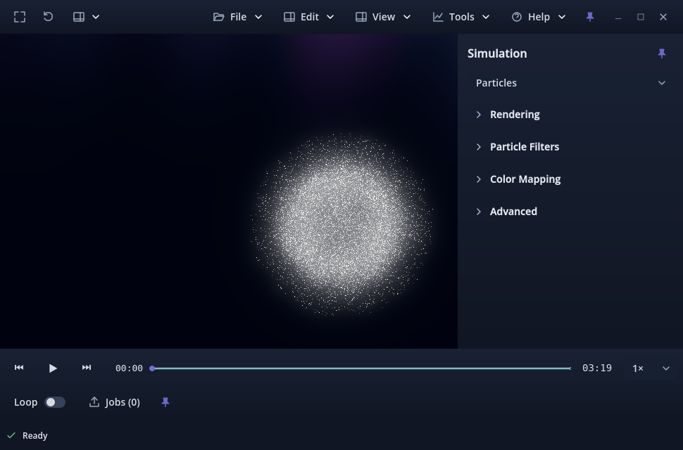

# Issue #229 review evidence

Pending owner review, candidate **v0.1.0.36**. Accepted baseline is
`70fd282780b78a67ff10ba467c96560579a69de5` (PR #228 merged). Issue #229 was the
only Ready item; its existing owner-linked branch was clean and identical to
accepted main before edits. Fetch/prune found no completed local issue branch
to remove. No historical report or evidence file was rewritten.

## Cause and reproduction

The production file is `cavity_collapse_recirculator_192_long.wvz`,
**1,526,072,427 bytes**, 1,001 samples from t=0 through approximately 200, one
`tracers` particle object, 20,000 persistent int64 IDs per sample. Its 14 arrays
include float32 position/velocity, ten float32 scalar channels, uint32
`particle_type`, and int64 `particle_id`. The layout and complete-file SHA-256
are in [measurements.json](measurements.json).

On unchanged accepted main, a fresh paused open admitted/prepared **8 pairs**,
retained **9 decoded samples** (46,878,336 charged bytes) and **95,564,800 prepared
charged bytes**. Coverage was t=0–1.6, **0.8%** of duration, under separate 1 GiB
limits. The worker was idle with no error and roughly 29.9 GiB physical RAM
available. The exact stop was exhaustion of the eight requested indices, not
RAM admission or hidden resident coverage.

Advancing through 42 samples and settling each window produced **50 resident
pairs**, t=0–10, **5% coverage**, at playhead t=8.4. Pausing did not grow it further.
Thus 5% was accumulated playhead history plus lookahead, not a hard 5% ceiling.
The Ready tooltip said only that the committed visible sample was ready.

The historical explanation and the valid reasons for immediate interaction are
recorded in [the policy/history document](../../PARTICLE_CACHE_CAPACITY.md).
The owner clarified the mixed-scene intent during this issue: a large field
buffer supplies continuous-playback runway for roughly 150 GB recordings;
particles stay around the playhead so they do not consume that field capacity.
**That mixed-scene policy is preserved.** Safe whole-scene expansion applies to
scenes without fields. Field/mesh preparation algorithms are unchanged.

There is a second sizing trap: compact record headers contain all channel bytes,
not particle count. The old unresolved estimate treated this channel-rich sample
as up to 76,000 particles rather than 20,000, yielding **59,863,927,104 bytes**
for a whole-scene estimate. Even materializing shapes under the old generic
formula gave 21,517,311,104 bytes. Blindly restoring the old full-preload switch
would therefore still misclassify this recording. Worker-side validated shape
and retained-type accounting resolves that without blocking initial display.

## Measured memory and coverage

Godot 4.7.2, RTX 3070 Ti, Linux, 50,404,552,704 physical bytes (46.94 GiB).
Production runs used fresh viewer processes and warm filesystem caches: source
hashing occurs before timing. Measurements are host observations, not latency
or throughput guarantees. The 1,001-interval completion includes the final held
sample; timeline duration is measured from actual source timestamps.

| Quantity | Measured / authoritative charge |
| --- | ---: |
| Raw decoded payload per source sample | 1,520,000 bytes |
| Retained decoded sample, including IDs/display arrays | 5,208,704 bytes |
| Ordinary prepared pair | 11,945,600 bytes |
| All decoded sample charges | 5,213,912,704 bytes |
| All prepared pair charges | 11,952,336,896 bytes |
| Combined full-scene charge/admitted allocation | **17,166,249,600 bytes (15.99 GiB)** |
| Global particle safe-cache ceiling at measurement | 20,161,821,081 bytes (18.78 GiB) |
| System + renderer reserve | 1,780,572,037 bytes |
| Additional scene/cache allowance | 536,870,912 bytes |
| Requested-pair working allowance | 23,891,200 bytes after sizing |
| Allocation slack | 5%, outside the admitted cache charge |

The full allocation plus working space and slack fits the safe allowance. The
same immutable arrays/identity lookup are deliberately charged repeatedly in
cache accounting. **15.99 GiB is not unique allocated RAM or process RSS.**

| Result | Forward+ | Compatibility |
| --- | ---: | ---: |
| Prepared intervals | 1,001 / 1,001 | 1,001 / 1,001 |
| Prepared duration | 100% | 100% |
| Time to full cache after first presentation | 29.512 s | 29.406 s |
| Process RSS at full cache | 4,460,462,080 bytes | 4,020,760,576 bytes |
| Available physical RAM at full cache | 28,208,611,328 bytes | 28,529,315,840 bytes |
| Process swap | 0 | 0 |
| Prepared-scrub/playback decode misses | 0 additional | 0 additional |

The Ready tooltip at partial preparation reported **1 / 1,001** intervals and
9.9 MiB decoded + 11.4 MiB prepared accounting; it did not claim completion.
At completion it reported **1,001 / 1,001**, full preparation, 4,972.4 MiB decoded
and 11,398.6 MiB prepared. The timeline independently matched resident intervals.

Injected realistic low-headroom snapshots reduced the admitted allocation to
**2,942,785,645 bytes**. Actual cache eviction left 171 pairs and 890,688,384
decoded + 2,037,488,896 prepared charged bytes. Coverage contained the contiguous
forward interval and a protected previously displayed pair. The timeline matched
that resident set; it did not advertise 100%. A below-one-pair budget additionally
reclaimed unpinned history while retaining the committed display. The per-job
physical headroom guard stopped unsafe work and reported pressure; releasing
pressure restored all 1,001 pairs without reopening.

This pressure experiment drives the production controller and worker guards with
controlled snapshots. It **does not allocate competing system RAM**. Resident
charges fell on eviction, while process RSS largely stayed at its allocator
high-water level and was reused during refill. OS-level pressure from a competing
external workload remains an owner check.

[Compatibility screenshot](production-full-compatibility.png). Both are normal
paused viewport states with a full prepared timeline and no obstructing dialog.

## Focused validation

| Check | Result |
| --- | --- |
| Production particle cache, Forward+ | 38 passed, 0 failed; full source hash unchanged |
| Production particle cache, Compatibility | 38 passed, 0 failed; full source hash unchanged |
| Smaller 41-sample channel-rich particle scene, headless | 38 passed, 0 failed |
| Packaged Linux smaller particle scene, each renderer | 38 passed, 0 failed per renderer; hashes unchanged |
| Particle/mixed playback semantic equivalence | 2,457 passed, 0 failed, headless |
| Deferred corrupt records / lazy opening | 217 passed, 0 failed, headless |
| Connected performance/cache maintenance | 66 passed, 0 failed, headless |
| Field adaptive admission/pressure/reuse | 73 passed, 0 failed, headless |
| Field rolling cache / scene coverage | 81 passed, 0 failed, headless |
| Paused particle/field/mesh/mixed matrix, each renderer | 66 passed, 0 failed per renderer |
| Representative 192³ fields and 256×256 mesh, Forward+ | 28 passed, 0 failed |
| Application version | 2 Python tests passed |
| Source import, temporary Linux release package import/export | Passed after allowing required local editor sockets |
| Existing playback lifecycle | **50 passed, 1 pre-existing failure** on candidate and accepted baseline |

The mixed matrix explicitly asserts the existing at-most-2-GiB particle
reservation and at-most-eight requested pairs, with concurrent field/mesh
preparation. The smaller known-good capture now extends past the old window;
older fixtures with four or fewer samples could appear fully prepared even under
that old policy. Existing playback checks preserve ID matching, trails, channel
values, scientific timing and packed display buffers. No unrelated camera,
analysis, video-export or full scientific-suite runs were added.

The unchanged lifecycle failure is `incomplete append cannot publish a source
timestamp`; compare [baseline](baseline-lifecycle.log) and
[candidate](candidate-lifecycle.log). It is not attributed to #229.

Corrected validation attempts are retained under `/tmp/wavez-229`: a temporary
probe referenced the wrong UI property; the new harness initially needed a typed
GDScript variable. Early pressure assertions sampled before eviction settled and
included a zero-duration final endpoint that the timeline correctly omits; the
harness now waits for settled cache accounting and compares drawable spans.
One uncontrolled native pause run changed playback unexpectedly; the harness now
disables hardware shortcut input and uses its explicit Play/Pause signal actions.
Its final runs pass; the initial interruption's exact input source is inconclusive.
Restricted editor import/export initially reported local-socket errors; authorized
imports/exports pass. Unrelated generated resize UID sidecars were removed; the
new regression script's UID is committed.

## Limits and owner verification

No long soak, physical 4K/mixed-DPI review, non-Linux memory policy, or simultaneous
external workload pressure was run. The roughly 150 GB mixed production recording
was not replayed; focused mixed/budget checks preserve its established policy.
The production particle capture used default mapping with trails off; adversarial
small playback fixtures cover mapped styles, trails and changing IDs. Packaged
checks use a temporary test-entry copy with the same runtime scripts; the normal
entry scene is unchanged and third-party binaries remain outside Git.

Use the exact [owner verification steps](../../PARTICLE_CACHE_CAPACITY.md#validation-and-owner-review)
before acceptance. The owner controls review, merge and Project completion.
