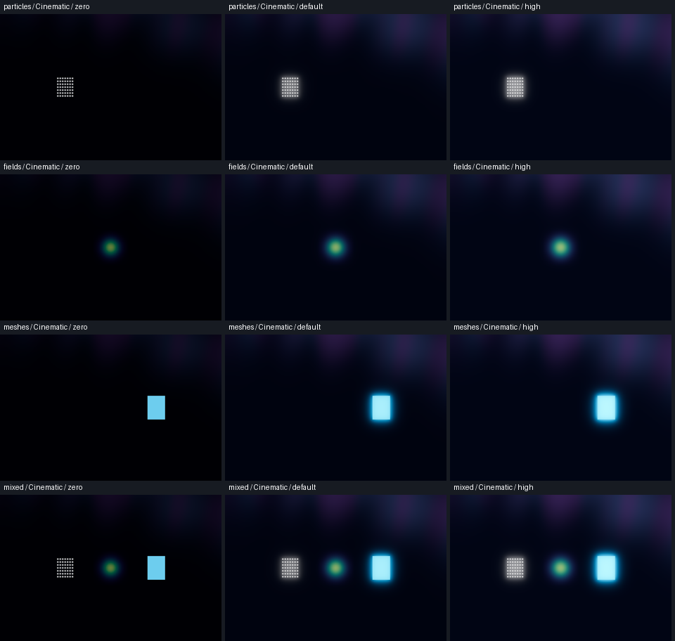
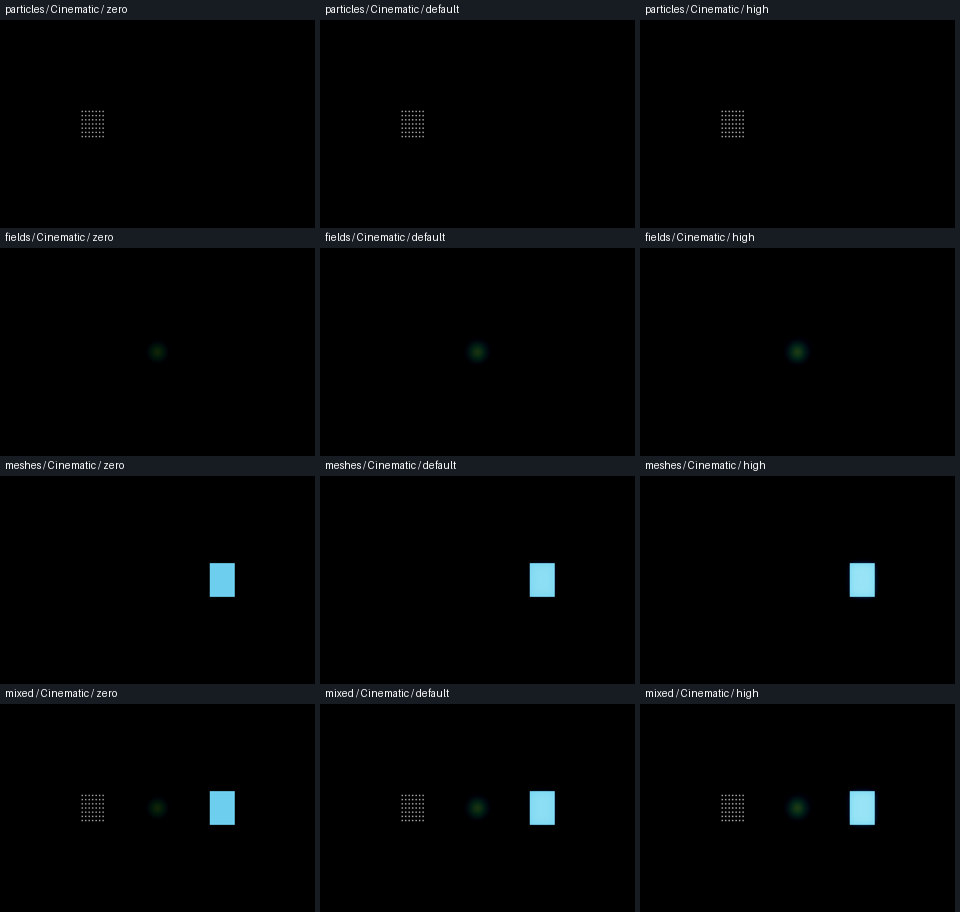

# Issue #306 — accepted Bloom baseline and architecture review

**Investigation checkpoint; independent category Bloom is unimplemented.**
Review the [architecture proposal](../../CATEGORY_BLOOM_PROPOSAL.md) before
approving renderer/artistic changes. These results do not satisfy independent
effect isolation or mark the issue owner-accepted.

On 2026-10-09, #306 was the first Ready item in Wavez Development. Its existing
linked branch was checked out and clean:
`306-render-ux-independent-bloom-controls-for-particles-fields-and-meshes`.
HEAD, local main and origin/main matched `65fd8fae15a1b8dd37c75eca3a197d75003ee4ee`.
PR #304 was owner-merged at that commit; its completed local/remote branches were
already absent. Fetch/prune left no stale branch references. Historical reports
were preserved. This PR proposes candidate **v0.1.0.80**; no production renderer,
shader, capture format or UI control was changed.

## Reproduction and interpretation

Fixture objects: 49 static particles on the left, a 17³ Gaussian scalar field
at the center, and a two-triangle mesh with the default display color on the right. Four separate
WVZ1 captures declare particles-only, fields-only, meshes-only and all three.
They remain external to the repository. The shared stationary camera uses
position `(0,0,12)`, target `(0,0,0)`, FOV 45°, and native 970×640 scene images.
Scientific channels, geometry and transforms are unchanged by the Bloom writes.
Each run confirms complete capture-file SHA-256 invariance.

| Scene | Cinematic control | Cinematic 0→2 output | Scientific control/output |
| --- | --- | --- | --- |
| Particles | Editable; keyboard and mouse update intensity | Visible particle change | Input disabled; zero changed pixels |
| Fields | Editable; keyboard and mouse update intensity | Visible field change | Input disabled; zero changed pixels |
| Meshes | Editable; keyboard and mouse update intensity | Visible mesh change | Input disabled; zero changed pixels |
| Mixed | Editable; keyboard and mouse update intensity | All three categories change | Input disabled; zero changed pixels |

The table holds for both source and Linux validation packages on both renderers.
The original disabled Cinematic mesh/field control was **not reproduced**. The
owner's original capture/recipe and preceding interactions were unavailable.
Do not infer that the reported problem is fixed or that the synthetic behavior
rules out the report. Compatibility's visible effect is much weaker than
Forward+ for this fixture, despite the same editable control and intensity.

Opening each capture retains the previous preset, editable state and environment
settings; selecting the initial category does not gate Bloom. Serialized
`VisualState` round trips preserve the effective environment. The harness also
demonstrates an explicit restore with a Cinematic label and `glow_enabled=false`:
the slider becomes disabled, and reapplying Cinematic enables it. This is a
possible state path, **not a confirmed explanation of the owner's capture**.
The default comparison writes exactly 1.35 to the environment; the existing
0.02-step slider displays 1.36 for that value.

In the mixed scene, the global slider changes the following separated 160×190
regions (0→2, 8-bit RGB). These are the **existing single global control**, not
proof of category independence. Forward+ also blooms the backdrop, so region
statistics include backdrop changes. Inspect the object halos in the images.

| Renderer | Particle changed pixels / mean channel delta | Field | Mesh |
| --- | --- | --- | --- |
| Forward+ | 30,262 / 40.431 | 30,400 / 22.919 | 30,400 / 51.124 |
| Compatibility | 2,596 / 0.622 | 7,531 / 1.403 | 12,815 / 6.383 |

All four Scientific scene comparisons on all four runs have **zero** changed
pixels. Source versus package images are byte-for-byte equal as decoded RGB
pixels for all 24 scene/preset/intensity images per renderer (48 comparisons).
This says nothing about future isolation, ordinary PNG export or MP4 encoding.

## Results and measured baseline

[Summary and source/package pixel comparisons](summary.json) retain all exact
measurements. Each native run completed and exited successfully; its final log
contains no errors or warnings. Timing is measured over 45 steady **paused**
mixed-scene frames at intensity 2 after 15 warmup frames, without VSync, on an
NVIDIA GeForce RTX 3070 Ti, Godot
`4.7.2.stable.official.ed1daf0bf`. Timing is descriptive; GPU clocks/background
load are not controlled, and small-scene package/source differences are not
performance claims.

| Run | Native checks | GPU median / p95 ms | Render CPU median ms | Engine texture / buffer bytes |
| --- | --- | --- | --- | --- |
| [Source Forward+](source-forward-plus.json) | 109, 0 failures | 1.030 / 2.282 | 0.051 | 99,675,136 / 19,283,248 |
| [Source Compatibility](source-compatibility.json) | 109, 0 failures | 0.590 / 1.586 | 0.184 | 48,796,692 / 32,125,228 |
| [Package Forward+](package-forward-plus.json) | 109, 0 failures | 1.030 / 2.209 | 0.047 | 99,675,136 / 19,283,248 |
| [Package Compatibility](package-compatibility.json) | 109, 0 failures | 0.173 / 0.204 | 0.170 | 48,796,692 / 32,125,228 |

All mixed runs report 3 visible draw calls, 3 visible objects and 61,120 decoded
cache bytes. Visible counters exclude the engine's post-process stage inventory;
engine memory counters are not process/device VRAM totals. There are **no new
production render passes** in this investigation. Additional passes, render
targets, cache/admission pressure and heavy-workload frame time for the proposed
architecture have **not been measured**. The proposal's 7-stage minimum and
83.1–98.9 MiB (1080p) / 332.2–395.5 MiB (4K) attachment costs are explicit
estimates, not empirical costs or upper bounds.

The focused scope is appropriate to this investigation: accepted Bloom state,
input, render output and resource observations plus schema/version tooling.
No particle/field/mesh preparation, camera, solver or scientific-format code was
changed, so unrelated full-suite regressions were not run.

Additional checks: Python compilation, two `tests.test_application_version`
tests, warmed Godot resource import, GDScript parse and `git diff --check`.

## Visual evidence

Columns are intensity **0 / 1.35 / 2**; rows are particles / fields / meshes /
mixed. Each source screenshot's package counterpart matches exactly.





Scientific comparisons:
[Forward+](source-forward-plus-scientific-comparisons.png),
[Compatibility](source-compatibility-scientific-comparisons.png).

Normal 1440×900, editable Cinematic controls:
[Forward+ field Light](source-forward-plus-fields-light-normal-control.png),
[Forward+ mesh Light](source-forward-plus-meshes-light-normal-control.png),
[Forward+ mixed Dark](source-forward-plus-mixed-dark-normal-control.png),
[Compatibility field Light](source-compatibility-fields-light-normal-control.png),
[Compatibility mesh Light](source-compatibility-meshes-light-normal-control.png),
[Compatibility mixed Dark](source-compatibility-mixed-dark-normal-control.png).

Minimum 970×600 Light controls:
[Forward+](source-forward-plus-mixed-light-compact-control.png),
[Compatibility](source-compatibility-mixed-light-compact-control.png).

## Reproduction commands

From the repository root, with an externally installed Godot 4.7.2 binary:

```sh
python tools/investigate_category_bloom.py \
  --godot /absolute/path/to/Godot \
  --renderer forward_plus \
  --output-dir /absolute/path/to/new-source-results
```

Repeat with `--renderer gl_compatibility`. Add `--package` for a Linux release
validation-entry package containing production resources. Output directories must
be new; the runner isolates preferences and writes logs/captures/images externally.
The local final outputs are under
`/home/Nozba/Codex/Wavez/bloom-306/{source-forward-plus-final,source-compatibility-final,package-forward-plus,package-compatibility}`.
Packages and third-party runtimes are not committed or approved for distribution.

## Failed attempts, limits and owner verification

Retained diagnostic attempts:

- [Display unavailable](attempt-display-unavailable.log): sandboxed X11/Wayland
  startup failed before rendering; reran with native display access.
- [Mouse routing](attempt-mouse-routing.log): the first harness sent mouse events
  to the root viewport instead of the embedded dialog's viewport; four mouse
  assertions failed while all keyboard checks and render images completed.
  Corrected routing to `Window.push_input()`; all final runs pass. This was a
  harness failure, not evidence of the reported product defect.
- [Import environment](attempt-import-environment.log): sandbox blocked the
  editor socket/settings write. An isolated authorized import completed; initial
  cached missing-UID warnings for five unrelated baseline scripts disappeared
  on an unchanged warmed import. Incidental generated sidecars were discarded;
  only the new investigation script's UID is included.

Unverified: owner's exact reproduction; true independent gains/zero-contribution
and overlapping/occluded scenes; new source/render-target HDR fidelity; dense or
moving particle/field/mesh workloads and pass/VRAM/cache costs; slice/isosurface/
wireframe behavior; actual ordinary image export and deterministic MP4; physical
mouse/keyboard/Wayland interaction, 4K/mixed-DPI, other GPUs/OSes and long sessions.
Input checks use synthetic native Godot events through the real embedded dialog.
All displayed images use viewport PNG snapshots. The architecture is unapproved.

Before architecture approval, the owner should:

1. Review the proposed offscreen source/occluder passes, HDR/transparency gates,
   export barriers and render-target budget in the architecture document.
2. Decide whether Fields/Meshes should gain **opt-in mapped-color decorative
   Bloom**, both defaulting to 0; Particles target the accepted 1.35 appearance.
3. Reopen the reported mesh/field capture and recipe on accepted build 79, select
   View → Viewing preset → Cinematic explicitly, then open View → Global effects
   and exercise Bloom by click and Right/Left keys. Compare with Scientific,
   then return to Cinematic; record whether the slider moves versus whether the
   rendered effect is weak. If only restore reproduces it, retain that recipe.
4. Review the evidence's renderer differences and agree to cost/appearance limits
   for a prototype before production integration. Do not merge this Draft as a
   completed implementation or treat the checks as owner visual acceptance.
