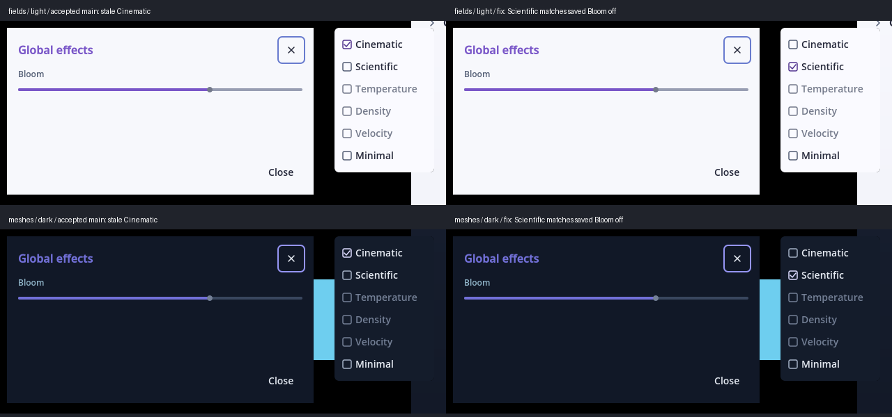

# Global Bloom control — owner review evidence

Accepted main: `65fd8fae15a1b8dd37c75eca3a197d75003ee4ee` / **v0.1.0.79**.
Candidate: `issue-306-global-bloom-control` / **v0.1.0.80**.
Godot `4.7.2.stable.official.ed1daf0bf`, Linux/Wayland, RTX 3070 Ti.
The owner superseded the independent Bloom architecture in
[issue #306](https://github.com/mongstad/Wavez/issues/306) and
[PR #309's clarification](https://github.com/mongstad/Wavez/pull/309#issuecomment-6088937621).
That Draft research PR and its historical evidence remain unchanged. This fix
branches directly from accepted main. Issue #306 stays open for physical review.

## Reproduction and result

Accepted main consistently reproduces an incorrect Cinematic checkmark with a
disabled Bloom slider after loading an explicitly Bloom-off saved view.
Ordinary Cinematic loading of particle-only, field-only, mesh-only and mixed
fixtures keeps the shared slider usable. The observed defect is state
synchronization, with no demonstrated category-dependent disabling in loading.
The owner's actual captures/presets were unavailable; they elected to verify
personally. This is a reproducible defect, not a confirmed explanation of their
specific experience.

The correction honors the saved environment and updates the checkmark to its
effective decorative mode. Choosing Cinematic through the real connected menu
enables native global Bloom and mouse/keyboard/drag interaction without particles.
Scientific deliberately disables Bloom. No other saved settings or pixels are
changed on restoration. See [behavior and implementation](../../../GLOBAL_BLOOM.md).



## Completed checks

| Validation | Completed evidence |
| --- | --- |
| Four WVZ1 capture types; both renderers; both themes; C → S → C; capture switching; direct VisualState, portable and source-bound recipe restoration | 298 checks per accepted/source/package renderer run: **1,788** total |
| Actual checked Viewing preset menu and its connected Cinematic action with fields/meshes, both themes/renderers, accepted/candidate | **96** checks; `menu-*.json` and screenshots |
| Existing v2/v3 recipe restoration and session/scientific ownership suite | **2,663** checks; `recipe-state.json` |
| Existing portable preset save/load, atomic rejection, repeated restoration and zoom round trips | **815** checks; `view-preset.json` |
| Existing independent Point rendering / environment restoration suite | **60** checks; `point-rendering.txt` |
| Native scene/PNG pixels, accepted main versus source and release candidate | **160** exact image pairs; `comparisons.json` |
| Real production-worker MP4 export, accepted/source/release, both renderers, both presets | **12** completed jobs / **36** frames; candidate and release PNG frame pixels match accepted main exactly; `exports.json` |
| Strict WVZ1 verification and source SHA retention | **18** records across four fixtures; all hashes unchanged |
| Version contract / Python compilation / diff checks | **2** version tests pass; runner compiles; diff clean |

Total: **5,422** completed Godot checks, separately from the two Python tests.
Native input events enter `Window.push_input` and the GUI focus/hit-test path;
the test does not invoke the slider callback directly. Key arrows, mouse
clicks and mouse dragging change intensity in Cinematic and cannot change it
in Scientific. Menu verification invokes the connected guarded command.
This establishes native event-path behavior, not a human hardware-input test.

The four fixtures are synthetic particles, a scalar volume, a triangle mesh
and their combination, sampled at 0, 0.5 and 1.0. Video samples 0, 0.25 and
0.5 at 4 FPS, crossing a sample boundary. The normal production worker and
first-party Linux packaging path are used without prototype hooks or a worker
patch. MP4 dimensions/frame count/rate are verified by FFprobe; source samples
produce changing video pixels. Native PNG uses `_capture_inspection_png`.

The named scientific presets remain selected with Bloom off; partial presets
leave omitted environment values intact. Point rendering can change particle
representation independently of the decorative environment. Existing recipe
checks retain scientific/session state and cover actual v3 worker restoration.

## Interaction versus visible effect

The ROI comparisons examine projected particle, field and mesh landmarks,
including all three in the mixed scene. Cinematic 0 → 2 intensity changes all
present landmarks. Scientific comparisons have zero changed pixels everywhere.
The single-category mean RGB-code differences in the 220×220 regions were:

| Renderer | Particles | Field | Mesh |
| --- | ---: | ---: | ---: |
| Forward+ | 45.19 | 25.56 | 50.13 |
| Compatibility | 0.86 | 1.89 | 8.01 |

These are fixture observations, not a promise of equally visible glow for
other brightness/material/color settings. Compatibility's smaller effect
does not indicate disabled input. Native scene-wide rendering is preserved;
Bloom can also change the Cinematic backdrop. Normal and compact Dark/Light
control screenshots are retained with their backend names. The Global effects
dialog has one slider and retains its original layout.

## Resources and performance boundary

No render pass, compositor, source buffer or viewport is added. The 240 tracked
files under `viewer/layers`, `viewer/video`, `viewer/selection` and
`wavez_export` are byte-identical to main; their SHA inventory is in
`comparisons.json`. Shaders and renderer quality/defaults are unchanged. The
production change runs only on preset selection/restoration, with no new
per-frame work. Measured private SubViewport count is zero in every run.

Texture allocation and decoded-cache counters match main exactly for each
source/release case. Forward+ buffer counters also match exactly. Compatibility
buffer pools vary between processes (candidate/release were lower here);
that counter is retained as an observation rather than asserted identical.
For the mixed fixture:

| Renderer | Accepted / source / release GPU median (ms) | Texture bytes, each | Cache bytes, each |
| --- | ---: | ---: | ---: |
| Forward+ | 2.068 / 2.091 / 0.945 | 135,734,272 | 61,120 |
| Compatibility | 1.009 / 0.869 / 1.174 | 70,216,892 | 61,120 |

Thirty native frame samples per case are recorded, including P95 and other
capture types. Clocks, desktop load and shader/allocator timing were not
isolated. Single-category timings vary substantially; these observations are
not a precise incremental-performance benchmark or a 4K throughput guarantee.
The preservation claim is unchanged rendering inputs/pipeline, zero new GPU
targets, matching texture/cache accounting and exact pixels. The expensive
independent renderer was not included or rerun.

## Reproduce

Godot and FFmpeg remain external dependencies; no binaries or WVZ captures are
committed. Use a fresh external output directory for each command. Accepted
main comparisons use a `git archive` checkout plus this same test harness,
without production edits. Substitute local paths below:

```sh
python tools/validate_global_bloom.py --godot /path/to/Godot --renderer forward_plus --output-dir /tmp/bloom-main-forward --project-root /path/to/accepted-main --baseline
python tools/validate_global_bloom.py --godot /path/to/Godot --renderer forward_plus --output-dir /tmp/bloom-fix-forward --compare-with /tmp/bloom-main-forward
python tools/validate_global_bloom.py --godot /path/to/Godot --renderer gl_compatibility --output-dir /tmp/bloom-main-compatibility --project-root /path/to/accepted-main --baseline
python tools/validate_global_bloom.py --godot /path/to/Godot --renderer gl_compatibility --output-dir /tmp/bloom-fix-compatibility --compare-with /tmp/bloom-main-compatibility
python tools/validate_global_bloom.py --godot /path/to/Godot --renderer forward_plus --output-dir /tmp/bloom-package-forward --package --compare-with /tmp/bloom-main-forward
python tools/validate_global_bloom.py --godot /path/to/Godot --renderer gl_compatibility --output-dir /tmp/bloom-package-compatibility --package --compare-with /tmp/bloom-main-compatibility
python tools/validate_global_bloom.py --godot /path/to/Godot --output-dir /tmp/bloom-exports --exports --project-root /path/to/accepted-main --fixtures-dir /tmp/bloom-fix-forward
```

For the additional menu screenshots, invoke the retained `review-harness.gd`
as an absolute `--script` with `--path <repo>/viewer`, native renderer,
`--resolution 1440x900`, and user args `<output> <fixture-directory>`; add
`baseline` for accepted main. `verification.json` binds tested code hashes,
fixture hashes and check counts; `sha256.json` verifies retained evidence.

Original outputs, staged PNG frames and the tested normal Linux build remain
external at `/home/Nozba/Codex/Wavez/bloom-global-306/`. The build is
`exports/WAVEZ.x86_64`. Earlier 260-check exploratory runs are superseded by
the completed 298-check matrix above, not counted again. An initial sandboxed
editor import lacked socket/settings access; the workspace-profile retry
completed cleanly. Incidental regenerated unrelated UID sidecars were removed.

## Owner review and remaining limits

Open the original field/mesh captures, select Cinematic and test the shared
slider with the mouse and keyboard. Switch Scientific → Cinematic, switch
captures, and load saved view presets. A saved Bloom-off view now shows
Scientific; selecting Cinematic enables the effect and control. Both Dark
and Light should retain the same behavior. If the original unusable state
persists, retain its exact capture/recipe/backend and interaction sequence.

The original owner case, human physical input, 4K/mixed-DPI, other GPUs/OSes,
long video, selection-aware v2 video and a full playback/cache soak were not
verified here. Existing v2/v3 recipe ownership tests passed, but that is not a
complete export/analysis acceptance matrix. No universal performance or
material-visibility guarantee is claimed. Do not merge or close #306 before
the owner's physical verification.
