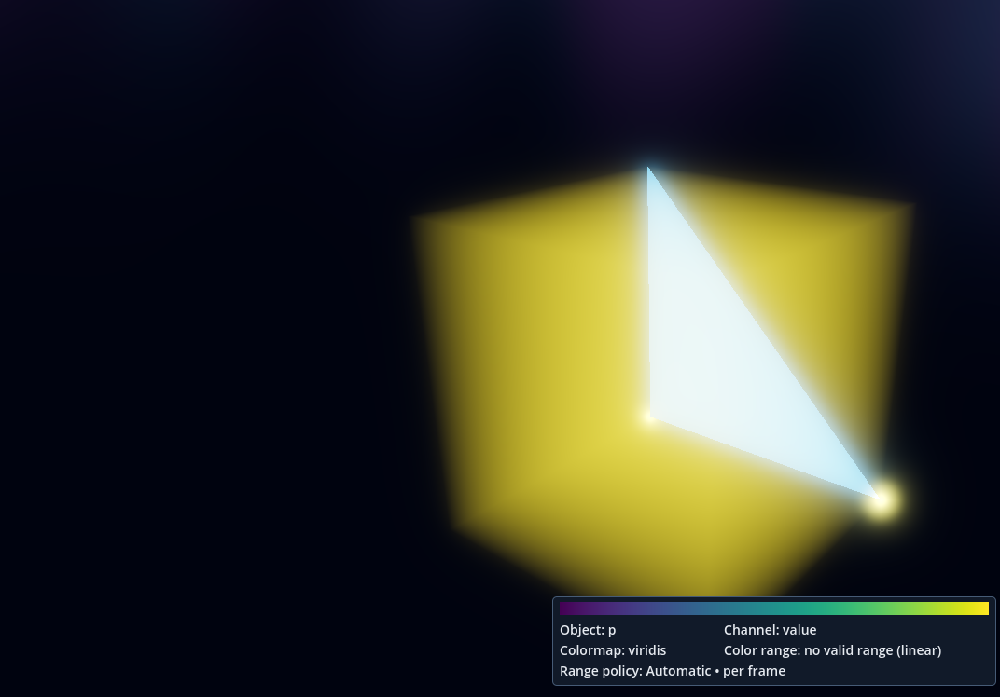

# Issue #371 — Forward+ Vulkan as the supported renderer

Candidate **v0.1.0.97**, pending owner review. The only Ready issue was
[#371](https://github.com/mongstad/Wavez/issues/371). The existing linked branch
`371-arch-render-make-forward-vulkan-the-sole-supported-wavez-renderer` was clean
and exactly matched accepted `main` / `origin/main` at
`eacdae866b017700e0919b263fdfd04c0f65bc27` (owner-merged PR #370). Remote refs were
fetched/pruned; no completed previous local issue branch remained.

## Change and audit boundary

The project explicitly selects Forward+ and Vulkan and disables automatic OpenGL
and Direct3D fallback. A shared runtime policy checks the actual method/driver
before building the viewer world or opening a capture. Standalone/headless,
Compatibility and Mobile operation are refused. Explicit editor-build headless
`--script` tests can still inspect CPU contracts; workers always require a real
Forward+ Vulkan GPU display.

Ordinary video and explicit Matched Views use the existing secondary-process
architecture with one pinned method/driver pair. Development children retain
`--path`, release children use their PCK, and unsupported job renderer requests
are rejected. Logs/launch diagnostics/worker metrics identify the method, driver
and GPU. The audit found no application renderer-selection widget. It removed
only the Compatibility volume NDC branch, preset-quality skip and framebuffer
label branch; Forward+ calculations and general scientific/shader code remain.

All 99 maintenance renderer arguments were audited; GPU choices/defaults are
Forward+ and explicit CPU choices remain headless. Fixed renderer matrices also
use Forward+ only. `investigate_window_signals.py` retains historical comparison
capability for archived sources. Existing benchmark reports, Compatibility
measurements, failures and `docs/evidence/` records are unchanged. Current guides
now point to [requirements, troubleshooting, scientific limits and #94/#362
coordination](../../RENDERER_REQUIREMENTS.md). No engine fork or later issue work
was performed; licensing and WVZ1 numerical contracts are unchanged.

## Validation

Godot **4.7.2.stable.official.ed1daf0bf**, Linux x86_64, NVIDIA RTX 3070 Ti,
driver **615.71.09**, Vulkan **1.4.351**. Native tests used synthetic external WVZ1
fixtures and isolated preferences. The final source import and final Linux
release build completed with no engine/script errors. Python tools compile
cleanly; 255 local documentation link targets exist. See
[summary](validation-summary.json) and the original reports retained here.

| Connected contract | Checks | Result |
| --- | ---: | --- |
| Python WVZ1/chunks/channel/field/version | 21 | PASS |
| Source/release startup, method/driver, job refusals and unavailable Vulkan | 68 | PASS |
| Source video, background Jobs, selections/analysis isolation and cancellation | 634 | PASS |
| Release video, startup failure, source/release pixels and timing | 702 | PASS |
| Asynchronous playback | 2,457 | PASS |
| Transport | 260 | PASS |
| Mesh preparation, source invariance and render comparisons | 3,001 | PASS |
| Field color / opacity, numerical source probes and export | 138 / 98 | PASS |
| Save Image: particles, fields, meshes, mixed | 64 | PASS |
| Navigation/tumble and source invariance | 13,062 | PASS |
| Native payload integrity | 480 | PASS |
| Explicit Matched Views, sequential children and scientific provenance | 50 | PASS |
| Forward+ portable preset quality restoration | 815 | PASS |
| CPU recipe restoration (headless; no GPU claim) | 2,663 | PASS |
| Repeated accepted-main/candidate PNG and timing comparisons | 12 | PASS |
| Final standalone worker PNG/timing/actual release backend | 6 | PASS |

This is a renderer-policy change that connects startup, every render kind and
export children. Those contracts justify the selected integration coverage;
unrelated shell/style/dialog, analysis-algorithm, solver and whole-suite runs
were not performed. Captures were hash/stat checked by the respective harnesses;
no production simulation was run and no captures, videos or runtimes are committed.

The final release defaults to Forward+ Vulkan from its PCK without renderer flags.
Its particle and mixed workers produce the same PNG bytes and source timing as
accepted main. Ordinary video source/release comparisons also match decoded
pixels and timing. Development and release child diagnostics explicitly confirm
Vulkan, including jobs, background operation, cancellation and encoder failures.

### Output and measured performance

Three sequential baseline/candidate repetitions per particle/mixed fixture used
the same official engine, view state, two frames and GPU. PNG hashes and complete
`timing.jsonl` bytes are identical. [Baseline comparison](baseline-comparison.json)
records all repetitions and worker metrics.

| Fixture | Median wall seconds, accepted / candidate | Median render/readback ms, accepted / candidate |
| --- | --- | --- |
| Particles with legend | 2.267536 / 2.267641 | 6.181 / 5.146 |
| Mixed particles/field/mesh | 2.467938 / 2.467849 | 6.190 / 6.080 |

No measurable wall-time regression appeared in these small fixtures. This is
not a large-capture, long-session, frame-rate or GPU-contention guarantee. A
separate headless recipe check overlapped baseline import/initial warm-up; later
repetitions ran without another validation process. Timing differences do not
establish an optimization or a universal performance improvement.



### Failed attempts and recovery

- Initial `compileall` found a malformed default argument introduced while
  pruning a maintenance renderer choice. It was corrected; final compilation
  of all tools is clean.
- An initial sandboxed source import could not bind an editor socket or write
  home-directory editor settings. A final native import used isolated writable
  editor state and completed cleanly.
- The first instrumented release-video build hid the external export templates
  through an isolated `XDG_DATA_HOME`. [The failure](initial-missing-template.txt)
  is retained. A fresh retry with installed template access passed 702 checks.
- The first local-link checker mishandled Markdown angle-delimited targets.
  Corrected parsing verified 255 existing targets without changing those links.

Missing-Vulkan tests deliberately hide the ICD only from each child process and
capture/dismiss its engine alert using test-local dialog stubs. Both source and
release exit 1 without an OpenGL renderer. Engine errors/leak warnings during
this injected pre-script initialization failure are retained in
[source](missing-vulkan-source.txt), [release](missing-vulkan-release.txt) and
[alert wording](engine-startup-alert.txt). They are not clean-startup results.
Godot still suggests OpenGL in that alert; Wavez cannot replace it before scripts
run. Current troubleshooting states that the suggestion is unsupported.

## Reproduce

Use fresh output directories and an externally installed official Godot engine,
matching Linux export templates, Python/NumPy and FFmpeg with libx264. The exact
run commands are in the linked reports and local digest-bound report inventory.
Representative current commands, from the repository root:

```sh
python tools/package_linux.py --godot /absolute/path/Godot --output-dir /fresh/package
python tools/validate_renderer_policy.py --godot /absolute/path/Godot \
  --output-dir /fresh/policy --packaged-binary /fresh/package/WAVEZ.x86_64
python tools/validate_packaged_video.py --godot /absolute/path/Godot \
  --output-dir /fresh/source-video --renderer forward_plus
python tools/validate_packaged_video.py --godot /absolute/path/Godot \
  --output-dir /fresh/release-video --renderer forward_plus --export \
  --compare-source /fresh/source-video
```

Do not hide installed export templates when isolating build state. Runtime test
preferences are isolated independently. Headless checks do not certify pixels.

## Owner verification and limits

The final local review package is
`/home/Nozba/Codex/Wavez/renderer-371/package-final/`; keep `WAVEZ.x86_64` and
`WAVEZ.pck` together. [Build metadata/hashes](package-build.json) identifies it.

1. Run `./WAVEZ.x86_64` without renderer flags. Check Help → About shows
   **v0.1.0.97**. Open the generated
   `/home/Nozba/Codex/Wavez/renderer-371/source-video/inputs/mixed.wvz`, then an
   owner capture. Inspect Particles, Fields and Meshes in Scientific/Cinematic;
   try channel/range/opacity settings and independently check source-probe values.
2. Play, pause, seek and step. Exercise physical LMB tumble, RMB steering, wheel
   zoom, Frame, Reset and configured roll controls. Check stationary geometry
   and retained camera/preset behavior.
3. Save an image to a fresh path. Export a short video to a fresh MP4 with
   external FFmpeg, use Run in background, reopen Jobs, and cancel another export
   while rendering/encoding. Check retained diagnostics show
   `rendering_method: forward_plus`, `rendering_driver: vulkan` and a release
   child; inspect outputs and source values independently.
4. From a terminal run `./WAVEZ.x86_64 --rendering-method gl_compatibility`.
   Confirm the Wavez requirement message and exit status 1, with no capture open.
   On a machine with a Vulkan startup problem, retain the engine error, update
   its GPU driver and follow the current troubleshooting guide.

No physical non-Vulkan hardware, other GPU/driver, Windows/macOS, physical input,
4K/mixed-DPI desktop, long session, large production capture or GPU contention
was tested. Native Save Image was tested from source; the final standalone Save
Image menu remains an owner physical check. Forward+ is not universally precise;
#360 remains separate. Engine pre-script messages retain upstream wording.
Passing automation is not owner acceptance. No merge, auto-merge, issue closure,
Project transition, release/tag or work on #94/#362 follows from this candidate.
