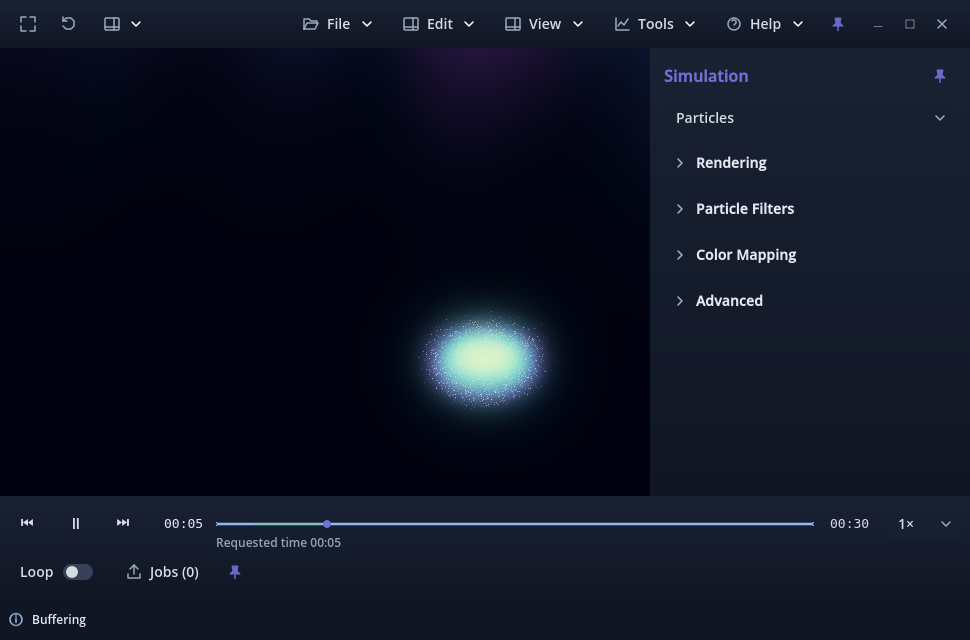
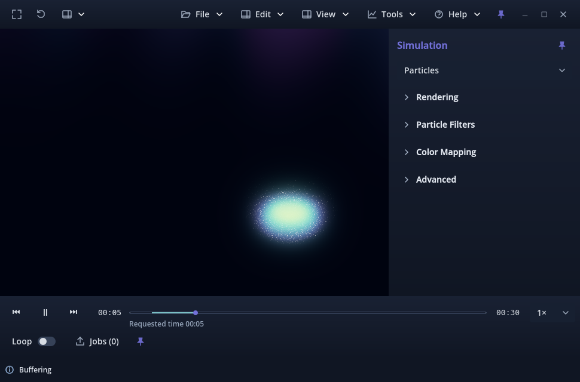

# Issue #378 review evidence

Candidate **v0.1.0.100** on the owner's existing linked branch
`378-bug-ux-playback-correct-misleading-prepared-timeline-coverage-and-improve-particle-readiness-visibility`.
Accepted base: `b0c0aed6099e091012fcf141846cf2e07f93a274`, owner-merged PR #379,
v0.1.0.99. #378 was the sole Ready item in Wavez Development when selected.
#159 and #197 are closed; the current baseline includes their merged history.
Owner acceptance is pending.

## Diagnosis and real-capture reproduction

Forward+ Vulkan, Godot 4.7.2.stable.official.ed1daf0bf, Linux, NVIDIA RTX 3070 Ti.
The retained toroidal mixed WVZ1 capture has 301 particle samples and 121 field
samples over 30 seconds. It was read directly, without running a solver or
writing scientific payloads. Exact source path/metadata and selected snapshots
are in [real-replay.json](real-replay.json).

On accepted main, paused preparations were **fields [0, 30]**, but **scene [0, 0.8]**;
particle ready indices were 0–7. Nevertheless the old drawing painted field-only
blue through the end. Its natural 1× run reached 30 seconds with no hold in the
one-second observations. This reproduces the false visual promise, but does not
establish the cause/frequency of the owner's natural stalls.

To reproduce the stall presentation deterministically on that same real capture,
the diagnostic sets the existing particle worker's test publication semaphore
at 5 seconds, releases it after three seconds of underflow, and retains the normal
requests, preparation, admission and transport gates. This is an **injected
publication delay**, not a claim of naturally slow scheduling.

| Observation | Accepted main | Candidate |
| --- | --- | --- |
| Field intervals at first hold | [0, 30] | [0, 30] |
| Scene intervals at first hold | [1.9, 5.7] | [1.9, 5.7] |
| Committed/requested clock | 5.667440 | 5.669223 |
| Missing particle target | 5.702151, pair 57 | 5.703981, pair 57 |
| Exact hold reason | Required particle content | Required particle content |
| Main painted duration | Blue reaches 30; teal ends 5.7 | Only teal ends 5.7 |
| After barrier release | Recovers, reaches 30 | Recovers, reaches 30 |

The missing target is outside the published scene interval. Worker `ready_indices`,
particle pair endpoint sequence numbers/times, all selected field keys, intervals,
RAM diagnostics and exact gate reason are retained in the first/last hold snapshots.
No contradictory full-length **scene** interval was observed in these real runs.
No scheduler defect is established by an injected delay, so #377 remains separate;
this PR does not claim to fix naturally slow preparation or GPU frame stalls.

Accepted main at the settled Buffering state (field-only blue reaches the end):



Candidate at the same controlled Buffering state (only required-scene coverage):



## Publication and presentation corrections

- The main track draws only `scene`; `fields` remains diagnostic information.
- Field/mesh publication consumes the exact current controller signature and
  current-generation resident worker keys. The signature construction is extracted
  unchanged from their request paths; scheduling and budgets are unchanged.
- Particle publication validates its source stamp/generation/configuration and
  current worker context. Source/configuration/visibility changes and evictions
  bypass the former 200 ms timeline throttle; unchanged metadata avoids rescanning.
- Static layers require their reusable sample throughout the union clock. Dynamic
  layers remain absent before their first sample. Prepared particle/mesh **pairs**
  cover their adjacent intervals; fields use held selected-channel samples.
- Terminal readiness is explicit. A missing exact terminal preparation leaves a
  one-logical-pixel endpoint gap rather than a full-length readiness promise.
- Positive intervals below three logical pixels keep their actual duration and
  receive a detached diamond above the track. It indicates presence, not cached
  duration. It never fills an unprepared gap or adds elapsed coloring. The native
  playhead remains dominant; both theme palettes supply readiness ink.

Dark and Light at 2× synthetic UI scale on a four-hour timeline (0.1-second window):


## Focused validation

| Check | Result |
| --- | --- |
| Focused headless resident/gate tests | 77 checks, zero failures; clean exit |
| Focused Forward+ source tests and pixels | 113 checks, zero failures; clean exit |
| Focused Linux release-template validation entry | 113 checks, zero failures; clean exit |
| Native timeline geometry, pointer/keyboard input | 104 checks, zero failures |
| Connected rolling cache/coverage regression | 81 checks, zero failures |
| Application version tests | 2 tests passed |
| Production Linux package | Build/export succeeded, v0.1.0.100; external executable/PCK |
| Existing shell style suite | 49/53 pass; same four failures on accepted main |

The five focused fixtures cover particle-only, field-only, mesh-only, static and
mixed scenes; paused prebuffering, 1× controller traversal, seek/scrub, visibility,
channel and mesh/particle configuration changes, source stamp/generation changes,
invalidation, real budget-induced particle eviction and re-preparation. The
explicit field-ready-to-end regression holds a real particle publication and
checks the exact playback gate. Read-only refresh checks ensure it neither reads
new source payloads nor changes particle requests. Pixel tests cover field-only
absence, truthful subpixel geometry, full coverage, terminal readiness, the
presence cue and dominant playhead in both themes at 1× and 2× scales.
Generated WVZ1 fixtures have identical before/after SHA-256 hashes.

This scope targets timeline publication/drawing and the directly connected
controller signature/input paths. No unrelated camera, analysis, scientific-format,
video-export or full application suites were run.

Reproduce with an externally installed editor and fresh output directories:

```sh
python tools/validate_prepared_timeline.py --godot /absolute/path/Godot --output-dir /fresh/headless
python tools/validate_prepared_timeline.py --godot /absolute/path/Godot --renderer forward_plus --output-dir /fresh/source
python tools/validate_prepared_timeline.py --godot /absolute/path/Godot --renderer forward_plus --export --output-dir /fresh/release
python tools/validate_timeline_geometry.py --godot /absolute/path/Godot --output-dir /fresh/geometry
```

The release check changes only a temporary test entry scene/base wrapper, because
release templates ignore `--script`. Production resources and controllers stay
unchanged. No source `--path` override is used when running the exported harness.
The normal production package was built separately with `tools/package_linux.py`;
no Godot binary or external runtime is committed.

For controlled retained-capture replay against an imported accepted snapshot or
candidate, pass this diagnostic's absolute script path to the external editor:

```sh
/absolute/path/Godot --path /snapshot/viewer --rendering-method forward_plus \
  --audio-driver Dummy --resolution 960x640 \
  --script /checkout/viewer/layers/profile_prepared_timeline.gd -- \
  /external/mixed.wvz /fresh/trace.jsonl --particle-barrier
```

## Failures, limits and preserved records

- The existing style suite fails `top/right/bottom pin retains tooltip` and
  `Single accepted Play handler` on both accepted main and candidate. Reports/logs
  are retained here. Its timeline/theme assertion passes. These pre-existing
  assertions were not rewritten to manufacture a complete pass.
- Early fixture/API and GDScript test-harness errors were repaired before clean
  validation. The first Vulkan pixel checks exposed inherited Light ink; the
  production fix and final pixel evidence address it. An initial import/rolling
  launch lacked permission to write default user logs/settings; isolated writable
  profiles/import settings provided clean reruns.
- An initial accepted snapshot lacked its import cache; it was imported and replayed
  cleanly. An ordinary release launch ignored `--script` and was stopped; a first
  temporary wrapper failed import, then the corrected validation entry passed.
  These launches are not counted as passing package checks.
- Natural baseline playback had no sampled hold. The controlled delay proves
  the incorrect old display and correct new publication/gate boundary, but does
  not reproduce the owner's natural load or prove scheduler reliability.
- Real captures were opened read-only. Recorded metadata is after replay; no
  whole-file before/after hash claim is made for the external 3.97 GB input.
- 2× synthetic UI scaling is verified; physical KDE/4K, mixed-DPI comfort, other
  GPUs/OSes and long-session behavior remain owner/environment checks. Headless
  evidence establishes CPU contracts only. Compatibility is unsupported and unrun.
- Existing CPU startup gates/GPU staging may still wait; resident readiness is
  not a universal throughput or frame-rate promise.

Current documentation: README, handbook, current status and
[Prepared timeline](../../PREPARED_TIMELINE.md). The #106 report receives only a
superseding-contract pointer; its original body/measurements remain unchanged.
All earlier evidence and historical pending-review wording are preserved.

Exact manual acceptance steps are in
[Prepared timeline — owner review](../../PREPARED_TIMELINE.md#validation-and-owner-review).
Review the mixed capture, gap scrubbing, visibility/channel changes, long-window
presence cue in both themes at ordinary/4K scale and normal Linux package playback.
Stop boundary: one PR to main, awaiting owner review; no merge, auto-merge, manual
issue closure, Project transition or next Ready issue.
