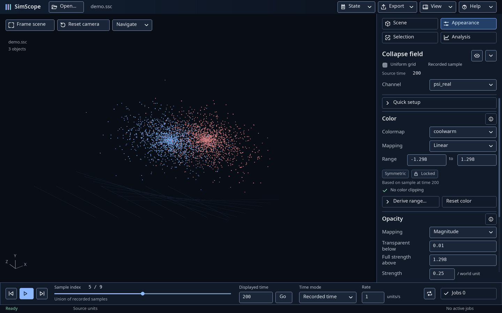
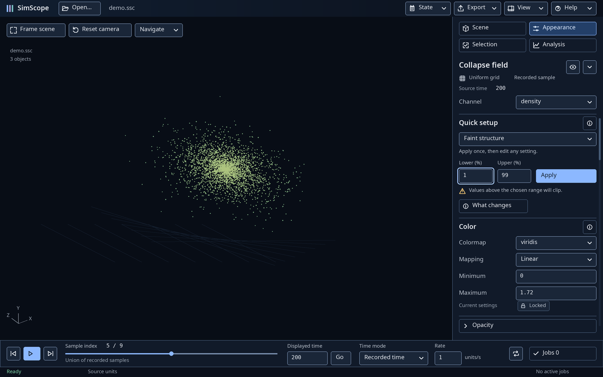
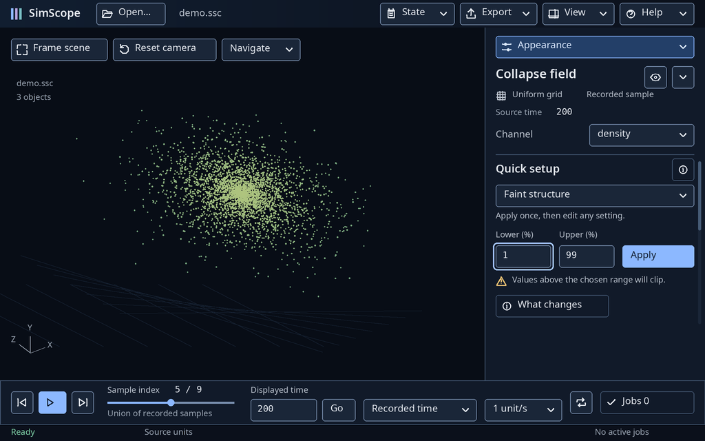
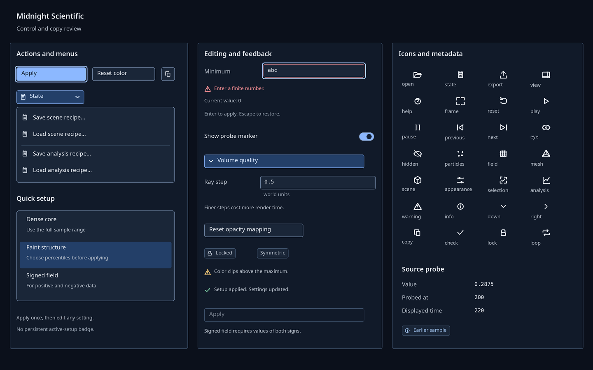

# Issue #40 — revised visual review

**Static high-fidelity proposals, pending owner review.** These supplement and
supersede the original issue-14 schematic **visual/copy direction**. They are not
native viewer screenshots. Scene marks, source names, values and plots are
illustrative. No new scientific rendering is proposed or validated.

Start with the [visual/copy specification](../../UX_VISUAL_LANGUAGE.md), then
compare the images at 100% native size. The
[semantic architecture](../../UX_INFORMATION_ARCHITECTURE.md),
[control map](../../UX_CONTROL_MAP.md) and
[original workflow research](../../UX_IA_REVIEW.md) remain the other review inputs.

| Static mockup | What to inspect |
|---|---|
| [Loaded Scene](scene.png) | Visible workspaces; structured selected-object header; visibility separate from row selection; Source probe |
| [Particle Appearance](particle.png) | Representation, Color, Display filters and Recorded history; no mixed volume controls |
| [Volume Appearance](volume.png) | Clean Color/Opacity headings, independent fields, badges and source metadata |
| [Volume continuation](volume-details.png) | Local scroll with fixed context; reset mapping, strength, Volume quality and derivative disclosures |
| [Faint: inherited inputs](faint-inherited.png) | Choosing Faint retains 0–100 from Dense core; current mappings remain unchanged |
| [Faint: edited inputs](faint-edited.png) | Explicit 1–99 choice, focus treatment, adjacent Apply and prospective clipping notice |
| [Signed field](signed.png) | Symmetric/Locked color; independent magnitude thresholds; manual 0.01 threshold example |
| [Selection](selection.png) | Explicit source binding, source object, exact ID above 2^53, primary Create action |
| [Analysis](analysis.png) | All-particles request, units and inclusive range; primary Run; no implicit source rebinding |
| [Results](results.png) | Temporary expanded workbench, source/request provenance, bounded table and full numerical export |
| [Compact 1024×640](compact.png) | Chooser fallback, readable 14-pixel labels, adjacent percentile inputs/Apply, persistent transport/Jobs |
| [Mesh Appearance](mesh.png) | Named mesh context, scalar colors and wireframe only |
| [Controls and menus](components.png) | Real action hierarchy, recipe/setup menus, 29-icon family, focus, invalid draft, disabled reason, probe metadata |
| [Different requested time](time-difference.png) | Displayed 200 versus requested 220, visible preparation state; no invented source advance |
| [Focused Color details](color-details.png) | Concise secondary help, close control and handbook route |









## Exact owner review

1. At 1440×900, identify all four workspaces, the selected object, its type,
   visibility, channel and source time without reading a paragraph. At 1024×640,
   inspect the compact chooser and transport without shrinking the image.
2. Compare inherited and edited Faint views. Confirm that choosing Faint does not
   replace 0–100 with 1–99; Apply is beside both inputs, and manual fields below
   remain authoritative. Inspect the setup menu's positive/negative requirement.
3. In the signed and volume-continuation views, distinguish color range, opacity
   thresholds, strength and ray step. Verify Locked is metadata, not a disabled
   editor or a persistent preset. Check reset labels against their narrow scopes.
4. Compare ordinary transport with the requested-time example. Confirm the index
   is a union index, time/rate units are understandable, Jobs stays reachable, and
   displayed time does not move merely because a request has been entered.
5. In Selection/Analysis/Results, distinguish object context from scientific
   membership and explicit source binding. Check the exact ID, inclusive range,
   units, support, full-result export and Return to viewport.
6. Inspect the component sheet: primary versus secondary actions, menus, icons,
   focus clearance, readable disabled reason, persistent error and old probe time.
   Confirm that short details supplement rather than conceal essential warnings.
7. Review the specification's old/revised wording table and copy rules. Decide
   whether this visual/copy direction is acceptable before authorizing production
   work. Visual approval does not implement or accept UX3.

## Reproduction and focused checks

From the repository root, using the existing Python environment with Pillow:

```sh
python docs/evidence/issue-40/render_mockups.py
python docs/evidence/issue-14/check_review.py
python docs/evidence/issue-40/check_review.py
```

The generator reads the current theme tokens and existing bundled numeric font.
`UX_MOCKUP_FONT` and `UX_MOCKUP_BOLD` can point to installed body/heading fonts;
the recorded run uses Noto Sans Regular/Semibold. No third-party asset, font,
dependency, capture or runtime is added. The SVG sprite is original documentation
art; existing UX2 icon geometry is retained for compatible commands.

[Layout evidence](layout.json) records image hashes, labels and control rectangles.
[Verification](verification.json) records scope checks, images,
control bounds/overlaps, navigation/required-copy coverage, theme identity and
contrast arithmetic. These assertions support a manual review, not replace it.
The [original checker](../issue-14/check_review.py) still checks all 96 control
entries and their source symbols. Original native evidence and historical reports
are retained without altering their recorded measurements.

Final focused results: 15 images, 29 vector icons, 471 controls checked for bounds,
non-overlap and minimum size; 20 token contrast pairs passed. The architecture
checker passed 256 local links/anchors and all 96 inventory/source-symbol checks.
Deterministic regeneration preserved every image hash and layout record. Godot
4.7.2 headless editor import passed with a clean log and no new source sidecars.

The 15 mockups were rendered and visually inspected. Development review corrected
touching range controls, footer clearance, compact transport spacing, a prospective
clipping warning shown for 0–100, and a sample selection/result inconsistency.
Final figures use independent illustrative request states explicitly identified
above. Repeated generation should preserve the recorded hashes in the same font
environment.

Not rerun for this design-only revision: native viewer interaction or scientific
tests, native backend comparisons, capture hashing, export, solver, usability
timing, screen-reader, physical 4K or mixed-DPI checks. Old 4K schematic allocations
remain historical and do not validate this new visual treatment at those scales.
No runtime accessibility or scientific performance claim is made. Native Godot
import is a separate repository hygiene check, not a mockup validation.
