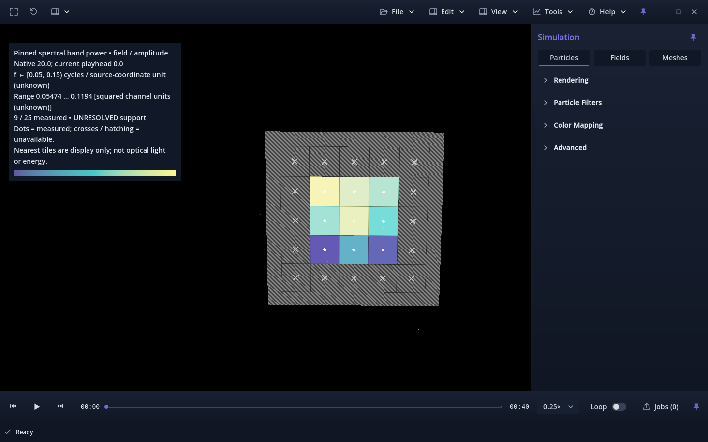

# Issue #415 — viewport spectral band map

Candidate **v0.1.0.116**, based on accepted **v0.1.0.115**, owner-merged
PR #414 / `40b00adb745e3a813069e148f6ccd8dd6e1fd147`. Implementation and focused
checks are complete; **owner review is pending**. No merge, release, tag or
project-board transition was performed. Historical #135/#413 evidence is intact.

## Result and architecture

**Tools → Spectral band map** shows one numerical spatial-frequency band over a
bounded source-aligned plane. Each center is a complete 3D Hann window at one
verified native record. Source field visibility is independent; dots identify
measurements, crosses/hatching identify missing support, and the legend states
units, coverage, pinned time and unresolved support.

The batch reuses the accepted regional kernel, one `SourceSnapshot`, one channel
decode and one sequential workspace lease. The request identity binds source
extent/hash, object/channel, native record, geometry, grid, support, band and
algorithm. The individual-spectrum key now also binds object/channel and its
optional exact band. Three baseline fixtures retained exactly equal numerical
outputs after refactoring (excluding timings and the strengthened request key).

The existing owned worker enforces memory, cancellation and revision checks.
Only bounded float64 center values reach the controller; normalized float32
display values reach the plane shader. No source/preview texture is used for
analysis. The UI refuses unsupported float32 coordinate precision. The feature
does not change WVZ1/SWSS, exporter APIs, scalar rendering, prepared coverage or
dependencies. See [the complete contract](../../SPATIAL_BAND_MAP.md).

## Validation evidence

All final checks below passed, with no skipped assertions:

| Scope | Result | Evidence |
|---|---|---|
| Spectrum + map + source/worker + application version | 67 Python tests | [validation.json](validation.json) |
| Focused map numerical/worker suite | 15 tests | [backend-tests.json](backend-tests.json) |
| Accepted spectrum refactor parity | 3 exact comparisons; previous 17+33 connected checks also retained | [phase1-parity.json](phase1-parity.json) |
| Actual N192 map versus individual regional analyses | 9 centers; relative power difference 0 | [model-a-worker.json](model-a-worker.json) |
| Forward+ source viewer, including actual N192 | 68 native checks, zero logged errors | [native-source.json](native-source.json) |
| Forward+ local Linux review package, including actual N192 | 68 native checks, zero logged errors | [native-package.json](native-package.json) |
| Final CPU/UI state contracts | 63 headless checks, zero logged errors | [native-state.json](native-state.json) |
| Existing individual-spectrum Forward+ workflow | 48 native checks | [native-spectrum-regression.json](native-spectrum-regression.json) |
| Source import; package import/export | PASS | [source import](source-import.txt), [owned package inventory](packaged-sources.json) |

Numerical tests include independently summed full-complex DFTs, single/mixed/
oblique modes, spatially changing amplitudes, exact inclusive-low/exclusive-high
edges, leakage, insufficient support, anisotropic/translated geometry, boundary
and nonfinite masks, one verification/decode per batch, constant workspace,
resource refusal, source binding, and cancellation after two of 64 centers.
Individual Model A comparisons share the production kernel; their agreement is
cross-path consistency evidence, not an independent physical validation.

Native checks compare every fixture center against a separate full-complex
NumPy oracle, verify numerical-to-texture addressing, all three plane normals,
translation once, tiny/unsupported coordinate admission, missing-amplitude
refusal, source/time/band/grid/channel/selection invalidation and stale callbacks.
They exercise keyboard Compute, independent reference visibility, Dark/Light,
Scientific/Cinematic, compact layout, orbit/free look, play/seek, shared job
ownership, close/reopen, and source replacement. Saved-image pixels are identical
with the transient map enabled versus hidden. Inspection/offline exclusion guards
are checked; a new video encoding run was not necessary for this isolated overlay.

The final 68-check graphical runs include warning-label invalidation, explicit
missing-amplitude refusal, inspection/offline guards and the corrected palette
reference. The 63-check headless run provides CPU/state evidence, not additional
graphical acceptance. Final independent review found no remaining actionable defect. The first harness attempts exposed test assumptions
(camera already in free mode, worker-side transform refusal, and redraw-on-change
timing); those were corrected. UI review also corrected an oversized legend, the misleading zero range for
fully unavailable maps, stale warnings, and the palette color conversion. A restricted editor import
could not create its local socket/settings; the retained isolated-settings import
completed without errors. No failed attempt is counted as a PASS.

## Measured resources and limits

Environment: Linux x86_64, Godot 4.7.2 Forward+ Vulkan, RTX 3070 Ti **8 GB**,
1440×900, Python 3.14.8 / NumPy 2.4.3. No scientific solver was run. Existing
capture content was read only; fixture hashes and reference source stamps stayed
unchanged. The worker verifies the full committed reference prefix against:

```text
UUID: 5848557b4ddd4d56b48e62f9f5700b23
bytes: 6965545431
SHA-256: 1af76f2e5e0642808f33119168d8f5e0c7cc847599e414790923c2c3585e3d7d
native time/index: 20
channel: field/amplitude; shape 192³; spacing XYZ 1/6
```

The first worker request verified the entire prefix in **3.399 s**. “Cold” here
means no worker verification memo; OS disk caching was uncontrolled.

| Warm batch | Verify/open | Decode once | FFT only | Reduction | Whole center loop | Worker roundtrip |
|---|---:|---:|---:|---:|---:|---:|
| 4 × 128³ centers | 21.5 ms | 86.8 ms | 53.8 ms | 31.2 ms | 176.0 ms | 307.8 ms |
| 9 × 128³ centers | 25.4 ms | 96.2 ms | 126.7 ms | 70.6 ms | 398.3 ms | 546.3 ms |

The nine-center mean is **44.25 ms/center** including windowing, FFT,
normalization and reduction. FFT timing is a subset of calculation timing;
roundtrip also includes verification, decode, IPC and polling. Logical worker
peak stayed **324,886,925 bytes (309.84 MiB)** for 1/4/9 centers. Measured worker
RSS high-water was **164,945,920 bytes (157.30 MiB)**; logical admission is a
conservative allocation bound, not RSS. The established 512 MiB budget remains.
Real mid-batch cancellation acknowledged in **16.6 ms** after two centers;
a separate mid-batch worker-close test took **31.6 ms**, with no complete map published.

Native source UI publication was **4.174 s** for first full verification and
**546 ms** warm; package figures were **4.246 s / 601 ms**. Source Compute input
returned in **14.6 ms**, and the larger Model A request in **18.7 ms**. Source
Cancel returned in **0.25 ms** with acknowledgement in **206 ms**. These are
observations from bounded fixtures, not latency guarantees.

Each 25-center plane has **220 bytes** of logical GPU payload: 100 bytes of RF
values including the unavailable sentinel, 72 bytes of vertices and 48 bytes of
UVs. Palettes are analytic shader colors. This excludes driver overhead and the
128×1 RGBA8 UI gradient (512 bytes, displayed 12 px high). Hiding the map retains its allocation; visible-versus-hidden
engine memory is therefore not an allocation delta.

During 60 presented orbit frames, source Model A baseline/map averaged
**59.97 / 59.96 FPS**; the package averaged **59.97 / 59.96 FPS**, under the
existing 60 FPS paused-orbit cap and VSync. Source GPU median frame times were
1.782 / 0.553 ms, while package medians were 0.520 / 0.525 ms. Their variation
does **not** establish a speedup or reliable isolated overlay cost. Engine video
memory was about **236 MB**, texture memory **151 MB**, with the plane already
allocated. Whole-desktop NVIDIA telemetry ranged **1,546–2,164 MiB of 8,192 MiB**
across source/package runs; it includes other applications. Frame-time summary statistics
and memory observations are retained in the JSON reports.

The safe fallback is fewer centers at unchanged 128³ support. Source decode can
still exceed admission on larger inputs. The default low edge spans only 1.067
cycles in Model A; even k≈0.5 spans about 1.70 cycles, below the two-cycle heuristic.
No dense-volume, per-voxel wavelength, real-time all-frame, optical or physical
energy interpretation is established. Only this workstation was graphically tested.

## Owner verification

Use the signed N192 reference already on disk:
`model_a_20261030T193414164759Z_b3a4a787cae945b0909004cac75740ca.wvz`.
The validator accepts its explicit external path; it is not bundled here.

1. Open that capture; choose **Tools → Spectral band map**. Select
   **field / amplitude**, **Native index 20**, **Support XYZ 128,128,128**,
   **First start XYZ −32,−32,32**, **Normal Z**, **Centers row/column 5,5**,
   **Hop row/column 32,32**, **band low 0.05 / high 0.15**. Compute.
2. Expect **9 / 25 measured**, nine central dotted tiles surrounded by hatched
   unavailable cells/crosses, native time 20 and **UNRESOLVED support**. Runtime
   source-coordinate and channel units are explicitly unknown in this capture;
   the audited worker comparison supplies a declared dimensionless override.
   The recorded power range is approximately **0.05474–0.1194**, with data-local
   plane Z=95.5/6≈15.9167 and measured X/Y centers 63.5/6,95.5/6,127.5/6.
3. Close the form: the map and pinned legend remain. Toggle **Show source field**
   off to inspect the plane alone, then on for reference. Try all palettes and
   opacity, Dark/Light, Scientific/Cinematic, camera orbit/free movement and
   resizing. Source rendering can occlude or blend with the transparent plane.
4. Play/seek: native map time must stay 20 while the legend's playhead changes.
   Change channel, native index, support, starts, normal, counts, hop or band:
   old map/warnings must clear. Compute again. Cancel a larger batch, then close
   and reopen the file; no old map may return. Active work retains the usual
   Close File refusal until cancellation acknowledges.
5. For a cheaper exploratory map, use **First start 32,32,32** and **Centers
   1,1**, retaining **Support 128,128,128**, the same band and native index.
   Expect one central measurement and the same unresolved-support warning.
6. Save an ordinary image with the map visible: the PNG must exclude map and
   spectral legend while retaining current scalar visibility. The interactive
   map must return immediately. It is also excluded from inspection and video
   output; this milestone does not provide spectral-map export.



[Synthetic plane](dark-plane.png), [nonfinite center mask](masked-center.png),
[Light controls](light-controls.png), [compact controls](compact-controls.png).

## Reproduction

Run from the authoritative repository root, with external Godot/NumPy installed:

```bash
python -m unittest tests.test_spatial_spectrum tests.test_spatial_band_map tests.test_analysis_source tests.test_analysis_worker tests.test_application_version
python tools/validate_spatial_band_map.py --output /tmp/band-tests.json
python tools/validate_spatial_band_map.py --skip-synthetic --capture "$MODEL_A_CAPTURE" --output /tmp/band-reference.json
python tools/validate_spatial_band_map_ui.py --godot "$GODOT" --output-dir /tmp/band-source --capture "$MODEL_A_CAPTURE"
python tools/validate_spatial_band_map_ui.py --godot "$GODOT" --package --output-dir /tmp/band-package --capture "$MODEL_A_CAPTURE"
python tools/validate_spatial_spectrum_ui.py --godot "$GODOT" --output-dir /tmp/spectrum-regression
```

Set `MODEL_A_CAPTURE` to the existing reference and `GODOT` to the external
4.7.2 executable. Output directories must be new. Captures, temporary review
binaries, caches and full screenshot sets stay outside Git. The local package is
validation only, not a release. The four unrelated generated resize UID sidecars
remain preserved in the pre-task stash; they are excluded from this issue PR.
