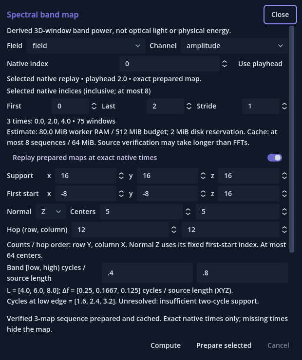
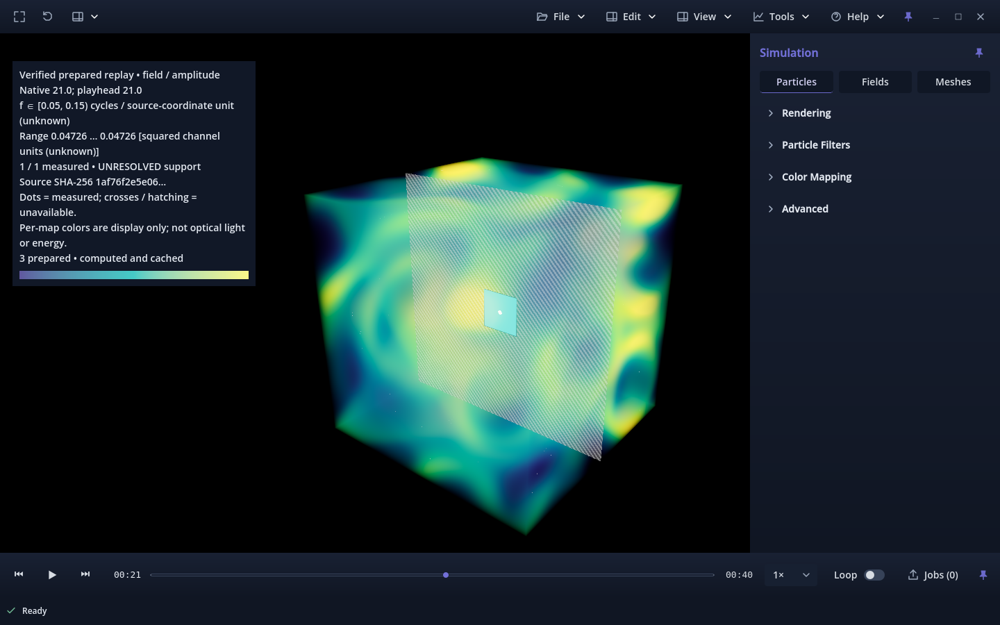

# Selected native-time spectral maps — owner review

Candidate **v0.1.0.117**, based on accepted main
`1afe36a3c31de5b5ba991e676e7a9ad856b36381` (owner-merged PR #416).
Issue [#417](https://github.com/mongstad/Wavez/issues/417) was the only Ready
item on the Wavez Development board. Its assigned branch was already at that
accepted main, with a clean worktree and no existing PR:
`417-feat-spectral-cache-selected-native-time-band-maps-for-playback-replay`.
Fetch/prune confirmed the predecessor; its local branch was already removed.
Preserved owner stashes were not changed. Owner acceptance of this candidate
is pending; this report does not authorize merging or a release.

## Change and architecture

The existing Spectral band map form now accepts an inclusive native-index range
with stride, at most eight records. It shows native times, window count and
RAM/disk estimates before **Prepare selected**. The owned background worker
verifies one source prefix, decodes each selected channel once and calls the
unchanged #415 kernel. One complete selected sequence is published atomically.

Persistence uses existing `ResultCache` / `ResultWriter` support artifacts and
`DiskQuota` in a stable private `spectral-cache/results` collection. Cross-process
locking serializes lookup, publication and eviction. The schema binds verified
extent/hash, exact native record/time, dtype, geometry, grid/support/band/units,
numerical algorithm and implementation identity. Complete manifest names bind
their hashes; artifacts and spectral semantics are validated before reuse.
The collection has eight-entry/64 MiB limits, 2 MiB reservations and oldest-
completed eviction. Unknown files/links are preserved with refusal. Invalid or
partial owned entries cannot become prepared results. No second result format
or capture format was introduced.

Replay uses only in-memory verified maps. It shows a plane at an **exact selected
native time only**, after the ordinary scene commits that time. Gaps, unprepared
records and buffering hide the plane with an unavailable legend. Per-frame and
pre-draw checks prevent a stale plane. Fresh file-stamp checks at preparation and
publication also cover changes before the normal reader polling interval.
Unverifiable stamps refuse sequence replay. Ordinary playback and its teal
prepared band receive no spectral readiness entries or gates.

Single-time **Compute**, dragging/menu access, retained form settings, source
visibility, palette/opacity, camera and presets remain available. Ordinary image,
inspection and offline/video guards exclude both plane and legend.
[The current guide](../../SPATIAL_BAND_MAP.md) specifies the complete behavior.

## Validation

| Focused check | Result |
|---|---|
| Sequence, accepted map/spectrum, transactional result store and source Python integration | 77 PASS, no failures/skips |
| Final sequence tests after bounded cache-read refinement and postpublication lease test | 20 PASS, no failures/skips; overlaps the preceding run |
| Worker and version contracts | 17 PASS, no failures/skips |
| Distinct Python tests across these runs | **95 PASS** |
| Forward+ source native sequence workflow | **82 PASS**, zero native errors; strict PASS |
| Forward+ release-package sequence workflow | **82 functional PASS**, zero assertion failures; **18 native errors; strict FAIL** |
| Existing pinned-map headless state regression | **63 PASS**, zero errors; does not certify GPU rendering |
| Source import and isolated release package import/export | PASS |
| Actual N192 native times 20, 21, 22, nine centers each | **27 exact direct-map comparisons PASS** |
| Independent minimal Popup probe, without Wavez | Source 18 PASS / zero errors; release 18 functional PASS / 32 errors / strict FAIL |

The 20 sequence tests cover exact values/masks and keys, one source verification
per sequence, one decode per time, fresh-worker re-verification, appends, mutation,
replacement, truncation, corrupt manifests/support, schema corruption after
rehashing, abandoned partials, unknown-file refusal, quotas/eviction, 512-center
maximum reply, active and queued cancellation, recovery, concurrent workers and
ordinary-analysis isolation from a broken spectral cache namespace.

Native checks use independently calculated full-complex synthetic Fourier values
at several times. They cover exact times/gaps/missing times, forward/reverse/loop,
scene-commit gating, parameters/selection/late replies, source switching,
append-before-request and same-size-mutation-before-publication, missing stamps,
close/reopen/restart, real Cancel after center progress, toolbar presets, camera,
presentation controls and pixel-identical ordinary image exclusion. Source Cancel
returned in 2.37 ms and worker acknowledgement took 61.0 ms in the measured batch.

This scope follows the changed source/cache/worker/UI boundaries. No unrelated
particle, mesh, video-encoding or full application suite was run. Numerical
kernel, source reader, generic result store/quota, plane/shader, main viewer,
scene playback and prepared timeline files remain byte-identical to accepted
main; see [the hash proof](unchanged-contracts.json).

## Measured Model A sequence

Read-only finalized signed N192 reference:
`model_a_20261030T193414164759Z_b3a4a787cae945b0909004cac75740ca.wvz`,
6,965,545,431 bytes, UUID `5848557b4ddd4d56b48e62f9f5700b23`, SHA-256
`1af76f2e5e0642808f33119168d8f5e0c7cc847599e414790923c2c3585e3d7d`.
The exact external path and parameters are retained in [worker evidence](model-a-worker.json).
No source copy, source modification, solver or whole-capture map computation ran.

CPU sequence: native indices/times **20, 21, 22**; `field/amplitude`; support
**128³**; normal Z; first XYZ **(0, 0, 32)**; centers **3×3**; row/column hop
**32×32**; band **[0.05, 0.15)**. Every center matches direct #415 calculation
exactly, including masks and request keys. Runtime units remain unknown.

| Measurement | Observed |
|---|---:|
| First owned-worker round trip | 4.968 s |
| First source verification/open | 3.422 s |
| Three-map preparation, excluding source open | 1.522 s |
| Warm verified cache hit, whole round trip | 45.1 ms |
| Fresh-worker persistent hit, whole round trip | 3.380 s |
| Fresh-worker source verification/open | 3.351 s |
| Cache lookup, warm / fresh worker | 1.99 / 2.17 ms |
| Stored complete sequence, two artifacts | 34,271 bytes |
| Peak logical worker charge | 319.9 MiB |
| Worker RSS high-water, first computation | 157.9 MiB |

| Native time | Channel decode | Nine-center loop | FFT subtotal | Nine-center power range |
|---|---:|---:|---:|---|
| 20 | 106.0 ms | 426.4 ms | 145.4 ms | 0.0547419502 … 0.1193539965 |
| 21 | 97.7 ms | 390.6 ms | 124.9 ms | 0.0336321014 … 0.0880436925 |
| 22 | 97.9 ms | 388.0 ms | 121.7 ms | 0.0775889406 … 0.3190603603 |

Each time decodes once; both cache hits decode zero source channels and perform
no FFT. “Cold” means a new worker verification memo; the OS page cache was not
controlled. Worker telemetry is sampled before staged publication: a cold reply's
2,129,920-byte current charge is the writer lease at that instant. A dedicated
test confirms actual worker pool usage is zero after commit, with no active
writer or pending result. Cache hits report zero current charge. RSS, logical
leases and GPU allocations are different measurements.

## Native CPU/GPU observations

Fedora 44 KDE, kernel 7.2.13, Godot 4.7.2, Forward+ Vulkan, NVIDIA RTX 3070 Ti
8 GiB, driver 615.78.08, Python 3.14.8 / NumPy 2.4.3. Native tests deliberately
use **one center at XYZ start (32,32,32)** per time, retaining the same 128³ support
and band. They measure UI publication/restart separately from the nine-center
CPU sequence above. The one-center sequence occupies 17,407 bytes.

| Native path | First / warm / new-viewer verified reuse | Hidden / shown mean FPS | Hidden / shown render CPU mean | Hidden / shown render GPU mean |
|---|---|---|---|---|
| Source | 4.043 s / 238 ms / 3.539 s | 59.93 / 59.82 | 0.136 / 0.194 ms | 3.032 / 2.340 ms |
| Release package | 4.117 s / 218 ms / 3.648 s | 59.95 / 59.87 | 0.136 / 0.151 ms | 0.401 / 1.019 ms |

Each orbit sample is 90 frames at 1440×900 with VSync and the existing 60 FPS cap.
Engine video allocation stayed about 224.5 MiB in both hidden/shown samples;
the one-center plane's logical payload is 124 bytes, excluding its legend and
driver overhead. Whole-device NVIDIA memory ranged 1826–2413 MiB source and
1812–2393 MiB package, including the desktop and other processes. Whole-run
viewer peak sampled RSS was 1.394 / 1.403 GiB; CPU use averaged 0.951 / 0.933
cores across startup, source preparation and all interactions. These are short
observations, **not isolated spectral costs, universal FPS/VRAM guarantees or
evidence of real-time all-frame FFT throughput**. Raw GPU samples and bounded
phase timings are retained in [source](source.json) and [package](package.json)
evidence.

## Failures, limitations and recommendation

Strict release validation remains failed. Its 18 diagnostics comprise eight
root Window disconnect errors, four nested Popup disconnect errors and six
duplicate connections. The existing standalone #335 probe independently emitted
32 release-template errors without Wavez while its source run was clean.
[Raw release diagnostics](popup-release-native.txt) remain visible. No filtering,
engine substitution, workaround or separate issue was introduced.

[Earlier attempts](earlier-attempts.json) retain three source1 harness failures
(JSON float/int array assertions and a different restart cache root), two source3
status-text assertion failures, and the initial pinned-regression wording mismatch.
Their assertions were corrected without weakening value/time/state checks.
Source2 passed 76 checks before the added source-boundary cases. The first CPU
probe stopped on an incorrect assumption that prepublication telemetry already
excluded the writer lease; the final probe checks transaction completion and the
new worker test independently proves release. These earlier attempts are not
counted as clean passes.

Limits: exact selected-set cache reuse only; no overlapping-subset assembly,
automatic whole-scene processing, temporal interpolation, GPU FFT, dense volume,
optical calibration or saved inspection integration. A continuous cursor can
miss every exact native timestamp; use exact seeks to inspect selected maps.
Each map uses its own display range. Low-frequency 128³ support remains unresolved
(about 1.067 low-edge cycles), and colors never add source measurements.
Only this Linux workstation/source and declared synthetic fixtures are tested.

**Recommendation:** proceed to owner review of this bounded preprocessing/replay
milestone. **No-go for automatic dense or per-frame spectral rendering** on this
evidence. Source verification dominates reopening, and the unresolved scientific
support and separate template limitation remain. Any later phase requires its
own owner-authorized scope and measurements.

## Exact owner checks

1. Run candidate v0.1.0.117 and open the signed N192 reference above. In
   **Tools → Spectral band map**, select `field / amplitude`, support XYZ
   128/128/128, first XYZ 0/0/32, normal Z, centers 3/3, hop 32/32 and band
   0.05–0.15. Set selected indices First 20, Last 22, Stride 1. Confirm the
   preflight shows three native times and 27 windows; choose **Prepare selected**.
2. Seek to exact 20, 21 and 22. Expect 9/9 measured centers and the ranges above;
   the center at XYZ index 95.5/95.5/95.5 has powers approximately
   0.1116750843, 0.0472635661 and 0.1809294605 respectively. Each remains marked
   UNRESOLVED. At 20.5 or unprepared 23, expect the plane hidden and unavailable.
3. Play, reverse and loop. Camera and ordinary source playback must remain usable;
   the spectral plane must never show another native time as current. The teal
   timeline must not acquire spectral readiness. Palette/opacity/Show source
   field and Scientific/Cinematic must work independently; drag the form as needed.
4. Repeat **Prepare selected**: expect verified cache reuse. Close/reopen the form
   without recomputation. Close/reopen the capture or restart the app, enter the
   same parameters and prepare again: expect source verification followed by a
   cache hit. Nothing should replay before this explicit request.
5. For a cancellable batch, choose more centers while preserving support, start
   preparation and cancel during progress. Expect no partial sequence, then a
   successful smaller request. Editing band/grid/times or changing captures must
   clear replay. Save an ordinary image and verify plane/legend are excluded.
6. Review the known release-template Popup diagnostics separately. Passing the
   functional checks does not turn strict package validation into a pass.




## Reproduction commands and retained artifacts

From the repository root, use the externally installed Godot path and a new
output directory for each run:

```sh
python -m unittest -v tests.test_spatial_band_sequence tests.test_spatial_band_map tests.test_spatial_spectrum tests.test_analysis_results tests.test_analysis_source
python -m unittest -v tests.test_analysis_worker tests.test_application_version
python tools/validate_spatial_band_sequence.py --capture /absolute/path/to/the/reference.wvz --output-dir /tmp/new-sequence-worker
python tools/validate_spatial_band_sequence_ui.py --godot /absolute/path/to/Godot --capture /absolute/path/to/the/reference.wvz --output-dir /tmp/new-sequence-source
python tools/validate_spatial_band_sequence_ui.py --godot /absolute/path/to/Godot --capture /absolute/path/to/the/reference.wvz --package --output-dir /tmp/new-sequence-package
python tools/validate_spatial_band_map_ui.py --godot /absolute/path/to/Godot --headless --output-dir /tmp/new-pinned-check
python tools/investigate_window_signals.py --godot /absolute/path/to/Godot --mode minimal --runtime source --output-dir /tmp/new-popup-source
python tools/investigate_window_signals.py --godot /absolute/path/to/Godot --mode minimal --runtime release --output-dir /tmp/new-popup-release
```

[Validation manifest](validation.json), [final sequence tests](python-sequence-final.txt),
[integration tests](python-integration.txt), [worker/version tests](python-worker-version.txt),
[source native log](source-native.txt), [package native log](package-native.txt).
Compact native reports retain every failure/error plus metrics, source/request
keys, numerical hashes and raw local report hashes. Raw local reports remain in
the recorded `/tmp` directories. Captures, caches, executables and templates are
excluded from Git. Historical #135/#413/#415 reports remain byte-for-byte intact.
