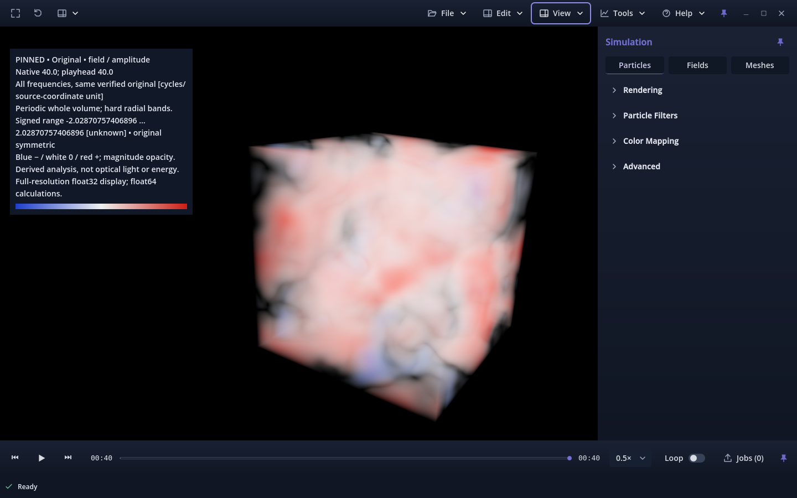
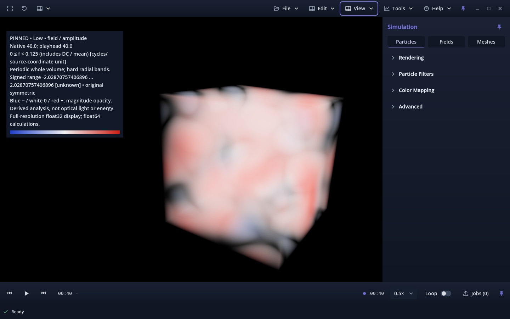
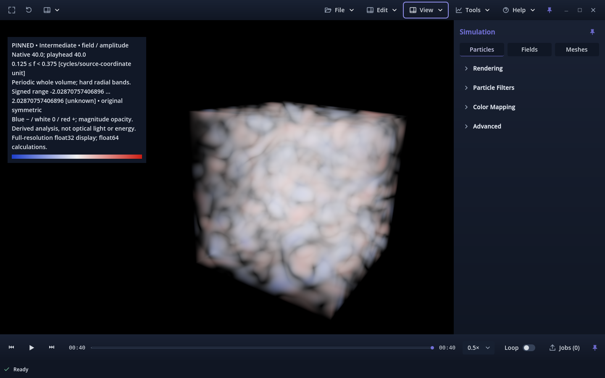
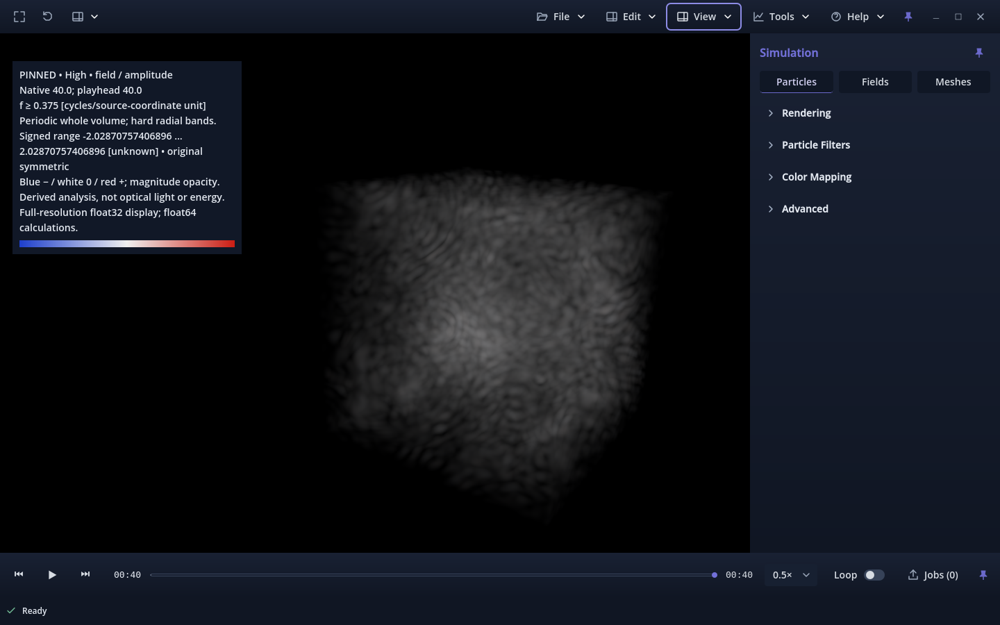

# Reconstructed 3D spectral volumes — owner review

Candidate **v0.1.0.119**, issue [#424](https://github.com/mongstad/Wavez/issues/424),
on assigned branch
`424-feat-spectral-explore-phase-preserving-reconstructed-3d-bands-in-wavez-viewport`.
The issue was the top Ready item on the Wavez Development board. No duplicate
branch or PR was created. The PR targets **`spectral`**, whose accepted baseline
is `4b9a1aeaa8658cd4ff65ebbcff06ac52b3667a09`. Main remains at the separately
accepted rollback, `e9248c2dad449f16c65f81259954339c518135c3`, v0.1.0.118.
The owner explicitly approved main BUILD +1 for this experimental candidate.
This report records implementation evidence, not owner acceptance or a release.

## Architecture and behavior

The owned analysis worker reconstructs one verified native float64
`field / amplitude` using full-domain FFT coefficients and disjoint radial
masks. Phase stays in the complex coefficients. Low includes DC; the default
edges are 0.125 and 0.375 cycles per source-coordinate unit. Periodicity must
be explicitly acknowledged. No Hann window, mean removal, zero padding or
optical conversion is applied. See the
[complete scientific/display contract](../../SPECTRAL_RECONSTRUCTION.md).

Float64 scientific files and float32 display copies are atomically published
under a bounded worker-owned namespace. Source, artifact and manifest checks
prevent incomplete, changed or superseded results from being uploaded. The
viewer reuses `GridView`, RF textures, volume raymarching and slice shaders.
Original and all three bands use the same pinned record, camera, geometry,
signed palette, magnitude-opacity mapping and shared symmetric display range.
Band selection reads one display file; it does not rerun the FFT.

The modeless draggable panel permits ordinary preset/menu/camera interaction.
Only this panel opts into viewport navigation outside its rectangle; nested
menus, modal dialogs and the panel itself keep input ownership. Cancellation
covers active work, transfer and the completion/reply race. Closing clears the
derived result and restores the ordinary source; form inputs remain drafts.
New source/target/channel/selection and worker revisions invalidate results.
Fresh source stamps guard computation/publication/transfer boundaries. Later
filesystem changes follow the ordinary reader's approximately one-second poll;
there is no synchronous stat subprocess on every rendered frame.

Original source arrays and caches are not overwritten. Ordinary source probes
are explicitly unavailable while the reconstructed view is shown. The older
regional spectral plane is suspended, and ordinary image export temporarily
restores the source. Video workers never receive this transient reconstruction.
Unchanged readers/writers, shaders, preparation code, scientific source contracts
and existing spectral kernels have a [byte-level proof](unchanged-contracts.json).

## Numerical evidence

[Model A reference evidence](model-a-reference.json) uses the finalized signed
N192 capture `model_a_20261030T193414164759Z_b3a4a787cae945b0909004cac75740ca.wvz`:
6,965,545,431 bytes, SHA-256
`1af76f2e5e0642808f33119168d8f5e0c7cc847599e414790923c2c3585e3d7d`.
The exact external path, UUID, native descriptors and array/artifact hashes are
in the evidence. The file is read-only; no solver, source copy into Git or
whole-capture reconstruction ran. Final full-file hash and stat matched.

Native times **0, 20 and 40** independently pass a full-complex FFT/inverse
oracle over values separately read by `SceneReader`. Production uses a real
half-spectrum; the oracle uses a complete frequency lattice and independent
masks. Small synthetic tests use direct exponential-matrix DFT/inverse, without
FFT helpers, across mixed/oblique phase, odd/even sizes, anisotropic spacing,
DC, Nyquist and exact half-open boundaries. Other checks cover Parseval,
roundtrip residual, exact f32 casts, zero fields, weak AC on large DC,
unsupported input, mutation, quotas, publication and cancellation.

At time 40, Intermediate contains **19.9756415709514% of AC variance**,
reproducing the earlier approximately 20% result. Its total mean-square share
is about **12.1911%** because total mean square includes the mean retained in
Low. The maximum independent full-grid error across the three native records
is below **1.9 × 10⁻¹⁵** in source-value units; summed-band RMS residuals are
below **3.1 × 10⁻¹⁶**. These are numerical decomposition checks, not physical
energy or material-identification results.

## Resource measurements

CPU: Ryzen 7 5800X, Python 3.14.8 / NumPy 2.4.3. The fresh reference subprocess
calls `SourceSnapshot` and the production reconstruction kernel directly; it is
not the viewer's full IPC worker. It uses a new verification memo and hashes the
entire committed prefix. The native UI evidence separately measures that worker.
The operating-system disk cache was not flushed; “fresh” is not a physical
cold-disk claim.

| Native time | Prefix/index verification | Decode | FFT | Three inverses and band writes | Total |
|---|---:|---:|---:|---:|---:|
| 0 | 3.417 s | 0.098 s | 0.059 s | 0.613 s | 4.290 s |
| 20 | 3.357 s | 0.097 s | 0.073 s | 0.618 s | 4.257 s |
| 40 | 3.364 s | 0.095 s | 0.063 s | 0.620 s | 4.245 s |

Logical peak charge is **1,010,917,773 bytes (964.1 MiB)**; final charge after
source close is zero. Fresh reference-subprocess high-water RSS is **371.4–372.1 MiB**,
measured by `/proc` and `ru_maxrss`. The initial measurement harness launched
workers after a large parent oracle and inherited the parent's high-water
figure; it was corrected to launch all workers before parent FFTs. Only the
corrected measurements above are used.

The kernel reserves 790.25 MiB in addition to a 171 MiB native decoding lease
and metadata. One N192 result owns 216 MiB of float64 arrays and 108 MiB of
display copies; its reservation is 326 MiB including metadata allowance.
The existing global 2 GiB quota applies. Graceful exit/release reclaims artifacts;
forced termination can defer cleanup to the next owned worker's startup reaper.
One active derived GPU texture adds
27 MiB of RF payload. Ordinary source/playback resources remain resident and
are included in conservative texture-budget admission. Unknown cleanup entries
are preserved with refusal. No reduced-resolution scientific fallback exists.

Native Forward+ measurements use an RTX 3070 Ti, 8 GiB, driver 615.78.08,
Godot 4.7.2 and a 1440×900 window. The production owned worker verifies the
reference with zero memo hits: **4.440 s**, **373.0 MiB peak RSS**, **968.1 MiB
peak logical charge**, zero final charge, with its existing 2 GiB address-space
guard enabled. The Compute callback takes **5.582 ms** and the complete UI
roundtrip including verified transfer is **5.078 s**.

One band switch reads/hashes/checks 27 MiB in **421–451 ms** on the transfer
thread. The measured main-thread upload call takes **6.4–8.3 ms**; it is a
submission measurement, not a GPU-fence completion measurement. Engine texture
counters increase by exactly **27 MiB**; total engine video memory increases by
27 MiB plus 336 bytes. Whole-device NVIDIA snapshots fluctuate around
2,472–2,491 MiB, including the desktop and driver allocations, so they cannot
isolate the small spectral increment. Full viewer high-water RSS is about
**1.390 GiB**, including startup, source preparation and all test interactions;
it is not the reconstruction worker's incremental memory.

| View | Mean FPS | Mean measured GPU render time | Mean measured CPU render time |
|---|---:|---:|---:|
| Ordinary source baseline | 59.98 | 2.27 ms | 0.234 ms |
| Pinned Original | 59.98 | 3.36 ms | 0.210 ms |
| Low | 59.98 | 4.30 ms | 0.222 ms |
| Intermediate | 59.97 | 2.72 ms | 0.227 ms |
| High | 59.97 | 2.47 ms | 0.235 ms |

Each row is a 90-frame gentle-orbit sample, with VSync and the existing 60 FPS
cap. It establishes usable interaction for this view/hardware, not uncapped
throughput, worst-case volume cost or real-time all-frame FFT. Complete camera
state is restored before every comparison image. Active cancellation returned
from the UI callback in **0.323 ms** and was acknowledged in **233 ms** during
observed source verification; Python tests separately cancel within active
reconstruction and after publication before reply acceptance.

## Actual Wavez views and interpretation

The following are actual application screenshots, not ordinary image exports.
`derived_markers` particles are explicitly hidden in every scalar comparison.
Native time is 40, full shape 192³, common range **±2.0287075740689637**,
magnitude opacity **0.25**, no clipping/slice, identical camera and extent:

| Original | Low |
|---|---|
|  |  |
| Intermediate | High |
|  |  |

The intermediate view exposes finer, connected-looking mottled regions inside
the full volume; Low retains the broad structure and mean. High is substantially
weaker on the same scale. These views are more informative than regional tiles,
but the ray-integrated cloudy appearance does **not** establish distinct
filaments or their topology. Projection, opacity, sign cancellation and hard
filter ringing can influence apparent connections.

An [alternate intermediate angle](model-t40-intermediate-alternate-angle-common-scale.png)
and central [X](model-t40-intermediate-slice-0-common-scale.png),
[Y](model-t40-intermediate-slice-1-common-scale.png) and
[Z](model-t40-intermediate-slice-2-common-scale.png) slices expose genuine
variation in the reconstructed 3D scalar, without proving a physical filament.
Explicit detail ranges [Intermediate ±0.8](model-t40-intermediate-manual-detail-scale.png)
and [High ±0.15](model-t40-high-manual-detail-scale.png) show contrast sensitivity;
they are not amplitude-comparable with the common-scale images. At native zero,
High is approximately numerical roundoff and should not be interpreted as
resolved structure.

Recommendation: retain this bounded, explicitly periodic, pinned experimental
workflow for owner exploration. Keep common-scale comparison as the default and
preserve the original/source distinction. Do not promote the apparent patterns
to material, optical or persistence claims. Smooth-mask comparisons and any
time-dependent reconstruction require separate owner-directed work; this PR
does not implement them.

## Validation and limitations

| Check | Result |
|---|---|
| Connected Python source/worker/result/memo and existing/new spectral suites | 108 PASS |
| Final reconstruction + worker tests after cleanup-race coverage | 28 PASS; overlaps the preceding run |
| Version contract | 2 PASS |
| Distinct Python tests across those runs | **113 PASS**, no failures/skips |
| Native source full reconstruction workflow, including actual N192 | **88 PASS**, zero native errors |
| Native Linux package, including actual N192 | **88 functional PASS**, zero assertion failures; **22 native errors, strict FAIL** |
| Existing native edge/popup/fullscreen regression | **210 PASS**, zero errors |
| Final range-input readability follow-up | **6 native PASS**, zero errors |
| Source import and isolated package import/export | PASS |
| Independent N192 numerical/source-identity checks at 0/20/40 | PASS |

Native checks cover phase-sensitive GPU texels, full resolution, source-state
preservation, all bands, symmetric/exact/zero ranges, tampered manifest refusal,
fresh source mutation before GUI acceptance, explicit channel/target changes,
worker ownership, active cancel/close, old regional-map suspend/restore, presets,
real viewport mouse/keyboard navigation, editing focus and navigation recovery,
clipping/slices, pinned playback, ordinary source probes and pixel-identical
ordinary image exclusion. GPU memory refusal is enforced by the same explicit
full-resolution admission check; no out-of-memory crash was induced on the
8 GiB device. Python tests explicitly exercise memory and shared-disk refusal.

The strict package failure comprises the existing Godot 4.7.2 release-template
`focus_entered` / `tree_exited` duplicate-connection and nonexistent-disconnection
diagnostics. All 22 messages are retained in [the native package log](package-native.txt).
The same diagnostic family was independently reproduced without Wavez in the
accepted [minimal Popup probe](../issue-417/popup-release-native.txt).
This PR does not fix the engine or treat functional PASS as strict PASS.

Earlier iterations are retained: [first input run](first-iteration.json) found
the popup guard defect plus a raw-probe test-routing mistake;
[camera profiling](camera-profile-iteration.json) found incomplete camera-state
restoration in the comparison harness; [keyboard coverage](keyboard-iteration.json)
found the focused-child-input defect. The UI defects and harness mistakes were
fixed before the final source run. The first sandboxed editor import had local
socket initialization errors; the permitted external import is clean. Prior
issue evidence and the owner's stashes remain untouched.

After the full source/package runs, visual inspection found long exact range
values scrolled past their leading sign/integer. The final presentation-only
follow-up left-aligns unfocused inputs and reveals their start, preserving the
entire double value and active editing caret. Its
[six focused native checks](range-input-final.txt) and
[native appearance](range-input-final.png) pass. The full source/package runs
precede this caret-placement refinement; scientific, rendering and worker code
is identical. The retained controls screenshots are explicitly named
`before-range-readability`; the four volume comparisons are unaffected.

This scope covers the changed numerical worker, handoff, native renderer/input
integration and package boundary. No unrelated full application, mesh, particle,
video codec, solver or observer/cone suite ran. Ordinary video exclusion follows
its unchanged separate-worker contract; no new encoding benchmark is claimed.

Reproduction (use new empty output directories and the external engine):

```sh
python -m unittest -v tests.test_spectral_reconstruction tests.test_analysis_worker tests.test_application_version
python tools/validate_spectral_reconstruction_reference.py --capture /absolute/path/to/reference.wvz --output-dir /tmp/new-reference-check
python tools/validate_spectral_reconstruction_ui.py --godot /absolute/path/to/Godot --capture /absolute/path/to/reference.wvz --output-dir /tmp/new-source-check
python tools/validate_spectral_reconstruction_ui.py --godot /absolute/path/to/Godot --capture /absolute/path/to/reference.wvz --output-dir /tmp/new-package-check --package
```

The reference validator deliberately binds the audited capture's size/hash;
arbitrary files are not substitutes. The native validator can omit `--capture`
for bounded synthetic integration only. Packaging needs the external Godot
release templates; no engine, NumPy, capture or dense result is committed.

## Owner verification

Use the signed N192 reference and **Tools → Spectral reconstruction**:

1. Select `field / amplitude`, native index **40**, edges **0.125 / 0.375**,
   acknowledge the periodic boundary and Compute. Confirm the verified native
   time, full resolution, source hash and approximately 0.199756 intermediate
   AC fraction in numerical details.
2. Hide the ordinary `derived_markers` particle layer for scalar-only comparison.
   Switch Original / Low / Intermediate / High without moving the camera or
   changing range/opacity. Confirm the signed legend and pinned time.
3. Drag the panel, use camera translation/look/orbit and switch Scientific /
   Cinematic through View while it remains open. Panel controls and open menus
   should keep their own input.
4. Inspect Intermediate at another angle and with X/Y/Z slices and clipping.
   Try an explicit symmetric range of ±0.8; compare High at ±0.15, recognizing
   that these detail ranges are not comparable with the original common range.
5. Play/seek ordinary time. The volume stays at native 40 and the legend shows
   both times. Source probing must say unavailable until the derived view is
   hidden or closed. Ordinary Save image must exclude the volume and legend.
6. Start another reconstruction and Cancel while progress is visible. Confirm
   no partial result appears. Close/reopen, change source channel, switch files
   and close the capture; derived state must clear and ordinary viewing recover.

Review remains limited to this experimental PR. Do not merge into main, publish
a release or interpret these checks as owner acceptance.
