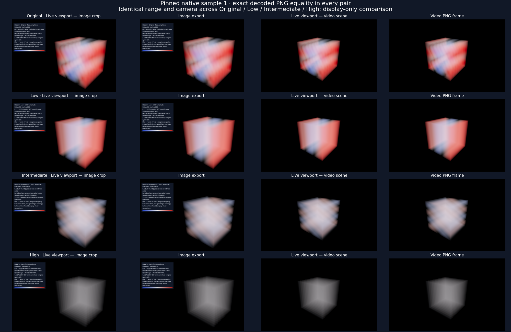

# PR #425 — displayed-scene export follow-up

Candidate **v0.1.0.119**, on the existing #424 issue branch, targeting
**`spectral`**. This records the owner's requested export correction after the
initial reconstruction review. It is not owner acceptance, a merge or a release.
The [initial report](../README.md) and its scientific evidence remain historical
records; their old image/video exclusion description is superseded here.

## Behavior and ownership

Image export now captures the active Original, Low, Intermediate or High
reconstruction with its colormap, opacity, signed range, camera, clipping and
slices. The reconstructed texture stays active through the capture lock and
draw. Application windows/chrome and selection handles are hidden temporarily;
the eligible scientific legend remains. Capture checks the source and visual
snapshot again before publishing, preserves live settings, and refuses a
changing/unavailable reconstruction instead of substituting another field.

A derived PNG always has a `wavez-visual-export` JSON sidecar identifying the
source, native sample, selected band/edges, scientific and display artifact
hashes, exact LUT and visual settings, and PNG dimensions/hash. It is visual
provenance, not a scientific inspection recipe that would restore the source
field. Ordinary non-spectral inspection/bundle behavior remains unchanged.

Video export stages just the selected float32 display file and original hashed
manifest in the job's private directory. The separate worker verifies the source
prefix, native record/geometry, manifest bindings and field bytes, then uses the
existing volume renderer. Scientific/display numbers cross the job boundary
through the existing exact-float codec. No numerical tolerance was introduced
to weaken verification, and no FFT runs inside the video worker.

The reconstruction stays at one declared native sample while video time and
other visible scene layers advance. Camera/orbit and explicit export options
retain their normal meaning. Replaced source volumes are hidden only in the
worker state; the live scene is untouched. Exact LUT bytes allow a custom palette
to survive even when its name is unknown to the worker. The pinned scientific
legend uses the interactive styling and records the current video playhead.

Mandatory `spectral-presentation.json`, per-frame timing associations and an MP4
comment identify the derived pinned field. Optional frame JSON is distinct visual
provenance and records each frame's camera. Closing the parent or switching files
after staging cannot remove the job-owned copy. Changed sources, missing or
tampered files and unknown encoding fail explicitly. Active cancellation stops
publication; earlier valid PNGs follow normal recovery retention. Known private
display files are removed at terminal outcomes, while provenance is retained.

## Validation

The tests use bounded synthetic 32³ signed fields with
different low/intermediate/high modes, three native samples and separate
replacement/mutation fixtures. They do not rerun an external simulation.

The independent oracle reads the live viewport directly without calling the
export or reconstruction-suspension helpers. PNG comparisons require exact
decoded pixels. Video jobs are staged by the production dialog path; the parent
exits before any independent worker starts. H.264 is checked separately with
mean absolute RGB error below 5 and 99th-percentile error below 35 on 0–255 RGB.
The parent uses 1440×900 to match the existing video's 1440-wide annotation
canvas. Explicit output-resolution scaling remains the established video rule.

| Final run | Live/helper checks | Worker/export checks | Native errors | Strict result |
|---|---:|---:|---:|---|
| [Source](source-summary.json) | 121 | 117 | 0 | PASS |
| [Packaged](package-summary.json) | 121 | 117 | 0 | PASS |

Both runs test all four selections, an in-memory custom 256-entry colormap
unknown to the worker, custom opacity/range/camera/clipping/slice, enabled and
disabled scientific legends, unchanged viewport/numerical state, parent shutdown,
file switching, capture revision, source mutation before and during rendering,
missing/tampered artifacts, active cancellation and ordinary image/video export.
The included 18 helper checks exercise persisted exact-float transport, strict
manifest/native binding, float32 range overflow and bounded cleanup.

Every complete video contains three frames at capture times 0, 0.5 and 1,
with reconstructed samples pinned to native time 1. H.264 output has the requested
1440×900 dimensions, 2 FPS and three frames. Worst mean absolute RGB error was
0.330/255; the worst 99th percentile was 4/255. This is a lossy MP4 comparison,
separate from exact PNG equality. [Cross-build comparison](source-package-parity.json)
finds 22 of 27 source/package files byte-for-byte identical. Five differ only in
frequency-label word wrapping between the editor and release template; their
legend text and scene pixels outside the legend agree. Each build's exports
match its own active viewport exactly, including the legend.



The sheet is scaled for review; exact comparisons use original pixels. Full-size
examples include the [custom image](images/custom-image.png), its
[provenance](images/custom-image.json), a [custom clipped/sliced video](video/custom/result.mp4)
and [video with the pinned legend](video/legend/result.mp4). Their original PNG
frames, timing and provenance accompany the movies. Logs retain every native
diagnostic in [source](source-native.log), [package](package-native.log), and
their worker-log directories. The package build's [import](package-build-import.log)
and [export](package-build-export.log) logs are retained.

The initial full reconstruction package report retained 22 Godot release-template
Popup diagnostics, independently reproduced in the earlier engine-only probe.
Those historical findings are not erased or claimed fixed here. This fresh,
focused export/package run is clean and does not re-certify every popup workflow.

Connected checks completed:

- [71 reconstruction UI checks](reconstruction-regression.json), zero native
  errors: existing pinning, source lifecycle, cancellation and interactions.
- [64 ordinary Save Image checks](ordinary-image-report.json), including
  particles, fields, meshes, mixed scenes and fullscreen; source hashes unchanged.
- [13 reconstruction numerical tests](numerical-regression.txt) and
  [15 recipe/Matched Views tests](recipe-regression.txt) pass.
- [Resource import](import.log) succeeds. It reports the four pre-existing
  missing resize-script UIDs; regenerated unrelated sidecars were preserved
  outside the patch. New issue-specific source UID files are included.
- [270-file byte comparison](unchanged-science-history.json) confirms scientific
  Python, reader/layer/shader contracts, the application version and all prior
  #424 evidence remain unchanged from `a0ee717f`. The exact tested implementation
  files are recorded in [validated source hashes](validated-source-hashes.json).

Development checks caught and corrected JSON numeric conversion at strict
manifest validation, plus offline legend styling/playhead refresh. Initial
attempts remain under `/tmp/wavez-424-export/source-{1,2,3,4}`; final results use
`/tmp/wavez-424-export/source-5` and `/tmp/wavez-424-export/package-final`.
The test also confirmed that file opening is already blocked
during image capture; it verifies the unchanged bound scene is saved. A real
mid-capture reconstruction revision or source mutation instead refuses the save.

## Reproduce

From the repository root, with external Godot, Python/NumPy, Pillow and FFmpeg:

```sh
python tools/validate_spectral_export.py --godot /absolute/path/to/Godot \
  --output-dir /tmp/wavez-spectral-export-source
python tools/validate_spectral_export.py --godot /absolute/path/to/Godot \
  --output-dir /tmp/wavez-spectral-export-package --package
python tools/validate_spectral_reconstruction_ui.py --godot /absolute/path/to/Godot \
  --output-dir /tmp/wavez-reconstruction-regression
python tools/validate_save_image.py --godot /absolute/path/to/Godot \
  --output-dir /tmp/wavez-image-regression --renderer forward_plus
python -m unittest tests.test_spectral_reconstruction \
  tests.test_analysis_recipes tests.test_analysis_matched_render
```

Use fresh output directories and a real Forward+ Vulkan display. The package
runner uses externally installed export templates; it does not bundle Godot or
FFmpeg. Runtime profiles are isolated and package workers run from an unrelated
working directory.

## Owner verification

1. Compute one native sample, then save an image for each of Original, Low,
   Intermediate and High. Compare the scene and check each JSON band's native
   record. The panel and handles should be absent; the active view should remain.
2. Choose another colormap, change opacity/range, move the camera and enable
   clipping and a slice. Save again and compare those settings visually.
3. Export a short locked-camera video with the current view. Check the selected
   field stays pinned, the legend separates native time from video playhead,
   and `spectral-presentation.json`/MP4 metadata identify that field. Repeat with
   the legend disabled and, if desired, an orbit.
4. Start a longer export, change the interactive view or open another capture,
   and confirm the job retains its starting presentation. Cancel another active
   export and check no completed MP4 is advertised. Check ordinary exports after
   closing reconstruction.

Automatic time-dependent spectral reconstruction remains outside this follow-up.
No original scientific data, WVZ1/SWSS format, integration branch, tag or release
was changed. Stop for owner review on the existing PR.
