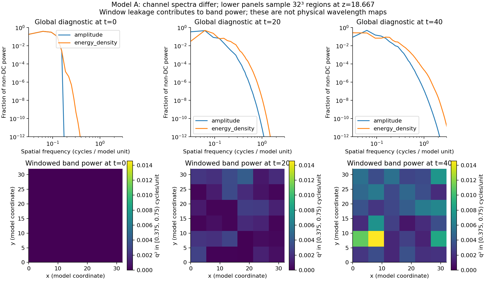
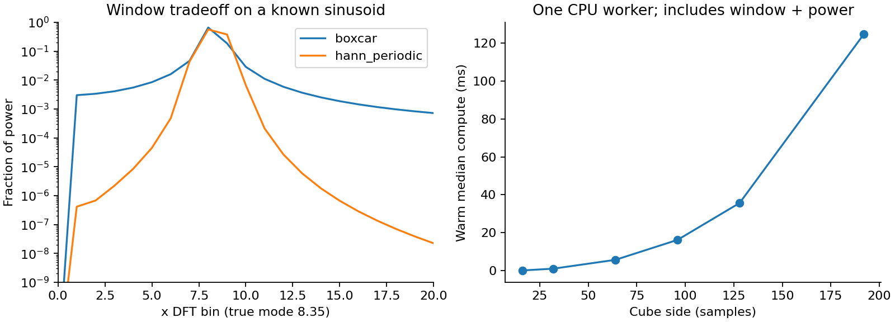

# Spectral Mode research — issue #135

Research completed for owner review on **2026-10-31**. Candidate **v0.1.0.114**
follows accepted `681a46f8f8473ee6b5323ec4af71ada883183077` / v0.1.0.113 /
PR #409. The sole Ready issue was
[#135](https://github.com/mongstad/Wavez/issues/135); its updated authorization
permits this research-only PR and the usual BUILD +1. The assigned branch is
`135-research-spectral-design-wavelength-aware-visualization-and-observer-models-for-wavez`.
No production spectral feature, runtime UI, renderer, capture format, exporter,
SWSS schema, dependency bundle, release or tag is changed. Owner acceptance is
pending. Proposed follow-up scopes below are not created issues or authorization
to implement them.

## Decision for the owner

**GO for one source-verified, region-based spatial-spectrum analysis of signed
Model A `amplitude`, at one pinned native sample, alongside the existing scalar
view.** An actual finalized 192³ capture already contains the required values.
The smallest production increment is one bounded CPU analysis operation, an
explicit source-grid region, and a labeled numerical spectrum plot. It needs
no new WVZ1/SWSS format or simulation export feature. The normal scalar renderer
remains the reference; Scientific/Cinematic are not redefined.

Use a 3D windowed real FFT, with explicit mean removal, source spacing, window
support, direction information and power normalization. Window size must follow
the wavelengths of interest. Around 128³ is a plausible exploratory starting
support for this reference's long modes; it is not a universal default or a
claim of precise local wavelength recovery. Start with raw numerical inspection,
not Human Vision colors. The [architecture](ARCHITECTURE.md) supplies proposed
worker/cache/UI boundaries and phased acceptance criteria.

**NO-GO** for recovering signed-field wavelengths from the newer energy-only
320³ capture; for a unique wavelength assigned to each voxel; for live spectral
rendering justified only by fast FFT timings; or for physically calibrated Human
Vision applied to this dimensionless scalar model. These claims require data,
scientific contracts and validation not supplied here.

| Required deliverable | Report and evidence |
| --- | --- |
| Actual data readiness, provenance and missing quantities | [Data audit](DATA_READINESS.md), [machine-readable audit](evidence/data_readiness.json) |
| Methods, recommendation, sampling and observer interpretation | [Methods and observer models](OBSERVERS_AND_METHODS.md) |
| Compute placement, derived representation, cache and minimal UX | [Architecture proposal](ARCHITECTURE.md) |
| Known-answer and actual-capture validation | This report, [experiment](experiment.py), [results](evidence/experiment.json) |
| CPU/memory/VRAM/storage budget and smaller fallback | Measurements below and [architecture resource budget](ARCHITECTURE.md#computation-placement-and-resource-budget) |
| Phases, dependencies, proposed acceptance criteria | [Proposed sequence](ARCHITECTURE.md#proposed-sequence-for-owner-review) |

## What the available Model A data supports

The primary reference is run
`20261030T193414164759Z_b3a4a787cae945b0909004cac75740ca`: 192³ float64 volume
samples, t=0…40 in steps of 1, box length 32, spacing 1/6, periodic nodes without
a duplicated endpoint. It contains signed `amplitude=q`, `energy_density` and
`gradient_magnitude`. Four actual finalized originals were structurally audited;
their different channels and cadences must not be conflated. The Downloads copy
of the 320³ energy run stops at t=72, whereas its finalized original reaches
t=200. It is a structurally valid prefix, not completed-run evidence.

Source snapshots, provenance and SWSS manifests establish the meanings. The
frozen model is `q_tt = ∇²q − q + q³ − 0.3q⁵`, with dimensionless coordinates,
time and values. Energy includes nonlinear potential, momentum squared and
gradient terms; it is not q. Signed q agrees bitwise with archived solver
checkpoints at t=0 and40 after the xyz→zyx transpose. Independent energy and
gradient recomputation matches the exported values exactly at both endpoints
in this environment. No simulation was rerun.

N192's existing three-channel sample is 162 MiB. At N320, just one float64
channel is 250 MiB, near WVZ1's **256 MiB whole-object-sample ceiling**. Adding
amplitude alongside energy at that resolution would exceed the current limit.
Future owner-run amplitude-only output already has an exporter option; no such
run or conversion was performed here. See the [audit](DATA_READINESS.md) for the
full input inventory, exact equations, units, derivatives, records and hashes.

The N192 file's complete SHA-256, subsequently measured through the existing
verified source adapter, is
`1af76f2e5e0642808f33119168d8f5e0c7cc847599e414790923c2c3585e3d7d`.
Its 6,965,545,431-byte extent and 82 committed field/marker records are pinned in
[source-path evidence](evidence/source_path.json). A whole-file hash identifies
bytes; it does not replace decoding/checking every payload or validate physics.
No captures, checkpoints or scientific arrays are bundled with this report.

## Numerical experiment and interpretation

[experiment.py](experiment.py) is a standalone research harness under this
documentation directory, not an application module or production API. Its
periodic Model A path pins the audited UUID and descriptor digest, including
geometry and payload hashes. It uses strict existing reads for samples t=0,20,40,
checks input stat stability, and retains only compact results and figures.

The local estimator is `μ=Σwq/Σw`, `y=w(q−μ)` and
`P=m|FFT(y)|²/(NΣw²)`, where N is the total number of samples in the region,
with periodic Hann factors on each spatial axis and the
correct real-transform conjugate multiplicity `m`. Its sum is window-weighted
mean-square residual, in q² units, **not Hamiltonian energy**. Local windows
32³/64³/96³/128³ are tested at three region centers for both amplitude and energy,
at three native times. The global periodic boxcar transform is only a diagnostic
reference. [Method definitions](OBSERVERS_AND_METHODS.md#proposed-fourier-contract)
give the frequency, phase, PSD and radial-shell conventions.

**24/24 synthetic cases PASS.** These cover anisotropic xyz/zyx wavevectors,
known amplitude/power and phase, odd/even conjugate folding, inverse transforms,
an independent explicit exponential-sum DFT, mixed tones, destructive/quadrature
interference, squaring/sign ambiguity, spatial/temporal alias examples,
traveling/standing snapshot limits, window leakage, distinct local regions,
periodic versus unsupported edges, invalid samples/spacing/window sizes, and
radial direction loss. These establish declared discrete cases, not universal
spectral correctness.

**84/84 Model A numerical checks PASS:** six global Parseval checks, six full
discrete inverses and 72 local Parseval checks. Maximum relative Parseval error
is **5.35×10⁻¹⁶** (rounded up); maximum inverse absolute error is
**1.78×10⁻¹⁵** (rounded up). A Hann inverse recovers only its windowed residual;
the full-box inverse recovers the sampled source. Neither proves continuum
reconstruction. The audit additionally verifies all selected payload checksums,
with independent checkpoint comparisons as described above.

| Native time | q mean | Global q residual power | Global energy-density residual power |
| ---: | ---: | ---: | ---: |
| 0 | 1.200000 | 0.0001000 | 0.0000047814 |
| 20 | −0.108049 | 0.1281243 | 0.0527115 |
| 40 | 0.327099 | 0.1675592 | 0.1134917 |

These are different observables with different squared-value meanings. The
energy-channel spatial variation is not total conserved energy; the q residual
power is not the kinetic/gradient/potential Hamiltonian. Three samples do not
establish a continuous evolution law, a stable object, or a propagation speed.



The upper plots show normalized shell sums, so their unit-sum normalization
hides absolute power changes; the table retains those. Radial shell centers are
bin labels, not exact wavelengths. The peak near 0.0625 cycles/unit has radial
bin width 0.03125; it must not be reported as an exact wavelength of 16. JSON
retains outer shells beyond 3 cycles/unit, which have incomplete angular support;
the plot stops at the inscribed Nyquist sphere's boundary.

The lower panels are slices through a 6³ grid of 32³-window measurements with
hop32, using a fixed color scale across times. They demonstrate spatial
association and its limitations, **not a validated physical wavelength map**.
At t=0, 8.8153% of their aggregated windowed residual power falls in the displayed
[0.375,0.75) cycles/unit band even though the initial source is restricted to
angular |k|≤0.9, or f≤0.14324. Individual region fractions span 6.247–23.983%.
Finite support and taper leakage therefore contribute substantially; these maps
cannot establish that physical modes in that band grew or existed initially.

### The decisive localization/resolution tradeoff

For this grid, the first nonzero bin of a 32³ region is 0.1875 cycles/unit,
already above the initial field cutoff. The central-region apparent peak is
0.1875 for all three inspected times; this is a window-resolution limitation,
not a discovered universal scale. Larger supports change the central-region
peak and residual power. At t=0, central q power rises from 5.84×10⁻⁶ (32³) to
6.12×10⁻⁵ (128³); these are different weighted regions, not an error against the
whole-box 10⁻⁴ value.

128³ spans 21⅓ model units with bin interval 0.046875 cycles/unit, but still
contains only roughly 1.7 cycles at angular k≈0.5, and Hann broadens spectral
response. It supports cautious regional scale comparisons, not a sharp
per-voxel wavelength. A smaller window is appropriate only if the desired bands
and uncertainty permit its smaller support. Prefer fewer centers, pinned times
and cached asynchronous results before sacrificing scientifically necessary
support. For unresolved bands, show insufficient support rather than a precise
wavelength label.



For the off-bin synthetic cosine, power outside x bins6…10 falls from 5.9873%
with a rectangular window to 0.03033% with Hann. This is a specific leakage
metric; tapering broadens the peak and does not eliminate leakage. Aliasing
examples produce indistinguishable samples for different true frequencies.
No estimator can recover information absent from those samples without added
assumptions. Native cadence, not solver step or viewer FPS, sets temporal
Nyquist: N192 Δt=1 gives 0.5 cycles/model time. The nonlinear solver's lack of
de-aliasing also limits continuum claims independently of this analysis.

## Measured costs and practical budget

Measured on AMD Ryzen 7 5800X, Fedora44/Linux x86_64, about 46.9 GiB system RAM,
Python3.14.8, NumPy2.4.3 and SciPy1.17.1. SciPy FFT calls use one worker. Timing
is descriptive for this machine, with uncontrolled OS cache/background load;
no throughput or latency guarantee follows.

| Region | Median warm calculation, five repeats |
| --- | ---: |
| 16³ | 0.156 ms |
| 32³ | 1.090 ms |
| 64³ | 5.742 ms |
| 96³ | 16.242 ms |
| 128³ | 35.683 ms |
| 192³ | 124.598 ms |

This includes window construction, weighted mean, FFT, power and Parseval; it
excludes source reads, radial aggregation, IPC, GUI publication and GPU work.
Each coarse 216-window map took approximately 0.12 seconds in this process;
that is a leakage-contaminated diagnostic, not a usable real-time spectral mode.

The separately measured [existing source path](evidence/source_path.json) makes
the main bottleneck concrete:

| Operation | First verification | Verified memo reopen |
| --- | ---: | ---: |
| Open/index/pin source | 3.330 s | 19.716 ms |
| Bytes read while opening | 6,966,045,110 | 499,679 |
| Read/verify one full 54 MiB amplitude channel | 95.897 ms | 83.587 ms |
| Extract128³ and compute window/FFT/power | 43.664 ms | 42.352 ms |

The first open hashes the entire 6.97 GB committed file; the memo avoids that
scan only while its identity remains valid. This is **first verification, not
a cold-disk benchmark**. Even a small region currently decodes the complete
selected channel. Keep visible cancellable verification progress and reuse only
verified identities; do not weaken scientific integrity to hide the cost.

The source-path probe's peak logical charge, including a deliberately reserved
128 MiB FFT workspace, is 305.84 MiB; measured process high-water RSS is
293.65 MiB. These are different measures. The larger all-channel/global research
harness reaches 623.52 MiB RSS before plotting and is **not** suitable to insert
unchanged into the existing 512 MiB analysis worker. The proposed selected-channel
128³ path fits its provisional budget in this probe; production lifecycle,
simultaneous jobs, cancellation and hidden allocator costs still require tests.
NumPy's FFT agrees with SciPy on this region to relative 1.89×10⁻¹⁶ (rounded up),
supporting evaluation of the existing NumPy dependency for the first feature;
this research does not mandate adding SciPy to the application.

A numerical plot requires no 3D spectral GPU volume. Later, four float32 values
at 64³ map centers cost 4 MiB/time, whereas four values at every256³ voxel cost
256 MiB/time before masks, staging and ordinary scene resources. An 8 GB card
must also hold the existing scalar scene and renderer allocations. No GPU FFT,
VRAM coexistence, frame rate, video or packaged build was measured here. Prefer
one pinned plot, then a plane of 3D windows, then a coarse map/cache if justified.
No persistent derived spectral cache or wire-format extension is needed first.

## Observer boundary and future decision

Human Vision remains the first conceptual observer model. The
[observer investigation](OBSERVERS_AND_METHODS.md#human-vision-two-explicitly-separate-uses)
reviews CIE XYZ and LMS responses, visible support, quadrature and units,
metamerism, photopic/scotopic distinctions, fixed/adaptive intensity, sRGB,
gamut and display tone mapping, with primary sources.

Physical mode needs defined optical spectra and radiometric calibration before
observer integration. Exploratory mode may deliberately map spatial bands to
synthetic visible colors, with a permanent explanatory label and retained raw
band powers. Model A lengths are not nanometres, q power is not radiance, and
XYZ conversion does not establish actual human perception or a calibrated
monitor. Response tables/licensing and observer numerics need separate review.
No tables are vendored and no observer computation is implemented here.

The proposed sequence is: (1) source-bound ROI spectrum, (2) a bounded local map,
(3) selected-time preprocessing/cache, (4) Human Vision with an explicit physical
or exploratory contract, (5) justified wavelet/filter/GPU alternatives. Each
phase has dependencies and acceptance criteria in the [architecture proposal](ARCHITECTURE.md#proposed-sequence-for-owner-review).
Only the owner can authorize those implementation issues.

## Reproduction, checks and owner verification

From the Wavez root, with existing Python/NumPy/SciPy/Matplotlib, synthetic-only
reproduction needs no external simulation data:

```sh
MPLCONFIGDIR=/tmp/wavez-135-mpl python docs/research/spectral-135/experiment.py \
  --output /tmp/wavez-135-owner-synthetic
python -m unittest tests.test_application_version -v
```

For the actual reference, supply the external capture explicitly:

```sh
capture=/home/Nozba/Documents/Dev/Sims/Model-A/outputs/run_20261030T193414164759Z_b3a4a787cae945b0909004cac75740ca/model_a_20261030T193414164759Z_b3a4a787cae945b0909004cac75740ca.wvz
MPLCONFIGDIR=/tmp/wavez-135-mpl python docs/research/spectral-135/experiment.py \
  --capture "$capture" --output /tmp/wavez-135-owner-reference
python docs/research/spectral-135/probe_source_path.py \
  --capture "$capture" --output /tmp/wavez-135-owner-source.json
```

The [audit command](DATA_READINESS.md#bounded-verification-results) independently
checks frozen provenance and selected checkpoint/payload semantics. It reads
five field samples; the spectrum experiment reads three. The source probe hashes
the whole N192 reference once and reads its t20 amplitude twice. No command
starts the solver or alters scientific input. Missing inputs are a reproducibility
limitation, not permission to substitute a generated field and call it Model A.
Timing/OS stat fields vary; compare assertions, scientific hashes and tolerance
results. The two plots were visually inspected for labels/layout.

Focused validation covers the mathematical research, actual data contract and
the sole production-file change, application BUILD metadata. The final
[handoff checks](evidence/handoff_checks.json) record the version tests, source
import, evidence consistency and link/scope checks. Historical evidence and
earlier status wording are retained unchanged. No unrelated application suite
is warranted by documentation, isolated prototypes and a BUILD-only change.

Before acceptance:

1. Confirm the diff contains only research/evidence, documentation entry points
   and `config/version="v0.1.0.114"`; no production spectral implementation.
2. Read the data audit's signed/energy distinction and incomplete-copy boundary;
   inspect the two figures together with the leakage and resolution caveats.
3. Run synthetic checks (expect24/24) and version checks (expect2 tests). If the
   external references are available, run the actual-data commands (expect84/84
   transform checks and matching pinned source SHA); inspect source audit hashes.
4. Review the proposed first regional spectrum, support choices, verified-source
   latency and memory limits; decide whether to authorize that one next issue.
   Human Vision/dense rendering remains a later decision.
5. Reconcile BUILD with accepted `main` if another PR merges first. Owner alone
   accepts/merges; passing these checks does not constitute acceptance.

Not run: all-frame payload validation, all-capture hashing, solver convergence,
real-time evolution/propagation estimation, production worker/IPC/cancel/UI
integration, GPU/8 GB contention, cold-disk trials, wavelet/filter performance,
observer numerical/color-display validation, package/video/full regressions.
These are explicit research limits, not passing results. No test failure remains
in the recorded final scoped checks.

The first Godot editor-import attempt exited0 but emitted sandbox socket errors
and restored four unrelated missing UID sidecars from its import cache; it is
not counted as a clean pass. An authorized repeat completed without errors or
warnings. Both transcripts are retained with the handoff evidence. The generated
sidecars were preserved externally and excluded from this issue; existing
tracked UIDs and source resources were unchanged. This was headless editor
import only, not Forward+ rendering validation.
